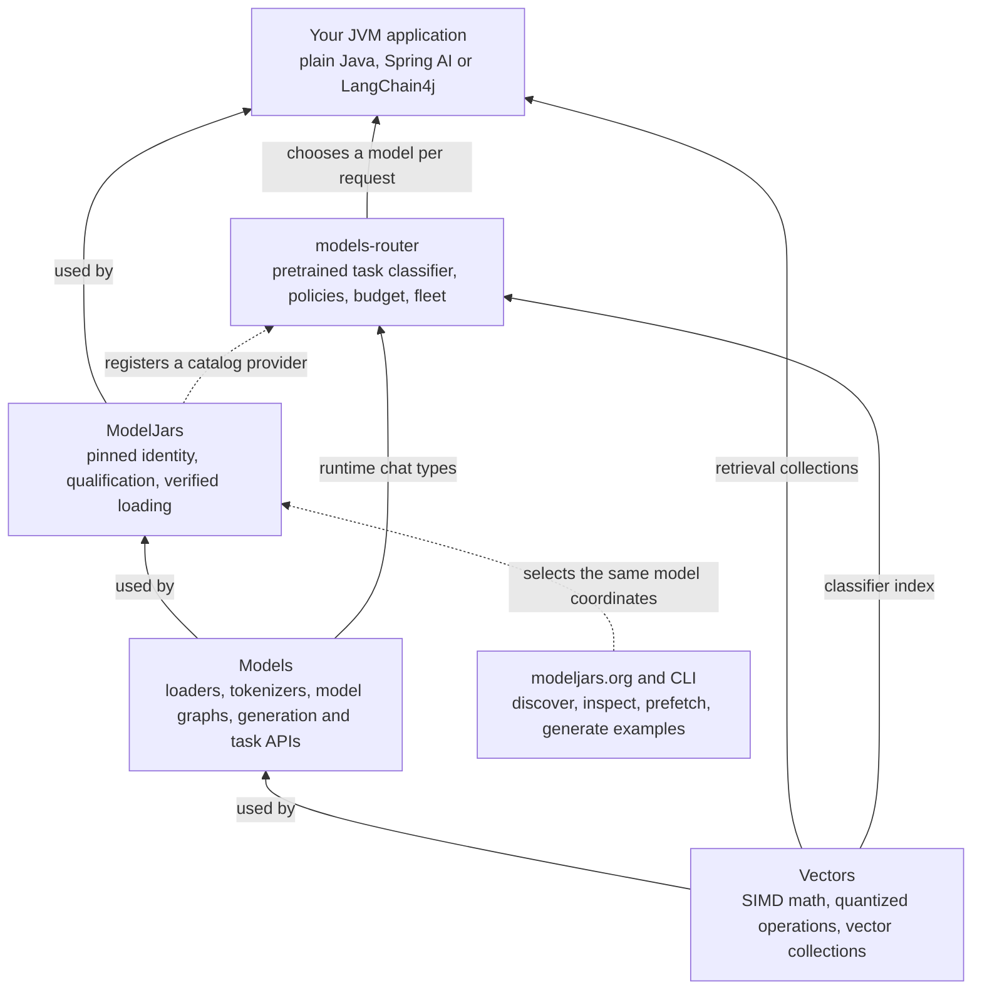
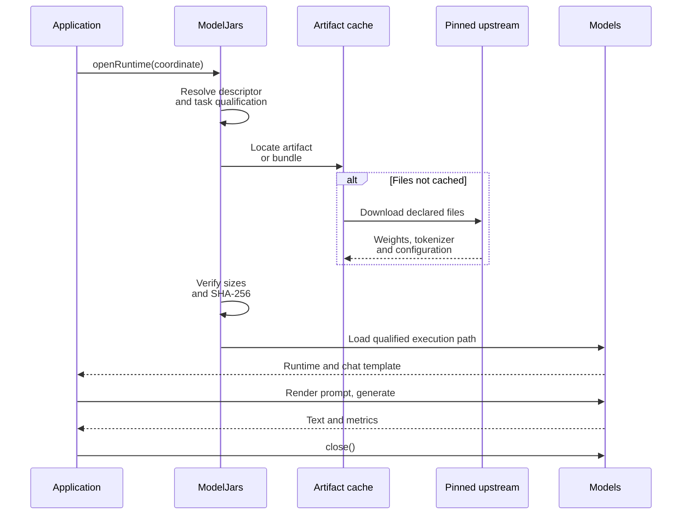
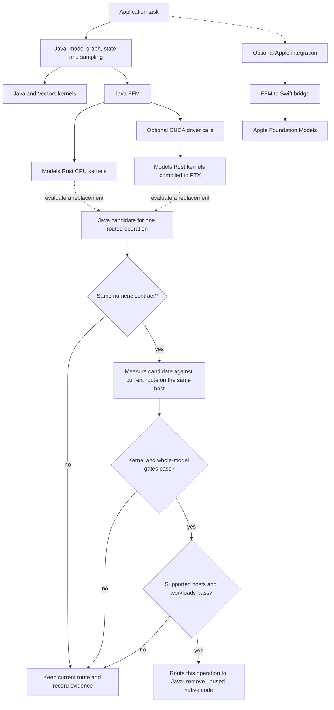
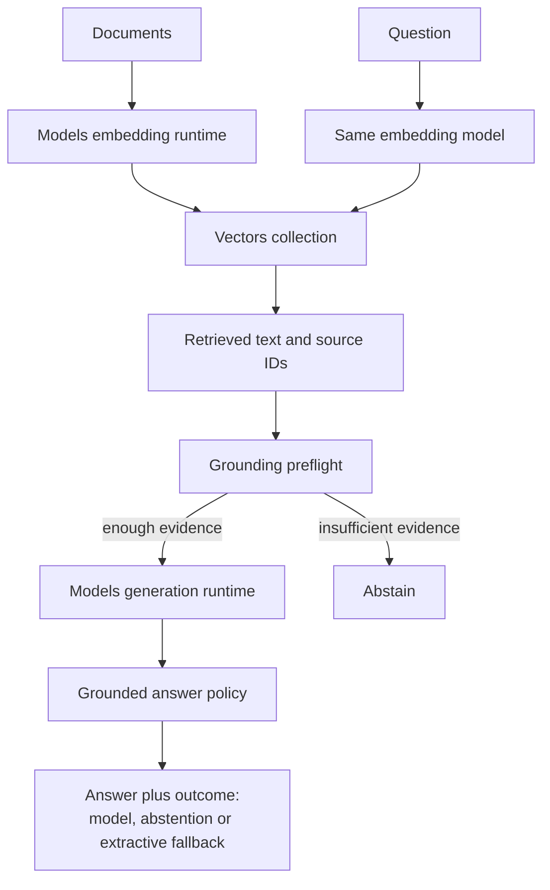

# A hundred models, one dependency, and a router that keeps most of them local

ModelJars publishes language models as Maven artifacts: you add a coordinate, and the weights arrive
through the same resolver that brings you Jackson. Models is the runtime that executes them on the
JVM. `models-router` decides, per request, which of them should answer.

This article takes one support conversation, runs it twice — once the obvious way, once routed —
and compares what each costs. Every number was printed by a script in [`code/`](code/) on the
machine named in [the run record](evidence/fleet-routing/RESULTS.md). Two figures are declared
rather than measured and are labelled where they appear: the providers' prices, and the
four-characters-per-token estimate the script uses to charge its budget.

## The conversation

One support session, ten prompts, in the order they arrive. It is a retrieval-augmented
conversation: some of the questions have to be answered out of the company's own notes rather than
out of a model's memory. Those notes are three sentences, embedded into a Vectors collection at
startup:

```
Refunds are issued to the original payment method within five business days.
A duplicate charge is reversed automatically once billing reconciliation runs nightly.
Account closures require written confirmation from the account holder.
```

The ten prompts are not ten of the same thing. They fall into six kinds, and the difference
between them is the whole point of what follows.

**Heartbeats** — `ping`, `still there?`, `ok`. A browser tab checking the session is alive. The
only correct answer is a few tokens saying so. There are three of them, and in a real deployment
there would be thousands.

**A conversation** — `I was charged twice for my September order.`, then `tell me more`. Two turns
that share a transcript; the second is meaningless without the first. Customer text, so it should
not leave the building.

**A closed decision** — `I was charged twice for my September subscription and no refund arrived.`
The question asked of it is not "write me a reply" but "is this about billing, which queue, how
urgent", each with a fixed set of answers. What is wanted is a label and a confidence, not prose.

**Two grounded questions** — `When is a refund issued, and to which payment method?` and
`What happens to a duplicate charge?` Both are answerable from the three notes above and from
nothing else. The model's job is to retrieve and quote, not to recall.

**One synthesis prompt** — a policy conflict: refunds promise five business days to the original
payment method, duplicate charges reverse automatically on the nightly reconciliation, and a
customer who is both refunded and reconciled falls between them. Work out where they disagree and
draft the paragraph that resolves it. This one genuinely needs a frontier model.

**One long-document summary** — a billing appendix of 2,500 consolidated clauses, **245,741
tokens** by the local tokenizer, to be condensed into two sentences for a handbook. Long input,
short output, no reasoning. The size is the point: it is larger than any local model in this fleet
can hold, and larger than one of the three remote providers can hold either.

Six kinds of work with wildly different requirements: one needs eight tokens, one needs a calibrated
label rather than prose, two need a document store, one needs real reasoning. And seven of the ten
are things you would rather not send to a third party at all — the heartbeats because there is no
reason to, the rest because they carry a customer's words.

## Without a router

The obvious implementation is one client, one model, one loop. Send every prompt to the best model
you have and let it sort them out. Strip the token and millisecond bookkeeping — this file is also
the measurement harness — and what is left is `callOpenAi(PREMIUM, ...)` once per prompt:

<!-- snippet:fleet#baseline -->
```java
System.out.printf("%n%-46s %8s %8s %8s%n", "PROMPT", "IN", "OUT", "MS");
for (var prompt : prompts()) {
  lastRemoteUsage = null;
  long began = System.nanoTime();
  var answer = callOpenAi(PREMIUM, PREMIUM_CAP, resolve(retrieval, prompt));
  long millis = (System.nanoTime() - began) / 1_000_000;
  accounted += millis;
  if (lastRemoteUsage == null) {
    System.out.printf("%-46s   no usage reported: %s%n", abbreviate(prompt.text(), 44), answer);
    continue;
  }
  input += lastRemoteUsage.inputTokens();
  output += lastRemoteUsage.outputTokens();
  System.out.printf(
      "%-46s %8d %8d %8d%n",
      abbreviate(prompt.text(), 44),
      lastRemoteUsage.inputTokens(),
      lastRemoteUsage.outputTokens(),
      millis);
}
```
<!-- end:snippet:fleet#baseline -->

That is the whole program, and it is not a stupid choice. A frontier model will answer all ten
correctly, including the heartbeats, and there is nothing to operate: no weights, no cache, no
startup. It is what most of these applications actually look like.

## What that costs

`IN` and `OUT` are the provider's own token counts, straight off the `usage` object on its
response. `MS` is latency.

```
PROMPT                                               IN      OUT       MS
ping                                                  7       10     1529
still there?                                          9       22     1208
ok                                                    7       23     1588
I was charged twice for my September order.          15      296     4887
tell me more                                          9      132     3567
I was charged twice for my September subscr…         19      443     8291
When is a refund issued, and to which payme…         73       26     1194
What happens to a duplicate charge?                  68       21     2652
Our refund policy promises five business da…         61      439     6300
Summarise this appendix for the support han…     236534       96     3345

== every prompt through gpt-5.1 ==
provider-reported: 236802 input + 1508 completion tokens
at the declared $1.25/M in, $10.00/M out: $0.311083
conversation wall clock: 34574 ms, of which 34561 ms (100.0%) was model calls
No local weights are loaded, so there is no startup cost to amortise.
Retrieval ran for the grounded prompts here exactly as it does in the routed arm, so both
arms sent byte-identical text and the comparison is like for like.
```

<!-- figures:baseline -->
Every prompt answered, in 35 seconds, for **$0.311083**.

Two things in that table do the damage. The appendix is **236,534 input tokens**, and at the declared rate that one prompt is **$0.295668** — 95% of the bill, paid to a frontier model to compress a document into two sentences. And the 3 heartbeats, whose only correct answer is "still here", took 1,208 ms, 1,529 ms, 1,588 ms, because a network round trip costs most of a second whatever you ask for.
<!-- end:figures:baseline -->

Nothing here is a defect. The model did exactly what it was asked, and did it well. The waste is in
the asking: one request needed a 236k-token window and none of the others needed a frontier model
at all.

## Adding a router

Nothing above is wrong, exactly. It is just paying frontier prices for work that is not frontier
work, and sending customer text to a third party to do it.

`models-router` replaces the single client with a fleet and a set of rules. Three pieces: what each
kind of traffic requires, what each model is, and the fleet that binds candidates to something
callable. None of it inspects prompt text.

### Saying what each kind of traffic requires

The six requirement objects are the whole routing policy. The classifier does read the prompt — it
embeds it to name a task type — but nothing branches on what it says: no `if` over prompt text, no
keyword matching, no per-model special case. The task type feeds the quality term in scoring;
eligibility is settled by these objects alone.

<!-- snippet:fleet#requirements -->
```java
var liveness =
    RoutingRequirements.builder()
        .requireCapability("liveness")
        .dataBoundary(RoutingDataBoundary.LOCAL_ONLY)
        .build();
var chatHere =
    RoutingRequirements.builder()
        .requireCapability("chat")
        .dataBoundary(RoutingDataBoundary.LOCAL_ONLY)
        .build();
var grounded =
    RoutingRequirements.builder()
        .requireCapability("grounding")
        .dataBoundary(RoutingDataBoundary.LOCAL_ONLY)
        .build();
var decision = RoutingRequirements.builder().requireCapability("decision").build();
var synthesis = RoutingRequirements.builder().requireCapability("reasoning").build();
// Nothing here says "go remote". The appendix is larger than any local arm's context window,
// so ModelRouter.eligible rules them out on `contextWindow < estimatedTokens` and only the
// three remotes are left. Which of them serves it is a policy question, not a vendor decision
// written into the code.
var longDocument = RoutingRequirements.builder().requireCapability("summarization").build();
```
<!-- end:snippet:fleet#requirements -->

A liveness check wants `liveness` and must stay local. A conversation wants `chat` and must stay
local. A ticket wants `decision`. A grounded question wants `grounding` and must stay local. Only
the synthesis prompt and the long document may leave the machine, and even then the policy picks
which provider.

### Describing the local models

A candidate is a description, not a wrapper: what the model claims to do, how fast it is, how large
a prompt it takes, how good it is at each task. Most of that you do not write. ModelJars registers a
catalog provider that `CatalogDiscovery` finds through `ServiceLoader`, so every model whose marker
model already on disk arrives carrying its id, whether it is local, the context window read from
its artifact — qwen3-0.6b's GGUF says 40,960 tokens, SmolLM2's says 8,192 — and
throughput, measured on this host if it has been benchmarked and logged as a conservative estimate
if not.

<!-- snippet:fleet#locals -->
```java
// Identity, locality, the context window read from the artifact and this host's throughput all
// come from the catalog, so none of them is written here.
var catalog = new LinkedHashMap<String, ModelCandidate>();
for (var found : CatalogDiscovery.discover()) {
  catalog.put(found.id(), found);
}

// Only what a catalog cannot know: `liveness` and `grounding` are names this application
// invented, and the quality weights are its judgement. `toBuilder` keeps the rest.
//
// Tags are a second filter, separate from capabilities and active only when non-empty: a model
// tagged `chat` is refused outright for a prompt classified `summarization`. The catalog tags
// these `chat` to describe the weights; this fleet selects on capability and quality, so the
// tags are cleared.
var tiny =
    discovered(catalog, TINY_ID)
        .tags(Set.of())
        .addCapabilities("liveness")
        .quality(Map.of("chat", 0.45))
        .build();
var small =
    discovered(catalog, SMALL_ID)
        .tags(Set.of())
        .addCapabilities("summarization")
        .quality(Map.of("chat", 0.60, "summarization", 0.62))
        .build();
var grounder =
    discovered(catalog, GROUNDER_ID)
        .tags(Set.of())
        .addCapabilities("grounding")
        .quality(Map.of("chat", 0.66, "grounding", 0.70))
        .build();
// Harriet is the exception. The catalog reports the composite's base weights as a chat model,
// true of the weights and wrong about this arm: three typed questions, three forward passes, no
// generated prose. So `capabilities` replaces rather than adds -- a decision arm claiming `chat`
// would be eligible for a customer's real question -- and tokens-per-second is overridden
// because it does not describe this cost. The window carries through.
var decisions =
    discovered(catalog, HARRIET_ID)
        .tags(Set.of())
        .capabilities(Set.of("decision"))
        .tokensPerSecond(1)
        .quality(Map.of("decision", 0.90))
        .build();
```
<!-- end:snippet:fleet#locals -->

What you write is what a catalog cannot know. `liveness` and `grounding` are not properties of the
weights; they are names this application invented for jobs it has. Per-task quality is a judgement
about a fleet, not a measurement of a file. `toBuilder()` and `addCapabilities(...)`, both new in
Models 0.4.1, add those to a discovered candidate without restating the dozen components discovery
already got right. (`discovered(catalog, id)` is a small helper that looks an id up and fails
naming what *was* found, since an absent entry means a missing marker jar.)

The capability sets are the load-bearing part. Only SmolLM2 claims `liveness`, only the Llama arm
claims `grounding`, only Harriet claims `decision`. That is an operator's declaration about what
each model is allowed to serve, and the router treats it as a hard filter before any score is
compared — which keeps a liveness check off a 4B decision model without an `if` statement anywhere.

Clearing the tags is the line worth pausing on, because tags and capabilities are different axes and
only one is obvious. A capability is a hard requirement a request asks for. A **non-empty** tag set
is a *second* hard filter, on the classifier's task type: a model tagged `chat` is refused for a
prompt classified `summarization`, however good it is at summarising, while an empty tag set
disables that filter entirely. The catalog tags these models `chat` to describe the weights; this
fleet routes on capability and quality, so the tags are cleared on purpose. Leave them and
`tell me more` — the one prompt in the run above that clears the 0.60 similarity floor — matches
nothing local.

Harriet is the exception. The catalog reports the composite's base weights as an ordinary chat model
with a 262,144-token window: true of the weights, wrong about the arm, which answers three typed
questions in three forward passes and generates no prose. So its capabilities *replace* rather than
add — a decision arm claiming `chat` would be eligible for a customer's real question — and its
throughput is overridden, because tokens per second does not describe what three forward passes
cost. The context window, which really is a fact of the weights, carries through.

### Binding each candidate to something callable

`ModelFleet<T>` is generic over the client type, and this is where that earns its keep. Each
provider's closure is where its SDK would live; `models-router` never learns any of their names.

<!-- snippet:fleet#wiring -->
```java
return ModelFleet.<Responder>builder()
    .classifier(classifier)
    // BALANCED weights quality 0.40 and latency 0.15, and picks qwen3-0.6b for a customer's
    // question. LOCAL_FIRST picks it too: every local arm scores identical locality, so a 0.35
    // thumb there separates nothing between them, and the LOCAL_ONLY boundary already keeps
    // these requests on this machine. FASTEST is the policy that changes the answer -- it
    // hands ordinary chat to the 360M model on latency alone, which is the wrong trade here.
    .policy(RoutingPolicy.BALANCED)
    .model(tiny, prompt -> acknowledge(TINY, prompt))
    .model(small, prompt -> chat(SMALL, prompt, 80))
    .model(grounder, fleet::ground)
    .model(decisions, fleet::decide)
    // One fleet, three remote clients. Each closure is where a provider's SDK would live, so
    // models-router never learns any of their names.
    .model(premium, prompt -> callOpenAi(PREMIUM, PREMIUM_CAP, prompt))
    .model(economy, prompt -> callOpenAi(ECONOMY, ECONOMY_CAP, prompt))
    .model(haiku, prompt -> callAnthropic(HAIKU, HAIKU_CAP, prompt))
    .build();
```
<!-- end:snippet:fleet#wiring -->

Two of those closures call OpenAI with different models and ceilings. The third calls Anthropic,
which needs a different endpoint, a different auth header and a different response shape — and the
fleet does not know or care.

## What the router does

Same ten prompts, same order. `CLASSIFIED` is the local classifier's nearest task and its
similarity, `SELECTED` the model chosen. `LOCAL IN` is the qwen3-0.6b tokenizer's count — the only
ruler available for a prompt that never leaves the machine, and a lower one: `ping` is 1 token
locally and 7 at OpenAI, which tokenizes differently and also bills the chat envelope.

```
WARMING                            LOAD MS
smollm2_360m_instruct_q8_0            2488
qwen3_0_6b_q4_0                       3727
bartowski_llama_3_2_1b_instruct…      3266
unsloth_qwen3_5_4b_gguf_q4_k_m       21132
total                                30613

PROMPT                           CLASSIFIED           SELECTED                          LOCAL IN      MS
ping                             ~chat 0.48           smollm2_360m_instruct_q8_0               1     246
    still here
still there?                     ~summarization 0.50  smollm2_360m_instruct_q8_0               3     184
    still here
ok                               ~reasoning 0.57      smollm2_360m_instruct_q8_0               1     161
    still here
I was charged twice for my Se…   ~tool-use 0.46       qwen3_0_6b_q4_0                          9    4123
    We'll check the details of your order to confirm if there was any issue with the payment. Let me know how we can assist you.
tell me more                     summarization        qwen3_0_6b_q4_0                          3    2431
    Of course, let me know how we can assist you with the next steps.
I was charged twice for my Se…   ~tool-use 0.49       unsloth_qwen3_5_4b_gguf_q4_k_m          13   11669
    billing=true(p=0.91,c=0.58) queue=billing(p=0.99,c=0.95) urgency=this week(p=0.38,c=0.01)
When is a refund issued, and …   ~math 0.50           bartowski_llama_3_2_1b_instruct…        67    1958
    A refund is issued to the original payment method within five business days.
What happens to a duplicate c…   ~code 0.50           bartowski_llama_3_2_1b_instruct…        62    1729
    A duplicate charge is reversed automatically once billing reconciliation runs nightly.
Our refund policy promises fi…   ~tool-use 0.52       gpt-5.1                                 55    7331
    There are two potential conflicts: 1. **Timing mismatch** - Policy: “Refunds in five business days to the original payment method.”…
Summarise this appendix for t…   summarization        gpt-4.1-mini                        245741   13964
    Refunds are issued to the original payment method within five business days unless the charge was already reconciled in the same ni…
```

Six kinds of traffic, six different destinations, no `if` statement over prompt text:

**Heartbeats** (`ping`, `still there?`, `ok`) require a `liveness` capability that only the 360M
SmolLM2 declares. They are answered statelessly under an eight-token ceiling — the table shows them
spending one to three — and never enter the conversation transcript, because a liveness check is not
a conversation turn.

**The conversation** (`I was charged twice…`, then `tell me more`) requires `chat` with a
`LOCAL_ONLY` boundary, and carries a session id. The first turn picks qwen3-0.6b on quality; the
follow-up stays there because of the switch margin. `tell me more` only means anything because the
transcript is real, which is why the arm appends both sides of each turn.

**The closed decisions** go to Harriet, which answers three typed questions in three forward
passes: a boolean, a choice over three queues, and an ordered severity. Nothing is generated, so
there is no JSON to repair. Each outcome carries a written rule, and that matters: Harriet's own
javadoc records accuracy **0.8917 with a rubric against 0.7500 without**, measured 2026-09-24 over
120 JevBench items on the same model and kernel. Note that the model is confident about what the
ticket is (`p=0.99`) and openly unconfident about its urgency (`c=0.01`) — a calibrated model
declining to commit is the feature, not a defect.

**The grounded questions** require a `grounding` capability that only the Llama-3.2-1B arm declares,
and that arm does retrieval before generation. Both answers come back as one sentence drawn from
the notes.

**The synthesis prompt** requires `reasoning`, which only `gpt-5.1` declares among the three
remotes, so it is the one request that can only go there. **The appendix summary** asks for nothing
special at all — plain `summarization`, which qwen3-0.6b also declares. It leaves the machine
because of its size: at 245,741 tokens it does not fit any local context window, so
`ModelRouter.eligible` rules every local arm out on `contextWindow < estimatedTokens` and the policy
picks among the remotes that remain. Which remote it picked is the whole of the bill below. Both
escalations really happened: those answers are the providers', and the tokens they report are what
the ledger bills.

The `CLASSIFIED` column repays a second look. Only `tell me more` clears the classifier's 0.60
similarity floor, as `summarization`. The rest print their nearest task with a tilde and the
similarity that fell short — `ping` is ~chat at 0.48, `ok` is ~reasoning at 0.57, "What happens to a
duplicate charge?" is ~code at 0.45. That is `PretrainedTaskClassifier.match`, new in Models 0.3.60.
Before it, every one of those rows was a bare dash, and a prompt unlike every exemplar looked
identical to one that nearly matched. The numbers say what is really going on: an index built from
1,929 work-shaped prompts has nothing much to say about conversational filler, and it reports that
honestly instead of guessing a task and silently applying the wrong quality column.

### The bill

`COST` is `ModelCandidate.costOf` on the candidate that actually ran, at that candidate's prices.

```
== ledger ==
10 prompts, 2 escalated to a remote provider, 8 answered on local weights
local ruler (qwen3-0.6b tokenizer): 245796 of 245955 input tokens were routed off this machine (99.9%)
provider ruler (gpt-5.1 reported): 236596 input + 566 completion tokens billed
  the same prompt measured 245796 tokens locally, so the two rulers differ by -9200
completions generated on local weights: 123 tokens
REMOTE PROVIDER            IN      OUT         COST
gpt-5.1                    61      488    $0.004956
gpt-4.1-mini           236535       78    $0.094739
total                  236596      566    $0.099695
had every prompt gone to gpt-5.1: $0.307444 of input alone, plus $0.001230 for the completions this machine produced for nothing
router-accounted spend: $0.099695 of the $0.50 shared budget
```

<!-- figures:cost -->
8 of the 10 prompts never left the machine. The 2 that escalated did not go to the same provider: *Our refund policy promises five business da…* to gpt-5.1, *Summarise this appendix for the support han…* to gpt-4.1-mini — and that second choice is most of the story.

| | input tokens | completion tokens | cost |
| --- | --- | --- | --- |
| Every prompt through gpt-5.1 | 236,802 | 1,508 | **$0.311083** |
| Routed across the fleet | 236,596 | 566 | **$0.099695** |

**68.0% less, a factor of 3.12.** Note where it does *not* come from. The 8 prompts answered locally would have cost $0.009989 on gpt-5.1 — **3.2%** of the bill. Keeping them local is almost free either way.

The saving is one decision: the same 236,535-token document cost **$0.094739** at gpt-4.1-mini's declared rate instead of **$0.296449** at gpt-5.1's. Both providers can hold it; one costs 3.1 times less to read it.
<!-- end:figures:cost -->

That is what having more than one remote buys, and it only works if the ledger prices each line
with `ModelCandidate.costOf` on the candidate that actually ran — which is why the router's
accounted spend matches the total exactly.

On this workload the small prompts are a rounding error and the big one is the bill. On a workload
of ten thousand heartbeats it would be the other way around. The router does not need to know which
you have.

### The time

`SHARE` is each model's slice of the conversation's wall clock.

```
== timing, warm ==
MODEL                            CALLS  TOTAL MS   MEAN MS     SHARE
smollm2_360m_instruct_q8_0           3       591       197      1.2%
qwen3_0_6b_q4_0                      2      6554      3277     13.3%
unsloth_qwen3_5_4b_gguf_q4_k_m       1     11669     11669     23.7%
bartowski_llama_3_2_1b_instruct…     2      3687      1843      7.5%
gpt-5.1                              1      7331      7331     14.9%
gpt-4.1-mini                         1     13964     13964     28.3%
conversation wall clock: 49261 ms, of which 43796 ms (88.9%) was model calls
one-off load of the four local models: 30613 ms, paid once at startup, not per request
```

Per prompt, with each arm's own wall clock:

<!-- figures:per-prompt -->
| prompt | no router | routed | | destination |
| --- | --- | --- | --- | --- |
| ping | 1,529 ms | **246 ms** | 6.2× faster | local |
| still there? | 1,208 ms | **184 ms** | 6.6× faster | local |
| ok | 1,588 ms | **161 ms** | 9.9× faster | local |
| I was charged twice for my September order. | 4,887 ms | **4,123 ms** | 1.2× faster | local |
| tell me more | 3,567 ms | **2,431 ms** | 1.5× faster | local |
| I was charged twice for my September subscr… | **8,291 ms** | 11,669 ms | 1.4× *slower* | local |
| When is a refund issued, and to which payme… | **1,194 ms** | 1,958 ms | 1.6× *slower* | local |
| What happens to a duplicate charge? | 2,652 ms | **1,729 ms** | 1.5× faster | local |
| Our refund policy promises five business da… | **6,300 ms** | 7,331 ms | 1.2× *slower* | gpt-5.1 |
| Summarise this appendix for the support han… | **3,345 ms** | 13,964 ms | 4.2× *slower* | gpt-4.1-mini |

One row holds across all 3 archived pairs: a heartbeat is answered locally **5.7× to 12.0× faster** than a network round trip can answer it at all. Nothing a hosted model does is quick when the speed of light is in the way, and in a real deployment this row is most of the traffic.

The rest of the table is one afternoon: **3 of the 10 prompts** changed which arm was faster between pairs, so the per-prompt ordering is not a property of the fleet either. What is stable is where each prompt went and what it cost, which is what the policy actually decides.
<!-- end:figures:per-prompt -->

Where a prompt went was the policy's decision, and the two escalations were chosen for price, not
for speed: the appendix to gpt-4.1-mini because it reads a long document for a third of gpt-5.1's
rate, the closed decision to a 4B model on this laptop's CPU because the text is a customer's.
Change the weights and you change that — `FASTEST` would have kept the appendix on gpt-5.1 and the
decision off Harriet, at roughly three times the price. The router does not decide which you want.
It makes the trade explicit, prices both sides, and lets the policy pick.

#### The ratio between the arms is mostly a statement about the provider

Run the same pair again and the headline ratio moves, on code that has not changed:

<!-- figures:variance -->
| run (UTC) | routed | no router | latency ratio | cost factor |
| --- | --- | --- | --- | --- |
| `20261019T232147Z` | 58,446 ms | 49,230 ms | 1.19× | 3.17× cheaper |
| `20261019T232350Z` | 37,694 ms | 40,133 ms | 0.94× | 3.18× cheaper |
| `20261019T232628Z` | 49,261 ms | 34,574 ms | 1.42× | 3.12× cheaper |

Across **3 measured pairs** — same code, same prompts, same machine, all archived under [`evidence/fleet-routing/runs/`](evidence/fleet-routing/runs) — the latency ratio moved from **0.94× to 1.42×** (median 1.19×) while the cost factor moved from **3.12× to 3.18×**. One of those is a property of the fleet; the other is a property of the provider's queue on the day. Which is which:

- the no-router arm's wall clock ranged over **1.42×** (34,574 ms to 49,230 ms)
- the routed arm's remote portion ranged over **2.36×** (15,379 ms to 36,342 ms)
- the routed arm's local portion ranged over **1.02×** (22,104 ms to 22,501 ms)
- the appendix prompt alone, byte for byte identical every run, came back in 3,345 ms at best and 15,094 ms at worst — **4.51×** on one call to one provider
<!-- end:figures:variance -->

The local arm is the stable one. Four models on this laptop's CPU answer in nearly the same time
every run, because nothing is competing for them and no queue stands in front of them. The hosted
calls are the opposite, and the last bullet is worth isolating: that is one prompt, one provider,
identical input. Sent repeatedly on purpose by
[`appendix-providers`](evidence/fleet-routing/appendix-providers.log):

<!-- figures:provider-latency -->
| provider | n | fastest | median | slowest | spread | cost of the same input |
| --- | --- | --- | --- | --- | --- | --- |
| gpt-5.1 | 5 | 2,224 ms | 2,705 ms | 3,436 ms | **1.5×** | $0.296568 to $0.296678 |
| gpt-4.1-mini | 5 | 1,869 ms | 1,920 ms | 2,644 ms | **1.4×** | $0.094737 to $0.094740 |

The same prompt, the same declared model, 5 calls each: latency spread **1.4× to 1.5×**, while the bill moved in the sixth decimal place — the few completion tokens the model chose to emit. A hosted model's price is something you can quote. Its latency is something you can only sample, and this article says how many times it was sampled wherever it quotes one.
<!-- end:figures:provider-latency -->

The no-router arm is made entirely of calls like that.

So the honest claim is not "routing is faster" and not "routing is slower" — on this mix it has
landed on both sides of parity across runs. It is that routing moves most of the conversation onto
hardware whose latency you can measure once and then rely on, and prices the part that stays
remote. The cost factor above is the number that holds still; the latency ratio is the number that
depends on somebody else's afternoon. Quote a single pair of wall clocks for an API arm and you are
quoting that afternoon.

None of these numbers survive a busy machine, which is why each pair is gated before it is kept:
at load average 39, qwen3-0.6b reported **25,163 ms** for a call it answers in about 3,000 ms quiet.
The share of wall clock spent inside model calls is a weaker tell than it looks — a contended run
once reported 96.1% while every per-call figure was inflated eight-fold, because contention slows
the calls themselves rather than descheduling the process between them. So acceptance is decided
after the run, on a known model's mean against its quiet baseline, and a pair that drifts is thrown
away. Each kept pair carries its load readings beside it in
[`runs/`](evidence/fleet-routing/runs).

The model loading reported above the table is paid once. Four models then stay resident, which is
what a server does, and each native runtime sizes its worker pool for every logical CPU unless told
otherwise — four pools on twelve cores. Measured on this host by
[`oversubscription.java`](code/oversubscription.java), that costs less than it sounds: the same
prompt takes **3,152 ms** with qwen3-0.6b alone and **3,749 ms** with three other runtimes resident,
a factor of 1.2. Capping each runtime at three threads did not improve it — 3,584 ms and 3,827 ms,
and slower on its own. The script still sets the cap; this measurement does not justify it, and the
figure is published as it came out.

### Where these numbers come from

Token counts are each provider's own report or the qwen3-0.6b tokenizer's, kept apart because they
disagree — the escalated prompts measured 139 tokens locally and 204 at the providers. Shares are
quoted on the local ruler, where every prompt is measured identically, and bills on the provider's,
where they are charged.

Prices are the script's declared inputs, matching published rates from third-party trackers in
autumn 2026: $1.25/$10.00 per million for gpt-5.1, $0.40/$1.60 for gpt-4.1-mini, $0.10/$0.50 for
Haiku 5.5. Set them to your own contracts. Haiku also charges a higher rate above a 100k-token
prompt, which the script declares as `.pricingTier(100_001, 0.50, 2.50)` — new in Models 0.4.0.
Nothing here comes close to that threshold, so every figure above is the base rate; it is declared
because `RoutingBudget` charges whatever `costOf` reports, and a budget told a flat price would
overshoot by five times on a long request.

Scoring, though, still uses list price. Cost is normalised across the eligible candidates into a
0–1 term, so a rate that moved with prompt size would shift a candidate against all the others at
its own threshold and make its rank non-monotonic in request size. Accounting is where the tier has
to be exact. That split is not universal: reading the other routers on this machine rather than
their documentation, weave-os applies its tier when scoring as well as billing — it can, because it
scores on an absolute dollar estimate — while vLLM's semantic router and RouteLLM carry no tier
concept at all, and LiteLLM carries one but is a gateway, so the question does not arise.

Where prices come from divides the same field three ways. LiteLLM fetches a community-maintained
price map over HTTP at startup, validates it, and falls back to a packaged copy. weave-os keeps its
catalog in source. TensorZero and the selection routers take operator-declared values. Models is in
the last group deliberately — a startup fetch trades a network dependency and a third-party trust
boundary for freshness, which is a deployment's call, not a library's — and the cost of that is
real: a declared price goes stale silently. Citations are in
[the run record](evidence/fleet-routing/RESULTS.md).

One thing about the comparison itself. The headline percentage moves between runs, because gpt-5.1
bills its reasoning as completion tokens and does not spend the same amount twice: measured pairs on
these prompts at these prices have come out at 74.3%, 69.4%, 74.6% and the 68.0% above. Read it as
roughly **70%, a factor of three**, and expect it to move with how much reasoning the provider
decides to bill.

Both arms send byte-identical text, retrieval included, so the input side is a like-for-like
measurement rather than an estimate.

## Inside the router

`com.integrallis:models-router` ships a pretrained task classifier **inside the jar**: an index of
1,929 exemplar prompts across ten task types — chat, code, creative, extraction, math, reasoning,
sql, summarization, tool-use and translation — embedded at 768 dimensions with
`google_embeddinggemma_300m_gguf_q8_0` and stored SQ4-quantized. Both sides are embedded under the
prefix `task: classification | query: `, and the index records that prefix so callers do not have
to know the convention.

The consequence is that classification is one local forward pass on a model already in your cache.
No prompt text leaves the machine in order to decide where the prompt should go. That is the part
most routing layers get backwards.

Around the classifier sits the rest of the machinery, each piece of which earned its place in the
run above:

- **Capabilities are a hard filter.** A model is eligible only if it declares every capability the
  request requires. This is an operator's declaration, not a measurement.
- **Tags are a second, separate filter** on the classifier's task type, and only when non-empty: a
  candidate tagged `chat` is refused for a prompt classified `summarization`, while a candidate with
  no tags is never filtered on task type at all.
- **Policies** are weight vectors over cost, quality, latency, availability and locality.
  `BALANCED` weights quality 0.40 and latency 0.15; `LOCAL_FIRST` weights locality 0.35;
  `CHEAPEST`, `FASTEST`, `BEST_QUALITY` and `PRIVACY_STRICT` sit where their names suggest.
- **A data boundary** (`LOCAL_ONLY` or `REMOTE_ALLOWED`) is enforced per request.
- **A shared budget** charges each attempt from the candidate's declared prices against actual
  usage. When the budget denies an attempt, the router falls through to the next candidate — so an
  exhausted budget pushes work local rather than failing the request.
- **Sessions make routing sticky.** A request carrying a session id gives the incumbent model a
  `switch-margin` so a conversation does not hop between models on a near-tie.

A fleet binds candidates to whatever your application can call. `ModelFleet<T>` is generic over the
client type on purpose, and that is what makes **several remote providers ordinary rather than
special**. A provider is not a mode the router has to support; it is a candidate with its own
prices, its own context window, its own output ceiling, and a closure that knows how to call it.
One fleet can hold an in-process Models runtime, two different vendors' hosted APIs and a private
gateway, and `models-router` never learns any of their names or links any of their SDKs.

The fleet holds three remote providers alongside the four local models: `gpt-5.1` for work
that needs reasoning, `gpt-4.1-mini` as a cheaper stablemate, and Anthropic's `claude-haiku-5-5`
through an entirely separate endpoint, credential and response shape. Only the premium one declares
`reasoning`. Their context windows — 200k, 400k and 1M — are what make them the only candidates
left for a 245,741-token document — and only two of them, since Haiku's 200,000 is too small. Which
of the two serves it is then a policy question rather than a vendor decision written into the code — and each client normalises its own provider's usage into one `RoutingUsage`, which is the
only thing the ledger needs.

### Declaring the remote providers

Three of them, at two vendors. They differ in price by two orders of magnitude on output.

<!-- snippet:fleet#providers -->
```java
var premium =
    ModelCandidate.builder(PREMIUM)
        .local(false)
        .capabilities(Set.of("chat", "reasoning", "summarization"))
        .costPerMillionTokens(PREMIUM_IN, PREMIUM_OUT)
        // New in Models 0.3.60. A reasoning model bills its reasoning as completion, so it
        // cannot share an output ceiling with a model that answers a liveness check in eight
        // tokens. The execution-wide bound stays small for the local arms.
        .maxOutputTokens(PREMIUM_CAP)
        // New in Models 0.4.3, and the mirror of maxOutputTokens. The fleet-wide input bound
        // has to stay small, because the execution takes input + output as the context every
        // request must fit: raise it and a one-token liveness check demands a window no local
        // model has. So the ceiling belongs on the candidate that can honour it.
        // 272,000, not the 400,000 a tracker lists. The provider is the authority and it
        // says so in its own refusal: "Input tokens exceed the configured limit of 272000
        // tokens. Your messages resulted in 284034 tokens." A declared window that is too
        // generous does not fail at routing time; it fails at the provider, after the
        // request was built and sent.
        .maxInputTokens(272_000)
        .contextWindow(272000)
        .timeToFirstTokenMillis(850)
        .tokensPerSecond(90)
        .quality(Map.of("chat", 0.95, "reasoning", 0.96, "summarization", 0.94))
        .build();
var economy =
    ModelCandidate.builder(ECONOMY)
        .local(false)
        .capabilities(Set.of("chat", "summarization"))
        .costPerMillionTokens(ECONOMY_IN, ECONOMY_OUT)
        .maxOutputTokens(ECONOMY_CAP)
        .maxInputTokens(1_000_000)
        .contextWindow(1000000)
        .timeToFirstTokenMillis(400)
        .tokensPerSecond(140)
        .quality(Map.of("chat", 0.82, "summarization", 0.86))
        .build();
var haiku =
    ModelCandidate.builder(HAIKU)
        .local(false)
        .capabilities(Set.of("chat", "summarization"))
        .costPerMillionTokens(HAIKU_IN, HAIKU_OUT)
        // New in Models 0.4.0. The provider's step is "over 100k", and the threshold is
        // inclusive, so it is declared one token above. Crossing it reprices the whole
        // request, output included.
        .pricingTier(100_001, HAIKU_HIGH_IN, HAIKU_HIGH_OUT)
        .maxOutputTokens(HAIKU_CAP)
        .maxInputTokens(200_000)
        .contextWindow(200000)
        .timeToFirstTokenMillis(300)
        .tokensPerSecond(120)
        .quality(Map.of("chat", 0.80, "summarization", 0.83))
        .build();
```
<!-- end:snippet:fleet#providers -->

Only the premium model claims `reasoning`. None of them claims anything about document length,
because length is not a capability — it is a number, and the router already filters on it. What the
three declare instead are their real context windows, 200k to 1M, and their own
`maxInputTokens`/`maxOutputTokens` ceilings.

Both ceilings matter more than they look, for the same reason: one fleet-wide pair cannot describe a
mixed fleet. A reasoning model bills its reasoning as completion tokens, so it cannot share an
output ceiling with a model that answers a liveness check in eight tokens. And a provider that
accepts a 245,741-token prompt cannot share an input ceiling with an 8,192-token local model —
`maxInputTokens` is new in Models 0.4.3 for exactly that, and the section on what the run cost
explains what went wrong without it.

### Where a second vendor costs more than a config line

This is the part that only shows up when you actually call two providers:

<!-- snippet:fleet#anthropic -->
```java
static String callAnthropic(String model, int cap, String prompt) throws Exception {
  var key = System.getenv("ANTHROPIC_API_KEY");
  if (key == null || key.isBlank()) {
    return "[routed to " + model + "; not executed because ANTHROPIC_API_KEY is unset]";
  }
  var mapper = new ObjectMapper();
  var message = mapper.createObjectNode().put("role", "user").put("content", prompt);
  var body =
      mapper
          .createObjectNode()
          .put("model", model)
          .put("max_tokens", cap)
          .set("messages", mapper.createArrayNode().add(message));
  var request =
      HttpRequest.newBuilder(URI.create("https://api.anthropic.com/v1/messages"))
          .header("x-api-key", key)
          .header("anthropic-version", "2023-06-01")
          .header("Content-Type", "application/json")
          .timeout(Duration.ofMinutes(2))
          .POST(HttpRequest.BodyPublishers.ofString(body.toString()))
          .build();
  var response = HttpClient.newHttpClient().send(request, HttpResponse.BodyHandlers.ofString());
  JsonNode parsed = mapper.readTree(response.body());
  if (response.statusCode() != 200) {
    return "[%s returned HTTP %d: %s]"
        .formatted(
            model,
            response.statusCode(),
            parsed.path("error").path("message").asText(response.body()));
  }
  // Anthropic reports input_tokens and output_tokens where OpenAI reports prompt_ and
  // completion_. Each client normalises its own provider into one RoutingUsage.
  var usage = parsed.path("usage");
  if (usage.hasNonNull("input_tokens")) {
    lastRemoteUsage =
        new RoutingUsage(
            usage.path("input_tokens").asLong(), usage.path("output_tokens").asLong());
  }
  // Haiku 5.5 returns a thinking block first and the answer after it, so the text block has to
  // be found rather than assumed at index zero. Reading content[0] yields an empty answer that
  // then enters the ledger as a short one.
  for (JsonNode block : parsed.path("content")) {
    if ("text".equals(block.path("type").asText())) {
      return block.path("text").asText("");
    }
  }
  return "[%s returned no text block]".formatted(model);
}
```
<!-- end:snippet:fleet#anthropic -->

Anthropic reports `input_tokens` and `output_tokens` where OpenAI reports `prompt_tokens` and
`completion_tokens`, and it returns `content` as an array whose first block is `thinking` with the
answer in a later `text` block. Reading `content[0].text` yields an empty string, which then enters
the ledger as a short answer rather than as an error — it did exactly that on the first run. Each
client normalises its own provider into one `RoutingUsage`, and that is the only shape the ledger
needs to know.

### Counting what it cost, per provider

<!-- snippet:fleet#ledger -->
```java
if (!remoteSpend.isEmpty()) {
  System.out.printf("%-20s %8s %8s %12s%n", "REMOTE PROVIDER", "IN", "OUT", "COST");
  var total = BigDecimal.ZERO;
  for (var entry : remoteSpend.entrySet()) {
    long[] t = remoteTokensBy.get(entry.getKey());
    total = total.add(entry.getValue());
    System.out.printf(
        "%-20s %8d %8d %12s%n",
        entry.getKey(),
        t[0],
        t[1],
        "$" + entry.getValue().setScale(6, RoundingMode.HALF_UP).toPlainString());
  }
  System.out.printf(
      "%-20s %8d %8d %12s%n",
      "total",
      remoteTokens,
      remoteCompletionTokens,
      "$" + total.setScale(6, RoundingMode.HALF_UP).toPlainString());
}
```
<!-- end:snippet:fleet#ledger -->

`costOf` belongs to the candidate that actually ran. With one remote provider that is a detail; with
three at different prices it is the difference between a ledger and a guess.

## Six things only a real run would tell you

**A decision without a rubric is a coin flip.** Harriet's yes-or-no call accepts a written rule for
each outcome, and without them the question "is this ticket about billing?" came back
`false p=0.503 confidence=0.00` on evidence any human reads at a glance. With the rules attached it
returns `true p=0.920 confidence=0.60`. Harriet's javadoc puts a number on that gap — accuracy
0.8917 with a rubric against 0.7500 without, over 120 JevBench items — and this is what it looks
like from the outside.

**A heartbeat should not get a vote on the conversation.** Sessions make the router sticky on
purpose: an incumbent model gets a `switch-margin` so a conversation does not hop mid-flight. Give
every prompt the same session id and the first heartbeat anchors the whole exchange to the 360M
model, which then handles a real customer complaint badly. Liveness checks carry no session, and
`scoreBreakdown()` is what shows you why — `switch-margin=0.05`, sitting in the numbers.

**A reasoning model does not fit a chat model's output bound.** A 512-token completion ceiling is
generous for a chat reply and far too small for a model that bills its reasoning as completion, so
the first keyed run stopped on `RoutingBudgetExceededException`. The router's own part was exact: it
refused the attempt, recorded the real cost, and named the limit it crossed. What it could not do
was hold two models to two different ceilings, because the bound belonged to the execution rather
than the candidate — and worse, a bound checked after the call discarded the completion the call had
already been billed for. Models 0.3.60 fixes both: a candidate declares its own `maxOutputTokens`,
and an overrun carries `billedResult()`, `billedUsage()` and `billedCost()` so the spend buys
something. The script declares 2,048 on the remote candidate and leaves the fleet-wide bound small
for the local arms.

**An empty set and an unset one are not the same thing.** The router's task filter reads
`taskType != null && !candidate.tags().isEmpty() && !candidate.tags().contains(taskType)`. An empty
tag set opts a candidate out of task filtering altogether; a populated one turns it into a hard
constraint. Discovery populates tags from the catalog, so a fleet that routes on capabilities has to
clear them — otherwise `tell me more`, the only prompt here that clears the similarity floor, finds
no model tagged `summarization` and the conversation dies. Nothing in a passing run tells you which
of the two states you are in, which is the argument for setting the field rather than leaving it.

**A batch of decisions used to amortise only when the questions shared a rubric.** Harriet reads
the ticket once and then answers each question against that read — but until 0.1.62 the resumption
point was captured after the *shared prefix*, and the shared prefix is the evidence **and the
rubric** (`ModelJarDecisionRuntime.sharedPrefix` is
`criteria.isEmpty() ? state : state + "\n" + criteria`). Two questions reused that read only when
their rubrics were byte-identical. The three questions this demo asks are a boolean, a choice over
three queues and an ordered severity, each with its own written rules, so no two of them shared a
prefix and each one read the ticket again. Writing this article is what found it. Measured by [`grouping.java`](code/grouping.java) on one 250-token ticket, on both releases,
on a host provisioned for the measurement and doing nothing else — this laptop's own editor moves
a figure like this by more than the difference does:

<!-- figures:grouping -->
| questions about one ticket | one shared rubric, 0.1.61 | one shared rubric, 0.1.62 | three different rubrics, 0.1.61 | three different rubrics, 0.1.62 |
| --- | --- | --- | --- | --- |
| 1 | 8,019–8,275 ms | 8,231–8,432 ms | 7,972–8,232 ms | 8,244–8,438 ms |
| 2 | 8,622–8,934 ms | 8,919–9,096 ms | 16,132–16,603 ms | 10,294–10,540 ms |
| 3 | 9,348–9,657 ms | 9,617–9,819 ms | 24,418–25,206 ms | 12,612–12,945 ms |

Each build was run 2 times and the range is what moved; the first question costs what reading the ticket costs and no build changes it. What the next two cost is the finding. On 0.1.61 they cost **8,223–8,487 ms** each when the rubrics differ against **664–691 ms** when they are shared, because a question whose rubric differed read the whole ticket again.

0.1.62 moves the resumption point behind the rubric when the rubrics differ, so such a question reads only its own rules: **2,184–2,254 ms** each, **3.6× to 3.9× cheaper**, with every measured answer identical and the live heap unchanged. A batch that shares one rubric is untouched (693–694 ms per extra question) and is still the cheapest shape there is.
<!-- end:figures:grouping -->

Where the rubric sits in the *prompt* is a measured choice, not an accident: the library's own
record puts rubric-before-with-letters-after at Intelligence 88.9 over 120 JevBench items against
86.1 for both after the criterion and 79.6 for both before. What that choice never forced is where
the *resumption point* sits, and that is what 0.1.62 changes. `decideAll` sees every question
before it answers any of them, so it decides: one rubric across the batch keeps the point after the
whole prefix, and rubrics that differ put it after the ticket, so each question re-reads its own
rules rather than the ticket. The prompts are byte-identical, the answers are unchanged to six
places, and no extra state is held — a second resumption point would have cost 98.3 MiB on every
open runtime, measured, which is why there is still only one.

The operating rule the measurement leaves you with: a batch that shares one rubric is nearly free
after its first question, and a batch of unlike rubrics now costs its first question plus one rubric
read each, not one ticket read each. The walkthrough above is the second kind — a boolean, a choice
over three queues and an ordered severity — which is most of what the decision row in its timing
table costs.

**Keeping four models resident costs less than expected, and the obvious fix does not work.**
Holding three other runtimes open while qwen3-0.6b answers takes it from 3,152 ms to 3,749 ms, a
factor of 1.2 — not the collapse that four worker pools on twelve cores suggests. Capping each
runtime at three threads, which is what the script does, measured no better: 3,584 ms alone and
3,827 ms beside. Both numbers are in
[`oversubscription.log`](evidence/fleet-routing/oversubscription.log), and the cap stays in the
script only because the run above was measured with it.

The run record carries all six with their numbers and the runs that produced them.

## What the catalog holds today

<!-- diagram:stack -->


<sub>[Mermaid source](diagrams/stack.mmd) · [SVG](diagrams/stack.svg) · the block below is the same diagram</sub>


<!-- end:diagram:stack -->


As of the fall of 2026 the published catalog has **103 entries** drawn from **67 upstream
repositories**, totalling 167.2 GB across the 101 that declare a size. The smallest is 13.7 MB and
the largest 16.8 GB; the median entry is 0.91 GB, which is the real centre of gravity — most of this
catalog runs on a laptop. Every figure in this section is derived by
[`tools/catalog_stats.py`](tools/catalog_stats.py) from
[the published catalog](evidence/modeljars-catalog.json), the exact body served by
`modeljars.org/catalog.json`.

Entries are not all the same kind of thing:

| Dimension | Breakdown |
| --- | --- |
| Format | 97 GGUF, 3 safetensors, 2 composite, 1 CACT |
| Capability | 67 chat and text-generation, 31 text-embedding and semantic-search, 9 code-completion, 7 reasoning, 3 tool-calling, 2 each reranking, text-to-speech and math |
| Architecture | 21 distinct families: qwen2 (21), llama (20), bert (16), qwen3 (8), qwen35 (7), nomic-bert (6), gemma3 and lfm2 (4 each), gemma4 (3), granite and soprano (2 each) |
| Quantization | 14 schemes, led by Q4_K_M (49), Q8_0 (13), Q4_0 (7) and F16 (6) |
| Domain | general (54), retrieval (34), embeddings (31), coding (10), reasoning (7), then legal, healthcare, finance, speech and mathematics in twos and threes |
| License | 77 Apache-2.0, 6 Gemma, 5 MIT, 5 Llama-3.2, 4 LFM-1.0, and 6 single-model terms including one non-commercial |

Qualification is tracked per entry and per task, not as a single badge: 65 entries carry RAG
qualifications, 31 carry embedding qualifications, 29 have a performance profile measured on
specific hardware, 3 carry tool qualifications and 2 carry speech. 

### The models people actually pull

Popularity is not something the catalog invents; it comes from upstream. These are the catalog's
busiest upstream repositories by HuggingFace 30-day downloads, read from the HuggingFace API on
2026-10-16 and committed as [a snapshot](evidence/huggingface-downloads.json), because a
download count is a moving number and quoting one without saying when it was read is quoting
nothing. Across the 65 repositories that report counts, the total is 17,441,805 downloads in thirty
days.

| Upstream repository | 30-day downloads | Catalog entry |
| --- | --- | --- |
| Qwen/Qwen2.5-0.5B-Instruct | 5,973,624 | `qwen_qwen2_5_0_5b_instruct_bf16` |
| deepreinforce-ai/Ornith-1.0-9B-GGUF | 2,324,254 | `deepreinforce_ai_ornith_1_0_9b_gguf_q4_k_m` |
| unsloth/gemma-4-12b-it-GGUF | 1,615,593 | `unsloth_gemma_4_12b_it_gguf_q4_k_m` |
| unsloth/Qwen3.5-4B-GGUF | 1,228,761 | `unsloth_qwen3_5_4b_gguf_q4_k_m` |
| mixedbread-ai/mxbai-rerank-xsmall-v1 | 681,103 | `mixedbread_ai_mxbai_rerank_xsmall_v1_f16` |
| Qwen/Qwen3-8B-GGUF | 581,959 | `qwen3_8b_q4_k_m` |
| bartowski/Meta-Llama-3.1-8B-Instruct-GGUF | 499,927 | `llama_3_1_8b_instruct_q4_k_m` |

Two of the 67 report no count, and neither is a HuggingFace repository: the first-party
compositions `org.modeljars.composite:harriet` and `org.modeljars.composite:granite-answerability`
carry `modeljars://` source ids, exist only here, and so have no upstream history to count. They are
the catalog's own contributions rather than republished weights.

Just outside that table, ninth by downloads, sits `ggml-org/embeddinggemma-300M-GGUF` at 373,740
pulls. It is a 334 MB embedding model, and it is also the model the router's task classifier runs
on — which is where this turns from a catalog into a system. The
router's position in that system is the part worth looking at: it takes its classifier index from
Vectors and its chat types from Models, it does not depend on ModelJars at all, and ModelJars
reaches it the other way round, by registering a catalog provider that the router finds through
`ServiceLoader`.

## How a model gets from a coordinate to a forward pass

Two diagrams for the parts underneath. Opening a model is resolution, verification and mapping:

<!-- diagram:loading -->


<sub>[Mermaid source](diagrams/loading.mmd) · [SVG](diagrams/loading.svg) · the block below is the same diagram</sub>


<!-- end:diagram:loading -->

And the boundary between Java and the native kernels, which is where the arithmetic that matters
actually runs:

<!-- diagram:native-boundary -->


<sub>[Mermaid source](diagrams/native-boundary.mmd) · [SVG](diagrams/native-boundary.svg) · the block below is the same diagram</sub>


<!-- end:diagram:native-boundary -->

Retrieval, which the grounded arm above performs before it generates, is the third:

<!-- diagram:rag -->


<sub>[Mermaid source](diagrams/rag.mmd) · [SVG](diagrams/rag.svg) · the block below is the same diagram</sub>


<!-- end:diagram:rag -->

## The rest of the walkthrough

Every script below runs on ModelJars 0.1.62, Models 0.4.3 and Vectors 0.1.30, all released and
verified on Maven Central. The thirteen non-keyed scripts were re-run on the 0.1.62 pins and every
one exited 0; `fleet.java` is the fourteenth and is measured separately, because it is the one that
spends money. Per-script logs, source hashes and exact dependency lists are in
[the walkthrough record](evidence/walkthrough-0.1.62.md), and the findings behind the release are in
[the run record](evidence/fleet-routing/RESULTS.md).

| Script | What it shows |
| --- | --- |
| [`chat.java`](code/chat.java) | A GGUF chat model end to end, with load, prefill and decode timings |
| [`safetensors.java`](code/safetensors.java) | The same API over a BF16 safetensors bundle |
| [`embed.java`](code/embed.java) | A 1,024-dimensional embedding |
| [`gemma.java`](code/gemma.java) | EmbeddingGemma under the publisher's own prefix recipe |
| [`rerank.java`](code/rerank.java) | Cross-encoder reranking, correct ordering by score |
| [`rag.java`](code/rag.java) | Retrieval with a grounding policy that can abstain |
| [`tools.java`](code/tools.java) | A model proposing tool calls that the JVM executes |
| [`composite.java`](code/composite.java) | A composition sharing a physical KV prefix, 182 tokens |
| [`decisions.java`](code/decisions.java) | Typed, calibrated decisions with no generation |
| [`speech.java`](code/speech.java) | Text to a 32 kHz wav, RTF 1.470 on this run |
| [`spring.java`](code/spring.java) | The same model behind a Spring AI `ChatModel` |
| [`route.java`](code/route.java) | Discovery over what is already cached, selection only |
| [`bonsai.java`](code/bonsai.java) | A verified 5.95 GB PTQ1_0 artifact |
| [`fleet.java`](code/fleet.java) | The routing fleet and ledger from the top of this article |

Two more scripts in [`code/`](code/README.md) are measurement harnesses rather than examples, both
used earlier in this article: [`oversubscription.java`](code/oversubscription.java), which times one
model alone against the same model with three other runtimes resident, and
[`grouping.java`](code/grouping.java), which times a batch of typed decisions with and without a
shared rubric. Neither needs an API key.

Run them with Java 25 and JBang from [`code/`](code/README.md). Discovery reports only models whose
weights are already on disk — `ModelJarsCatalog` checks the descriptor's local path and then the
content-addressed cache, and skips what it cannot find — so run `chat.java` and `safetensors.java`
before `route.java`. Discovery never downloads anything; opening a runtime is what fetches, which is
why `fleet.java` warms its four local arms before it builds its fleet.

## The two arms, side by side

Everything above, on one screen. Each row is a range over the three archived pairs rather than one
reading, because one of these rows is a property of the fleet and most of the rest are properties of
the afternoon, and a table of single numbers hides which is which.

<!-- figures:summary -->
| | Routed fleet — four local models and three providers | Every prompt to gpt-5.1 |
| --- | --- | --- |
| **Cost, all 10 prompts** | **$0.099425–$0.099695** | $0.311083–$0.316293 |
| Cost factor | **3.12× to 3.18× cheaper**, and steady: the prompts fix the token counts | — |
| **Wall clock, warm** | **37,694–58,446 ms** | 34,574–49,230 ms |
| Latency ratio | **0.94× to 1.42×** over 3 pairs, routed faster in one of them | — |
| Latency you can rely on | local portion 22,104–22,501 ms, a **1.02× spread** | all of it is the other kind: the routed arm's own remote portion spans **2.36×**, and one byte-identical provider call spans **4.51×** |
| The 3 heartbeats | **151–246 ms** | 1,082–1,997 ms — 5.7× to 12.0× slower |
| Startup | **30,613–31,330 ms** to load four local models, paid once, excluded from every per-request figure above | none |
| Data boundary | **8 of 10 prompts never left the machine**; by token count 99.9% still did, because the one appendix dwarfs the other nine prompts | every prompt and every token goes to gpt-5.1 |
| **Accuracy** | **16 to 35 points behind** on 4 public datasets, and a tie on the one shape this mix asks for — see below | the reference: **60 to 96** depending on the task |
<!-- end:figures:summary -->

Routing buys a bill three times smaller and a latency you can predict. It does not reliably buy a
smaller latency: on this mix it landed on both sides of parity across three runs of identical code.
The cost column is the one that holds still, because the prompts fix the token counts and nothing
about somebody else's queue can move them.

### The accuracy row, which used to say "not measured"

That row was empty for most of this article's life, and it was the row the whole argument rested
on: a 1B model quoting retrieved sentences and a 4B model choosing between labels are supposed to
be good enough that moving that traffic off a frontier model is free. The harness above never
tested it — it records what each arm charged and how long it took, not whether the answers were
right.

So it was tested, on four public datasets nobody here wrote, under a decision rule and a kill
criterion [frozen before the first call](experiments/routing-accuracy/README.md). Both arms got
byte-identical prompts, hashed per item. The local arms answered 100% of the items routing sent
them, so this measures the models and not the eligibility rules.

<!-- figures:accuracy -->
| public dataset | metric | routed | every prompt to gpt-5.1 | difference |
| --- | --- | --- | --- | --- |
| SQuAD v2 dev, half of it unanswerable (n=100) | exact match | **35.0** | **70.0** | -35.0 [-47, -23] |
| HotpotQA distractor, ten paragraphs per question (n=100) | exact match | **37.0** | **60.0** | -23.0 [-35, -11] |
| SNIPS 2017, seven intents (n=100) | label accuracy | **80.0** | **96.0** | -16.0 [-24, -9] |
| TREC coarse, six classes (n=100) | label accuracy | **76.0** | **92.0** | -16.0 [-25, -8] |

Every dataset rejects it, by 16 to 35 points, under a threshold fixed before the run. The aggregate hides where the loss is, and the split is the finding: on SQuAD's answerable half the 1B model scores **70.0** against the frontier model's **70.0** — a tie on extracting an answer from one short passage. On the unanswerable half it scores **0.0** against **70.0**, because it declined **0 times out of 50** while gpt-5.1 declined 35. HotpotQA, which has no unanswerable questions, isolates the rest: ten paragraphs and two-hop answers cost 23 points with no abstention involved.
<!-- end:figures:accuracy -->

**That rejects the quality claim, and the article is not going to round it off.** Three separate
things are in those numbers, and only one of them matches what this walkthrough asks of its local
arms. Extracting an answer from a single short passage — which is what the demo's three one-line
notes are — is a tie. Reading ten passages and combining two of them is 23 points worse. Knowing
that the answer is not there at all is not something the local arm did even once, though the prompt
told it exactly what to reply.

The obvious objection was measured rather than argued. `GroundedAnswerPolicy`, the grounding policy
the library ships and [`rag.java`](code/rag.java) uses and this fleet does not, was applied to the
same collected answers: it made them **worse** — 35.0 to 27.0 on SQuAD, 37.0 to 10.0 on HotpotQA —
because its extractive fallback overwrites answers that were already right, and it never produces
an abstention on an unanswerable question. Its declining comes from a retrieval-score gate that a
topically relevant paragraph passes.

One thing did work. The decision arm's confidence separates its hits from its misses — median 0.793
when right, 0.379 when wrong — so a gate that escalates its unsure answers recovers almost the whole
difference: 76.0 to 90.0 on TREC at a threshold chosen on SNIPS, and 80.0 to 96.0 the other way
round. It escalates 74% of the decisions to do it, which is most of the cost advantage on that
traffic. Calibration is real and it is not free.

[The findings](experiments/routing-accuracy/FINDINGS.md) carry the rest, including what four
datasets of a hundred items each cannot settle: three of the six traffic kinds above are untouched,
prompt engineering was not attempted for either arm, and a larger local model is the obvious next
question and is not answered here.

## What this adds up to

A catalog is only interesting if you can choose from it, and choosing by hand does not scale past
about three models. The router turns 103 entries into a fleet you can state the rules for: what each
model is allowed to serve, which traffic may leave the machine, what you are willing to spend, and
how much better an alternative must be before a conversation switches models mid-flight. Then it
tells you which rule fired, in numbers, for every request.

Eight of ten requests in the run above never left the machine, two did, and exactly one of those
needed a reasoning model — which it got. What that bought is measured: a bill three times smaller,
a local latency with a 1.02× spread, and eight prompts' worth of customer text that stayed here.

What it cost is also measured now, and it is not nothing. On public corpora the local arms are 16
to 35 points behind the frontier model — a tie on the one shape this walkthrough actually asks of
them, and well behind on multi-hop reading, on many-way classification, and on the question of
whether the answer is in the notes at all. So the honest form of the argument is narrower than
"most of this traffic never needed a frontier model". It is: for traffic you have characterised,
routing is dramatically cheaper and more predictable, and the router is the thing that lets you
state which traffic that is, price both sides, and change your mind in configuration rather than in
code. The measurement is what tells you where the line sits, and this article's own line moved once
it was measured.
