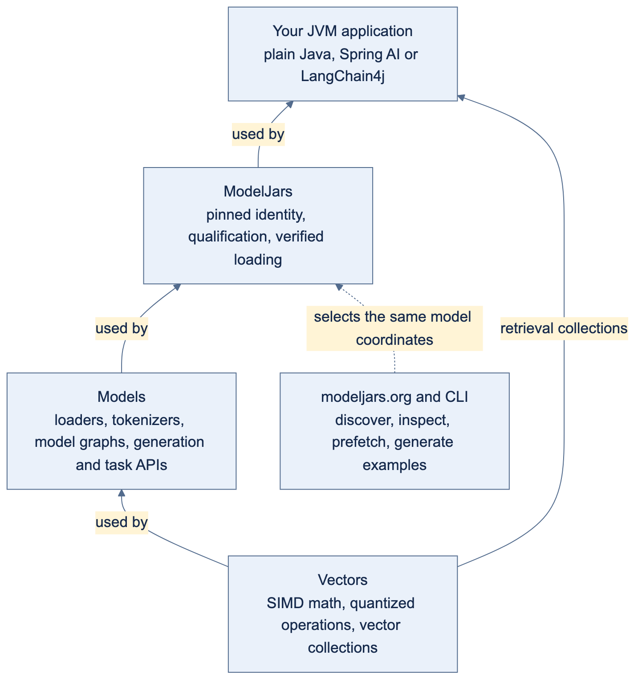
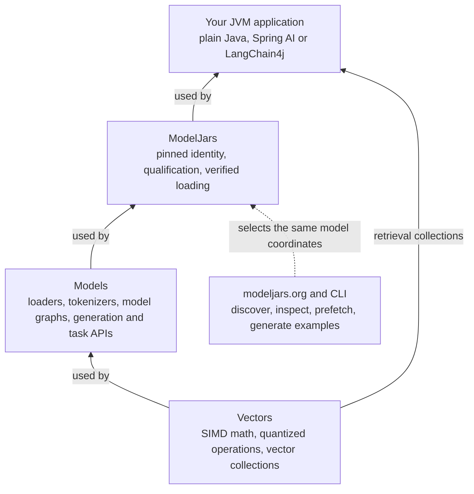
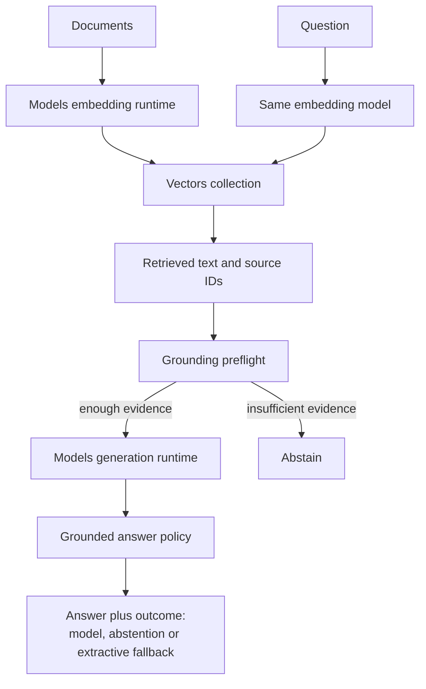
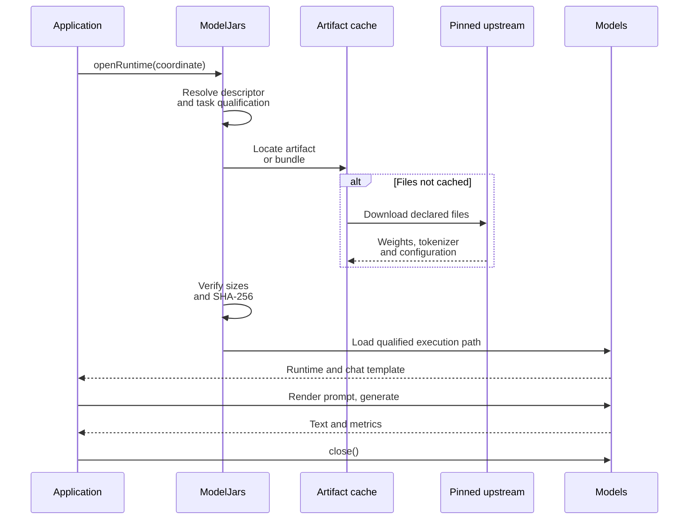
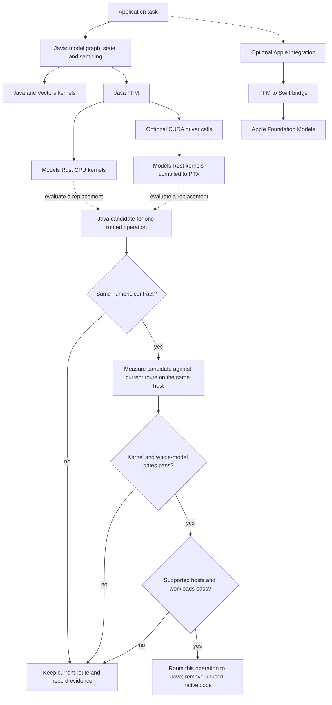

# A hundred models, one dependency, and a router that keeps most of them local

ModelJars publishes language models as Maven artifacts. You add a coordinate, and the weights
arrive through the same resolver that brings you Jackson. Models is the runtime that executes them
on the JVM. This article is about what the catalog currently contains, and about the piece that
turns a pile of models into something you can actually operate: the router.

Every number below was either read from the live catalog at `modeljars.org` or printed by a script
in [`code/`](code/) on the machine named in [the run record](evidence/fleet-routing/RESULTS.md).
Two figures are not measurements and are labelled where they appear: the remote provider's prices,
which are declared inputs to the script, and the four-characters-per-token estimate the script uses
to charge its budget.

## What the catalog holds today

As of the fall of 2026 the published catalog has **103 entries** drawn from **67 upstream
repositories**, totalling 167.2 GB. The smallest is 13.7 MB and the largest 16.8 GB; the median
entry is 0.91 GB, which is the real centre of gravity — most of this catalog runs on a laptop.

Entries are not all the same kind of thing:

| Dimension | Breakdown |
| --- | --- |
| Format | 97 GGUF, 3 safetensors, 2 composite, 1 CACT |
| Capability | 67 chat and text-generation, 31 text-embedding and semantic-search, 9 code-completion, 7 reasoning, 3 tool-calling, 2 each reranking, text-to-speech and math |
| Architecture | 21 distinct families: qwen2 (21), llama (20), bert (16), qwen3 (8), qwen35 (7), nomic-bert (6), gemma3 and lfm2 (4 each), gemma4 (3), granite and soprano (2 each) |
| Quantization | 14 schemes, led by Q4_K_M (49), Q8_0 (13), Q4_0 (7) and F16 (6) |
| Domain | general (54), retrieval (34), embeddings (31), coding (10), reasoning (7), then legal, healthcare, finance, speech and mathematics in twos and threes |
| License | 77 Apache-2.0, 6 Gemma, 5 MIT, 5 Llama-3.2, 4 LFM-1.0, and 3 single-model terms including one non-commercial |

Qualification is tracked per entry and per task, not as a single badge: 65 entries carry RAG
qualifications, 31 carry embedding qualifications, 29 have a performance profile measured on
specific hardware, 3 carry tool qualifications and 2 carry speech. 

### The models people actually pull

Popularity is not something the catalog invents; it comes from upstream. These are the catalog's
busiest upstream repositories by HuggingFace 30-day downloads, read from the HuggingFace API on October 2026. Across the 64 repositories that report counts, the total is 15,143,513 downloads
in thirty days.

| Upstream repository | 30-day downloads | Catalog entry |
| --- | --- | --- |
| Qwen/Qwen2.5-0.5B-Instruct | 6,002,460 | `qwen_qwen2_5_0_5b_instruct_bf16` |
| unsloth/gemma-4-12b-it-GGUF | 1,640,046 | `unsloth_gemma_4_12b_it_gguf_q4_k_m` |
| unsloth/Qwen3.5-4B-GGUF | 1,226,766 | `unsloth_qwen3_5_4b_gguf_q4_k_m` |
| mixedbread-ai/mxbai-rerank-xsmall-v1 | 685,657 | `mixedbread_ai_mxbai_rerank_xsmall_v1_f16` |
| Qwen/Qwen3-8B-GGUF | 570,103 | `qwen3_8b_q4_k_m` |
| bartowski/Meta-Llama-3.1-8B-Instruct-GGUF | 497,742 | `llama_3_1_8b_instruct_q4_k_m` |
| ggml-org/embeddinggemma-300M-GGUF | 371,815 | `ggml_org_embeddinggemma_300m_gguf_q8_0` |
| ggml-org/gemma-4-26B-A4B-it-GGUF | 327,324 | `ggml_org_gemma_4_26b_a4b_it_gguf_q4_k_m` |

Three repositories report no download count: one upstream GGUF conversion, and the two
first-party compositions `org.modeljars.composite:harriet` and
`org.modeljars.composite:granite-answerability`, which exist only here and so have no HuggingFace
history to count. Those two are the catalog's own contributions rather than republished weights.

Note the seventh row. `embeddinggemma-300m` is a 334 MB embedding model, and it is also the model
the router's task classifier runs on — which is where this turns from a catalog into a system.

<!-- diagram:stack -->


<sub>[Mermaid source](diagrams/stack.mmd) · [SVG](diagrams/stack.svg) · the block below is the same diagram</sub>


<!-- end:diagram:stack -->

## The router is part of the offering

`com.integrallis:models-router` ships a pretrained task classifier **inside the jar**: an index of
1,929 exemplar prompts across ten task types — chat, code, creative, extraction, math, reasoning,
sql, summarization, tool-use and translation — embedded at 768 dimensions with
`google_embeddinggemma_300m_gguf_q8_0` and stored SQ4-quantized. Both sides are embedded under the
prefix `task: classification | query: `, and the index records that prefix so callers do not have
to know the convention.

The consequence is that classification is one local forward pass on a model already in your cache.
No prompt text leaves the machine in order to decide where the prompt should go. That is the part
most routing layers get backwards.

Around the classifier sits the ordinary machinery, and it is worth naming precisely because each
piece earned its place in the run below:

- **Candidates** declare what they are: `capabilities`, `contextWindow`, `timeToFirstTokenMillis`,
  `tokensPerSecond`, per-task `quality`, and for remote models `costPerMillionTokens`.
- **Capabilities are a hard filter.** A model is eligible only if it declares every capability the
  request requires. This is an operator's declaration, not a measurement.
- **Policies** are weight vectors over cost, quality, latency, availability and locality.
  `BALANCED` weights quality 0.40 and latency 0.15; `LOCAL_FIRST` weights locality 0.35;
  `CHEAPEST`, `FASTEST`, `BEST_QUALITY` and `PRIVACY_STRICT` sit where their names suggest.
- **A data boundary** (`LOCAL_ONLY` or `REMOTE_ALLOWED`) is enforced per request.
- **A shared budget** charges each attempt from the candidate's declared prices against actual
  usage. When the budget denies an attempt, the router falls through to the next candidate — so an
  exhausted budget pushes work local rather than failing the request.
- **Sessions make routing sticky.** A request carrying a session id gives the incumbent model a
  `switch-margin` so a conversation does not hop between models on a near-tie.

A fleet binds candidates to whatever your application can call. `ModelFleet<T>` is generic over the
client type on purpose, and that is what makes **several remote providers ordinary rather than
special**. A provider is not a mode the router has to support; it is a candidate with its own
prices, its own context window, its own output ceiling, and a closure that knows how to call it.
One fleet can hold an in-process Models runtime, two different vendors' hosted APIs and a private
gateway, and `models-router` never learns any of their names or links any of their SDKs.

The fleet below holds three remote providers alongside the four local models: `gpt-5.1` for work
that needs reasoning, `gpt-4.1-mini` as a cheaper stablemate, and Anthropic's `claude-haiku-5-5`
through an entirely separate endpoint, credential and response shape. Only the premium one declares
`reasoning`; all three declare `long-context`. So when a request needs a long document summarised,
which provider serves it is a policy question among three, not a vendor decision written into the
code — and each client normalises its own provider's usage into one `RoutingUsage`, which is the
only thing the ledger needs.

## One fleet, four local families, one remote provider

Here is the whole thing. Four local model families, one remote provider, a local classifier, a
retrieval arm, a decision arm, and a ledger that counts what left the machine.

<!-- snippet:fleet -->
```java
//RUNTIME_OPTIONS --add-modules=jdk.incubator.vector
//RUNTIME_OPTIONS --enable-native-access=ALL-UNNAMED -Xmx6g
// Four models stay resident, and each native runtime otherwise sizes its persistent worker pool
// for every logical CPU. Four pools of twelve on twelve cores is oversubscription, and it cost
// 20x: qwen3-0.6b answered the same prompt in 1,169 ms alone and 23,946 ms beside the others.
// Three threads each shares the twelve this host has.
//RUNTIME_OPTIONS -Dmodels.native.kernels.threads=3

import com.fasterxml.jackson.databind.JsonNode;
import com.fasterxml.jackson.databind.ObjectMapper;
import com.integrallis.models.api.EmbeddingBackend;
import com.integrallis.models.api.SamplingOptions;
import com.integrallis.models.decisions.Verdict;
import com.integrallis.models.router.*;
import com.integrallis.models.runtime.chat.ChatMessage;
import com.integrallis.vectors.core.Document;
import com.integrallis.vectors.core.SimilarityFunction;
import com.integrallis.vectors.db.*;
import java.math.BigDecimal;
import java.math.RoundingMode;
import java.net.URI;
import java.net.http.*;
import java.time.Duration;
import java.util.*;
import java.util.logging.Level;
import java.util.logging.Logger;
import org.modeljars.ModelJarDecisionRuntime;
import org.modeljars.ModelJarRuntime;
import org.modeljars.ModelJars;
import org.modeljars.composite.harriet.Harriet;

/**
 * One fleet, four local model families, one remote provider, one token ledger.
 *
 * <p>Capabilities are declarations by the operator: a model is eligible only if it claims the
 * capability a request requires. That is what keeps a heartbeat off a frontier model and sends
 * genuine synthesis to one, with no hand-written if-chain over prompt text.
 */
class fleet {
  // Declared contract prices, not measurements. Set these to your own agreements.
  static final String PREMIUM = "gpt-5.1";
  static final double PREMIUM_IN = 1.25;
  static final double PREMIUM_OUT = 10.00;
  static final int PREMIUM_CAP = 2048;

  // A second provider in the same fleet, an order of magnitude cheaper on output.
  static final String ECONOMY = "gpt-4.1-mini";
  static final double ECONOMY_IN = 0.40;
  static final double ECONOMY_OUT = 1.60;
  static final int ECONOMY_CAP = 1024;

  // A third provider at a different vendor: its own endpoint, credential, auth header and JSON
  // shape. Anthropic prices Haiku 5.5 in tiers -- $0.10/$0.50 under a 100k-token prompt and
  // $0.50/$2.50 over it -- and a candidate declares one pair, so this declares the tier these
  // prompts actually fall in and would misprice a 100k-token request.
  static final String HAIKU = "claude-haiku-5-5";
  static final double HAIKU_IN = 0.10;
  static final double HAIKU_OUT = 0.50;
  static final int HAIKU_CAP = 1024;

  static final String REMOTE_MODEL = PREMIUM;
  static final double REMOTE_INPUT_PER_M = PREMIUM_IN;
  static final double REMOTE_OUTPUT_PER_M = PREMIUM_OUT;

  static final String EMBEDDER =
      "org.modeljars.huggingface:ggml-org.embeddinggemma-300m-gguf.q8_0:<model-version>";
  static final String TINY =
      "org.modeljars.huggingface:huggingfacetb.smollm2-360m-instruct-gguf.q8_0:<model-version>";
  static final String SMALL =
      "org.modeljars.huggingface:ggml-org.qwen3-0.6b-gguf.q4_0:<model-version>";
  static final String GROUNDER =
      "org.modeljars.huggingface:bartowski.llama-3.2-1b-instruct-gguf.q4_k_m:<model-version>";

  /** A fleet client is whatever the application can call. Here: text in, text out. */
  interface Responder {
    String respond(String prompt) throws Exception;
  }

  static final Map<String, Object> OPEN = new LinkedHashMap<>();

  /** Provider-reported usage for the last remote call, which beats any local estimate. */
  static RoutingUsage lastRemoteUsage;

  /** One running transcript per session, which is what makes "tell me more" answerable. */
  static final List<ChatMessage> TRANSCRIPT =
      new ArrayList<>(
          List.of(
              ChatMessage.system(
                  "You are a terse support assistant for an online store. Answer the customer in"
                      + " one or two sentences, and never invent policy details.")));
  static final List<String> NOTES =
      List.of(
          "Refunds are issued to the original payment method within five business days.",
          "A duplicate charge is reversed automatically once billing reconciliation runs nightly.",
          "Account closures require written confirmation from the account holder.");

  public static void main(String... args) throws Exception {
    quietLibraries();
    var embedding = ModelJars.openEmbedding(EMBEDDER);
    OPEN.put(EMBEDDER, embedding);

    // The shipped task index was built with this same embedding model, already in the cache, so
    // classification is one local forward pass and no prompt text leaves the machine to be routed.
    var index = TaskIndexResource.openBundled();
    var pretrained = PretrainedTaskClassifier.using(index, embedding::embed, 0.60);
    var classifier = TaskClassifier.local(pretrained);
    System.out.printf(
        "classifier: %d tasks from %s, %d-dimensional, similarity floor 0.60%n",
        index.taskNames().size(), index.embeddingModelId(), index.dimension());

    // "all-remote" measures the counterfactual the ledger cannot compute: what the same workload
    // costs when every prompt goes to the provider. Output tokens for prompts that never ran there
    // are not knowable from a local tokenizer, so they are billed by asking.
    if (args.length > 0 && "all-remote".equals(args[0])) {
      allRemote();
      return;
    }

    var retrieval = buildRetrieval(embedding);
    var fleet = buildFleet(classifier, retrieval);
    var tokenizer = runtime(SMALL).pipeline().tokenizer();

    var budget = new RoutingBudget(new BigDecimal("0.05"));
    var options =
        RoutingExecutionOptions.builder()
            .sharedBudget(budget)
            // The fleet-wide fallback, which now only has to fit the local arms: the remote
            // candidate declares its own ceiling.
            .tokenBounds(new RoutingTokenBounds(4096, 512))
            .timeout(Duration.ofMinutes(3))
            .build();

    long remoteTokens = 0;
    long allTokens = 0;
    long localCompletionTokens = 0;
    // Cold load dominates a first call -- Harriet maps 2.7 GB -- so the local arms are opened and
    // exercised once before anything is timed. Otherwise every per-call figure below would be
    // reporting a one-off startup cost as if it were routing latency. The remote arm is not warmed,
    // because warming it would cost money for no local benefit.
    System.out.printf("%n%-20s %9s%n", "WARMING", "LOAD MS");
    long warmTotal = 0;
    var warmers = new LinkedHashMap<String, Responder>();
    warmers.put("smollm2-360m", text -> acknowledge(TINY, text));
    warmers.put("qwen3-0.6b", text -> complete(SMALL, List.of(ChatMessage.user(text)), 8));
    warmers.put("llama-3.2-1b", text -> complete(GROUNDER, List.of(ChatMessage.user(text)), 8));
    // A lambda, not a method reference: the local fleet variable shadows this class's own name.
    warmers.put("harriet-decisions", text -> decide(text));
    for (var warm : warmers.entrySet()) {
      long began = System.nanoTime();
      warm.getValue().respond("ready?");
      long millis = (System.nanoTime() - began) / 1_000_000;
      warmTotal += millis;
      System.out.printf("%-20s %9d%n", warm.getKey(), millis);
    }
    System.out.printf("%-20s %9d%n", "total", warmTotal);

    long remoteCompletionTokens = 0;
    long localRulerRemote = 0;
    // Per provider, because there is more than one and they do not cost the same.
    var remoteSpend = new LinkedHashMap<String, BigDecimal>();
    var remoteTokensBy = new LinkedHashMap<String, long[]>();
    // Per-model timing comes from the router's own RoutingAttempt, not a stopwatch wrapped round
    // the call, so it measures what the router measured.
    var callMillis = new LinkedHashMap<String, List<Long>>();
    long sessionStart = System.nanoTime();
    TRANSCRIPT.subList(1, TRANSCRIPT.size()).clear();
    int escalated = 0;
    var work = prompts();
    System.out.printf(
        "%n%-40s %-20s %-18s %4s %7s%n", "PROMPT", "CLASSIFIED", "SELECTED", "TOK", "MS");
    for (var prompt : work) {
      lastRemoteUsage = null;
      int tokens = tokenizer.encode(prompt.text()).length;
      allTokens += tokens;
      // A session makes the router sticky: it adds a switch margin so a conversation does not
      // hop between models on a tie. Liveness checks are not conversation turns, so they carry
      // no session and cannot anchor the session to the smallest model.
      var builder = RoutingRequest.builder(prompt.text()).estimatedTokens(tokens);
      if (prompt.session() != null) builder.sessionId(prompt.session());
      var request = builder.build();
      RoutedResult<String> result;
      try {
        result =
            fleet.execute(
                request,
                prompt.requirements(),
                RoutingContinuity.none(),
                options,
                client -> client.respond(prompt.text()),
                answer ->
                    lastRemoteUsage != null
                        ? lastRemoteUsage
                        : new RoutingUsage(tokens, estimateOutputTokens(answer)));
      } catch (RoutingBudgetExceededException denied) {
        // Reported, not fatal: one refused attempt should not discard the rest of the ledger.
        System.out.printf(
            "%-44s %-14s %-18s %d%n", abbreviate(prompt.text(), 42), "-", "refused", tokens);
        System.out.printf("    refused: %s%n", denied.getMessage());
        continue;
      }
      var chosen = result.decision().selected();
      if (chosen.local()) {
        localCompletionTokens += tokenizer.encode(String.valueOf(result.value())).length;
      } else {
        // The provider's own count supersedes the local tokenizer for the arm it bills, and the
        // local count is kept beside it so the share stays measured on one ruler.
        localRulerRemote += tokens;
        long in = lastRemoteUsage != null ? lastRemoteUsage.inputTokens() : tokens;
        long out = lastRemoteUsage != null ? lastRemoteUsage.outputTokens() : 0;
        remoteTokens += in;
        remoteCompletionTokens += out;
        remoteSpend.merge(chosen.id(), chosen.costOf(in, out), BigDecimal::add);
        remoteTokensBy.computeIfAbsent(chosen.id(), key -> new long[2]);
        remoteTokensBy.get(chosen.id())[0] += in;
        remoteTokensBy.get(chosen.id())[1] += out;
        escalated++;
      }
      long millis =
          result.attempts().isEmpty()
              ? 0
              : result.attempts().getLast().duration().toMillis();
      callMillis.computeIfAbsent(chosen.id(), key -> new ArrayList<>()).add(millis);
      System.out.printf(
          "%-40s %-20s %-18s %4d %7d%n",
          abbreviate(prompt.text(), 38),
          describeClassification(pretrained, prompt.text(), result.decision().taskType()),
          chosen.id(),
          tokens,
          millis);
      System.out.printf("    %s%n", abbreviate(String.valueOf(result.value()), 132));
      // Pass "explain" to see why: the score breakdown names every term, including the
      // switch-margin a session grants the incumbent model.
      if (args.length > 0 && "explain".equals(args[0])) {
        System.out.printf("    %s%n", result.decision().explain().replace("\n", " | "));
      }
    }

    long sessionMillis = (System.nanoTime() - sessionStart) / 1_000_000;

    System.out.printf("%n== timing, warm ==%n");
    System.out.printf("%-20s %5s %9s %9s %9s%n", "MODEL", "CALLS", "TOTAL MS", "MEAN MS", "SHARE");
    for (var entry : callMillis.entrySet()) {
      long total = entry.getValue().stream().mapToLong(Long::longValue).sum();
      System.out.printf(
          "%-20s %5d %9d %9d %8.1f%%%n",
          entry.getKey(),
          entry.getValue().size(),
          total,
          total / entry.getValue().size(),
          100.0 * total / sessionMillis);
    }
    long accounted =
        callMillis.values().stream()
            .flatMap(List::stream)
            .mapToLong(Long::longValue)
            .sum();
    System.out.printf(
        "conversation wall clock: %d ms, of which %d ms (%.1f%%) was model calls%n",
        sessionMillis, accounted, 100.0 * accounted / sessionMillis);
    System.out.printf(
        "one-off load of the four local models: %d ms, paid once at startup, not per request%n",
        warmTotal);

    System.out.printf("%n== ledger ==%n");
    System.out.printf(
        "%d prompts, %d escalated to a remote provider, %d answered on local weights%n",
        work.size(), escalated, work.size() - escalated);

    // Two rulers, kept apart on purpose. The local tokenizer measures every prompt the same way,
    // which is what makes the share comparable; the provider's own count is what it bills.
    System.out.printf(
        "local ruler (qwen3-0.6b tokenizer): %d of %d input tokens were routed off this machine"
            + " (%.1f%%)%n",
        localRulerRemote, allTokens, 100.0 * localRulerRemote / allTokens);
    System.out.printf(
        "provider ruler (%s reported): %d input + %d completion tokens billed%n",
        REMOTE_MODEL, remoteTokens, remoteCompletionTokens);
    System.out.printf(
        "  the same prompt measured %d tokens locally, so the two rulers differ by %d%n",
        localRulerRemote, remoteTokens - localRulerRemote);
    System.out.printf("completions generated on local weights: %d tokens%n", localCompletionTokens);
    // ModelCandidate.costOf is new in Models 0.3.60 and is the arithmetic the shared budget
    // charges, so this ledger and the router's cannot drift. It belongs to the candidate that
    // actually ran: with one remote that was a detail, with three it is the whole point.
    if (!remoteSpend.isEmpty()) {
      System.out.printf("%-20s %8s %12s %12s%n", "REMOTE PROVIDER", "IN", "COMPLETION", "COST");
      var total = BigDecimal.ZERO;
      for (var entry : remoteSpend.entrySet()) {
        long[] t = remoteTokensBy.get(entry.getKey());
        total = total.add(entry.getValue());
        System.out.printf(
            "%-20s %8d %12d %12s%n",
            entry.getKey(),
            t[0],
            t[1],
            "$" + entry.getValue().setScale(6, RoundingMode.HALF_UP).toPlainString());
      }
      System.out.printf(
          "%-20s %8d %12d %12s%n",
          "total",
          remoteTokens,
          remoteCompletionTokens,
          "$" + total.setScale(6, RoundingMode.HALF_UP).toPlainString());
    }
    var premiumCandidate =
        fleet.router().candidates().stream()
            .filter(candidate -> candidate.id().equals(PREMIUM))
            .findFirst()
            .orElseThrow();
    System.out.printf(
        "had every prompt gone to %s: $%s of input alone, plus $%s for the completions this"
            + " machine produced for nothing%n",
        PREMIUM,
        premiumCandidate.costOf(allTokens, 0).setScale(6, RoundingMode.HALF_UP).toPlainString(),
        premiumCandidate
            .costOf(0, localCompletionTokens)
            .setScale(6, RoundingMode.HALF_UP)
            .toPlainString());
    System.out.printf(
        "router-accounted spend: $%s of the $0.05 shared budget%n",
        budget.snapshot().spent().setScale(6, RoundingMode.HALF_UP).toPlainString());

    for (var open : OPEN.values()) {
      if (open instanceof AutoCloseable closeable) closeable.close();
    }
    retrieval.close();
    index.close();
  }

  /**
   * Four local families and one remote provider.
   *
   * <p>Only the remote candidate claims {@code reasoning}; only the grounder claims {@code
   * grounding}; only Harriet claims {@code decision}. The capability filter therefore settles
   * eligibility before any score is compared.
   */
  static ModelFleet<Responder> buildFleet(TaskClassifier classifier, VectorCollection retrieval) {
    var tiny =
        ModelCandidate.builder("smollm2-360m")
            .local(true)
            .capabilities(Set.of("chat", "liveness"))
            .contextWindow(8192)
            .timeToFirstTokenMillis(90)
            .tokensPerSecond(55)
            .quality(Map.of("chat", 0.45))
            .build();
    var small =
        ModelCandidate.builder("qwen3-0.6b")
            .local(true)
            .capabilities(Set.of("chat", "summarization"))
            .contextWindow(32768)
            .timeToFirstTokenMillis(140)
            .tokensPerSecond(40)
            .quality(Map.of("chat", 0.60, "summarization", 0.62))
            .build();
    var grounder =
        ModelCandidate.builder("llama-3.2-1b")
            .local(true)
            .capabilities(Set.of("chat", "grounding"))
            .contextWindow(131072)
            .timeToFirstTokenMillis(210)
            .tokensPerSecond(28)
            .quality(Map.of("chat", 0.66, "grounding", 0.70))
            .build();
    var decisions =
        ModelCandidate.builder("harriet-decisions")
            .local(true)
            .capabilities(Set.of("decision"))
            .contextWindow(32768)
            .timeToFirstTokenMillis(260)
            .tokensPerSecond(1)
            .quality(Map.of("decision", 0.90))
            .build();
    // Three remote providers, not one. Each is an ordinary candidate with its own prices, ceiling
    // and client. Only the premium one claims `reasoning`; all three claim `long-context`, so a
    // long document is decided between them on policy rather than on vendor.
    var premium =
        ModelCandidate.builder(PREMIUM)
            .local(false)
            .capabilities(Set.of("chat", "reasoning", "summarization", "long-context"))
            .costPerMillionTokens(PREMIUM_IN, PREMIUM_OUT)
            // New in Models 0.3.60. A reasoning model bills its reasoning as completion, so it
            // cannot share an output ceiling with a model that answers a liveness check in eight
            // tokens. The execution-wide bound stays small for the local arms.
            .maxOutputTokens(PREMIUM_CAP)
            .contextWindow(400000)
            .timeToFirstTokenMillis(850)
            .tokensPerSecond(90)
            .quality(Map.of("chat", 0.95, "reasoning", 0.96, "summarization", 0.94))
            .build();
    var economy =
        ModelCandidate.builder(ECONOMY)
            .local(false)
            .capabilities(Set.of("chat", "summarization", "long-context"))
            .costPerMillionTokens(ECONOMY_IN, ECONOMY_OUT)
            .maxOutputTokens(ECONOMY_CAP)
            .contextWindow(1000000)
            .timeToFirstTokenMillis(400)
            .tokensPerSecond(140)
            .quality(Map.of("chat", 0.82, "summarization", 0.86))
            .build();
    var haiku =
        ModelCandidate.builder(HAIKU)
            .local(false)
            .capabilities(Set.of("chat", "summarization", "long-context"))
            .costPerMillionTokens(HAIKU_IN, HAIKU_OUT)
            .maxOutputTokens(HAIKU_CAP)
            .contextWindow(200000)
            .timeToFirstTokenMillis(300)
            .tokensPerSecond(120)
            .quality(Map.of("chat", 0.80, "summarization", 0.83))
            .build();

    return ModelFleet.<Responder>builder()
        .classifier(classifier)
        // BALANCED weights quality at 0.40 and latency at 0.15. LOCAL_FIRST would weight
        // locality at 0.35 and latency enough that the 360M model wins ordinary chat on speed,
        // which is the wrong trade for a customer's actual question. The LOCAL_ONLY boundary on
        // those requests already keeps them on this machine, so locality needs no thumb here.
        .policy(RoutingPolicy.BALANCED)
        .model(tiny, prompt -> acknowledge(TINY, prompt))
        .model(small, prompt -> chat(SMALL, prompt, 80))
        .model(grounder, prompt -> ground(retrieval, prompt))
        .model(decisions, fleet::decide)
        // One fleet, three remote clients. Each closure is where a provider's SDK would live, so
        // models-router never learns any of their names.
        .model(premium, prompt -> callOpenAi(PREMIUM, PREMIUM_CAP, prompt))
        .model(economy, prompt -> callOpenAi(ECONOMY, ECONOMY_CAP, prompt))
        .model(haiku, prompt -> callAnthropic(HAIKU, HAIKU_CAP, prompt))
        .build();
  }

  record Prompt(String text, RoutingRequirements requirements, String session) {}

  /** One support session: liveness, follow-ups, closed decisions, grounded questions, synthesis. */
  static List<Prompt> prompts() {
    var liveness =
        RoutingRequirements.builder()
            .requireCapability("liveness")
            .dataBoundary(RoutingDataBoundary.LOCAL_ONLY)
            .build();
    var chatHere =
        RoutingRequirements.builder()
            .requireCapability("chat")
            .dataBoundary(RoutingDataBoundary.LOCAL_ONLY)
            .build();
    var grounded =
        RoutingRequirements.builder()
            .requireCapability("grounding")
            .dataBoundary(RoutingDataBoundary.LOCAL_ONLY)
            .build();
    var decision = RoutingRequirements.builder().requireCapability("decision").build();
    var synthesis = RoutingRequirements.builder().requireCapability("reasoning").build();
    // No local model claims long-context, so this must go remote. Which remote is then a policy
    // question among three providers rather than a vendor choice written into the code.
    var longContext = RoutingRequirements.builder().requireCapability("long-context").build();
    return List.of(
        new Prompt("ping", liveness, null),
        new Prompt("still there?", liveness, null),
        new Prompt("ok", liveness, null),
        new Prompt("I was charged twice for my September order.", chatHere, "s-1"),
        new Prompt("tell me more", chatHere, "s-1"),
        new Prompt(
            "I was charged twice for my September subscription and no refund arrived.",
            decision,
            null),
        new Prompt("When is a refund issued, and to which payment method?", grounded, "s-1"),
        new Prompt("What happens to a duplicate charge?", grounded, "s-1"),
        new Prompt(
            "Our refund policy promises five business days to the original payment method, while"
                + " duplicate charges reverse automatically on the nightly reconciliation. Those"
                + " two paths can disagree for a customer who is both refunded and reconciled."
                + " Work out where they conflict and draft the terms-of-service paragraph that"
                + " resolves it.",
            synthesis,
            "s-1"),
        new Prompt(
            "Summarise this appendix for the support handbook, in two sentences. Refunds are"
                + " issued to the original payment method within five business days. A duplicate"
                + " charge is reversed automatically once billing reconciliation runs nightly."
                + " Account closures require written confirmation from the account holder."
                + " Reconciliation runs at 02:00 UTC and retries twice on failure. A reversal that"
                + " fails twice is escalated to the billing queue with the original charge id.",
            longContext,
            null));
  }

  /** Sends every prompt to the provider and totals its own reported usage. */
  static void allRemote() throws Exception {
    long input = 0;
    long output = 0;
    System.out.printf("%n%-46s %8s %11s%n", "PROMPT", "IN", "COMPLETION");
    for (var prompt : prompts()) {
      lastRemoteUsage = null;
      var answer = callOpenAi(PREMIUM, PREMIUM_CAP, prompt.text());
      if (lastRemoteUsage == null) {
        System.out.printf("%-46s   no usage reported: %s%n", abbreviate(prompt.text(), 44), answer);
        continue;
      }
      input += lastRemoteUsage.inputTokens();
      output += lastRemoteUsage.outputTokens();
      System.out.printf(
          "%-46s %8d %11d%n",
          abbreviate(prompt.text(), 44),
          lastRemoteUsage.inputTokens(),
          lastRemoteUsage.outputTokens());
    }
    double cost =
        (REMOTE_INPUT_PER_M * input + REMOTE_OUTPUT_PER_M * output) / 1_000_000.0;
    System.out.printf("%n== every prompt through %s ==%n", REMOTE_MODEL);
    System.out.printf("provider-reported: %d input + %d completion tokens%n", input, output);
    System.out.printf(
        "at the declared $%.2f/M in, $%.2f/M out: $%.6f%n",
        REMOTE_INPUT_PER_M, REMOTE_OUTPUT_PER_M, cost);
    System.out.println(
        "Floor, not a ceiling: the grounded prompts are sent without their retrieved notes, which a");
    System.out.println("real all-remote implementation would have to include in the input.");
  }

  // ---- arms -------------------------------------------------------------------------------

  /**
   * A liveness check is not a conversation turn: it is answered statelessly and never enters the
   * transcript, so it cannot teach the conversational model to answer everything with an
   * acknowledgement.
   */
  static String acknowledge(String coordinate, String prompt) {
    return complete(
        coordinate,
        List.of(
            ChatMessage.system(
                "You answer liveness checks. Whatever the message says, reply with exactly:"
                    + " still here."),
            ChatMessage.user("ping"),
            ChatMessage.assistant("still here"),
            ChatMessage.user(prompt)),
        8);
  }

  /** Single-shot: used by the grounded arm, which supplies its own retrieved context. */
  static String generate(String coordinate, String prompt, int maxTokens) {
    return complete(coordinate, List.of(ChatMessage.user(prompt)), maxTokens);
  }

  /** Conversational: appends to the session transcript so follow-ups resolve against it. */
  static String chat(String coordinate, String prompt, int maxTokens) {
    TRANSCRIPT.add(ChatMessage.user(prompt));
    var answer = complete(coordinate, List.copyOf(TRANSCRIPT), maxTokens);
    TRANSCRIPT.add(ChatMessage.assistant(answer));
    return answer;
  }

  static String complete(String coordinate, List<ChatMessage> messages, int maxTokens) {
    var runtime = runtime(coordinate);
    var rendered = runtime.chatTemplate().render(messages);
    return runtime
        .pipeline()
        .generate(rendered, SamplingOptions.builder().temperature(0).maxTokens(maxTokens).build())
        .strip();
  }

  /** Retrieval plus a small local model: the ordinary RAG shape, reachable only via "grounding". */
  static String ground(VectorCollection retrieval, String prompt) {
    var embedding = (EmbeddingBackend) OPEN.get(EMBEDDER);
    var hits = retrieval.search(SearchRequest.builder(embedding.embed(prompt), 2).build()).hits();
    var context = new StringBuilder();
    for (var hit : hits) context.append(hit.document().text()).append(' ');
    return generate(
        GROUNDER,
        "Notes: "
            + context.toString().strip()
            + "\nUsing only those notes, answer in one sentence. If they do not contain the"
            + " answer, say that you do not know.\nQuestion: "
            + prompt,
        64);
  }

  /** Closed answer spaces: one forward pass, no generated prose to parse or repair. */
  static String decide(String evidence) {
    var harriet = (ModelJarDecisionRuntime) OPEN.computeIfAbsent("harriet", key -> Harriet.open());
    // Each outcome carries a written rule. The Harriet javadoc records the difference this
    // makes: accuracy 0.8917 with a rubric against 0.7500 without, measured 2026-09-24 over
    // 120 JevBench items on the same model and kernel. Without one, the boolean below returns
    // a 0.50 coin flip on evidence a human reads instantly.
    var billing =
        Harriet.noul(
            harriet,
            "This ticket is about billing.",
            "the customer describes a charge, a refund, an invoice or a subscription payment",
            "the customer describes delivery, product faults, accounts or anything not monetary",
            evidence);
    var queue =
        Harriet.choice(
            harriet,
            "Which queue should handle this ticket?",
            List.of("billing", "technical", "shipping"),
            Map.of(
                "billing", "charges, refunds, invoices and subscription payments",
                "technical", "errors, outages and product faults",
                "shipping", "delivery, tracking and returns in transit"),
            evidence);
    var urgency =
        Harriet.score(
            harriet,
            "How urgent is this ticket?",
            List.of("can wait", "this week", "today"),
            Map.of(
                "can wait", "no money is at stake and nothing is blocked",
                "this week", "money is at stake but the customer is not blocked",
                "today", "the customer is blocked or out of pocket with no path forward"),
            evidence);
    return "billing=%s queue=%s urgency=%s".formatted(show(billing), show(queue), show(urgency));
  }

  static String show(Verdict verdict) {
    return "%s(p=%.2f,c=%.2f)"
        .formatted(verdict.winner(), verdict.probabilityOf(verdict.winner()), verdict.confidence());
  }

  /**
   * One provider's client. Two candidates bind to this with different models, prices and ceilings,
   * which is all "a second provider" means to the fleet.
   */
  static String callOpenAi(String model, int cap, String prompt) throws Exception {
    var key = System.getenv("OPENAI_API_KEY");
    if (key == null || key.isBlank()) {
      return "[routed to " + model + "; not executed because OPENAI_API_KEY is unset]";
    }
    var mapper = new ObjectMapper();
    var message = mapper.createObjectNode().put("role", "user").put("content", prompt);
    var body =
        mapper
            .createObjectNode()
            .put("model", model)
            .put("max_completion_tokens", cap)
            .set("messages", mapper.createArrayNode().add(message));
    var request =
        HttpRequest.newBuilder(URI.create("https://api.openai.com/v1/chat/completions"))
            .header("Authorization", "Bearer " + key)
            .header("Content-Type", "application/json")
            .timeout(Duration.ofMinutes(2))
            .POST(HttpRequest.BodyPublishers.ofString(body.toString()))
            .build();
    var response = HttpClient.newHttpClient().send(request, HttpResponse.BodyHandlers.ofString());
    JsonNode parsed = mapper.readTree(response.body());
    if (response.statusCode() != 200) {
      // Surfaced rather than swallowed: an empty completion would otherwise look like a short
      // answer and quietly enter the ledger as one.
      return "[%s returned HTTP %d: %s]"
          .formatted(
              model,
              response.statusCode(),
              parsed.path("error").path("message").asText(response.body()));
    }
    var usage = parsed.path("usage");
    if (usage.hasNonNull("prompt_tokens")) {
      lastRemoteUsage =
          new RoutingUsage(
              usage.path("prompt_tokens").asLong(), usage.path("completion_tokens").asLong());
    }
    return parsed.path("choices").path(0).path("message").path("content").asText("");
  }

  /**
   * A different vendor's client: different endpoint, credential, auth header and response shape.
   * The fleet does not know any of that; it holds a candidate and something callable.
   */
  static String callAnthropic(String model, int cap, String prompt) throws Exception {
    var key = System.getenv("ANTHROPIC_API_KEY");
    if (key == null || key.isBlank()) {
      return "[routed to " + model + "; not executed because ANTHROPIC_API_KEY is unset]";
    }
    var mapper = new ObjectMapper();
    var message = mapper.createObjectNode().put("role", "user").put("content", prompt);
    var body =
        mapper
            .createObjectNode()
            .put("model", model)
            .put("max_tokens", cap)
            .set("messages", mapper.createArrayNode().add(message));
    var request =
        HttpRequest.newBuilder(URI.create("https://api.anthropic.com/v1/messages"))
            .header("x-api-key", key)
            .header("anthropic-version", "2023-06-01")
            .header("Content-Type", "application/json")
            .timeout(Duration.ofMinutes(2))
            .POST(HttpRequest.BodyPublishers.ofString(body.toString()))
            .build();
    var response = HttpClient.newHttpClient().send(request, HttpResponse.BodyHandlers.ofString());
    JsonNode parsed = mapper.readTree(response.body());
    if (response.statusCode() != 200) {
      return "[%s returned HTTP %d: %s]"
          .formatted(
              model,
              response.statusCode(),
              parsed.path("error").path("message").asText(response.body()));
    }
    // Anthropic reports input_tokens and output_tokens where OpenAI reports prompt_ and
    // completion_. Each client normalises its own provider into one RoutingUsage.
    var usage = parsed.path("usage");
    if (usage.hasNonNull("input_tokens")) {
      lastRemoteUsage =
          new RoutingUsage(
              usage.path("input_tokens").asLong(), usage.path("output_tokens").asLong());
    }
    // Haiku 5.5 returns a thinking block first and the answer after it, so the text block has to
    // be found rather than assumed at index zero. Reading content[0] yields an empty answer that
    // then enters the ledger as a short one.
    for (JsonNode block : parsed.path("content")) {
      if ("text".equals(block.path("type").asText())) {
        return block.path("text").asText("");
      }
    }
    return "[%s returned no text block]".formatted(model);
  }

  // ---- helpers ----------------------------------------------------------------------------

  static ModelJarRuntime runtime(String coordinate) {
    return (ModelJarRuntime) OPEN.computeIfAbsent(coordinate, ModelJars::openRuntime);
  }

  static VectorCollection buildRetrieval(EmbeddingBackend embedding) {
    var probe = embedding.embed(NOTES.get(0));
    var collection =
        VectorCollection.builder()
            .dimension(probe.length)
            .metric(SimilarityFunction.COSINE)
            .indexType(IndexType.FLAT)
            .build();
    for (int i = 0; i < NOTES.size(); i++) {
      collection.add(
          new Document("note-" + i, embedding.embed(NOTES.get(i)), NOTES.get(i), Map.of()));
    }
    collection.commit();
    return collection;
  }

  /**
   * What the classifier saw, not merely what it returned.
   *
   * <p>`match` is new in Models 0.3.60. `classify` answers with a task or with nothing, so a
   * conversational prompt unlike every work-shaped exemplar and one that nearly matched both print
   * as the same dash. The nearest task and its similarity say which happened.
   */
  static String describeClassification(
      PretrainedTaskClassifier classifier, String prompt, String classified) {
    if (classified != null) return classified;
    return classifier
        .match(prompt)
        .map(match -> "~%s %.2f".formatted(match.task(), match.similarity()))
        .orElse("-");
  }

  /** Four characters per token is a declared estimate, used only to charge the budget. */
  static long estimateOutputTokens(String answer) {
    return answer == null ? 0 : Math.max(1, answer.length() / 4);
  }

  static String abbreviate(String text, int limit) {
    var flat = text.replaceAll("\\s+", " ").strip();
    return flat.length() <= limit ? flat : flat.substring(0, limit - 1) + "…";
  }

  static void quietLibraries() {
    Logger.getLogger("org.modeljars").setLevel(Level.WARNING);
    Logger.getLogger("com.integrallis").setLevel(Level.WARNING);
  }
}
```
<!-- end:snippet:fleet -->

Run it and the routing table is the output:

```
WARMING                LOAD MS
smollm2-360m              2493
qwen3-0.6b                2439
llama-3.2-1b              3478
harriet-decisions        21685
total                    30095

PROMPT                                   CLASSIFIED           SELECTED            TOK      MS
ping                                     ~chat 0.48           smollm2-360m          1     169
    still here
still there?                             ~summarization 0.50  smollm2-360m          3     170
    still here
ok                                       ~reasoning 0.57      smollm2-360m          1     149
    still here
I was charged twice for my September …   ~tool-use 0.46       qwen3-0.6b            9    4288
    We'll check the details of your order to confirm if there was any issue with the payment. Let me know how we can assist you.
tell me more                             summarization        qwen3-0.6b            3    2267
    Of course, let me know how we can assist you with the next steps.
I was charged twice for my September …   ~tool-use 0.49       harriet-decisions    13   13910
    billing=true(p=0.91,c=0.58) queue=billing(p=0.99,c=0.95) urgency=this week(p=0.38,c=0.01)
When is a refund issued, and to which…   ~tool-use 0.51       llama-3.2-1b         12    2049
    A refund is issued to the original payment method within five business days.
What happens to a duplicate charge?      ~code 0.45           llama-3.2-1b          7    1716
    A duplicate charge is reversed automatically once billing reconciliation runs nightly.
Our refund policy promises five busin…   ~tool-use 0.52       gpt-5.1              55   10400
    There are two flows that can collide: 1. **Manual refund path** - You initiate a refund. - Policy promises: “Refund within five bus…
Summarise this appendix for the suppo…   ~summarization 0.54  claude-haiku-5-5     84    1131
    Refunds go to the original payment method within five business days, and duplicate charges are reversed automatically by the nightl…
```

Five kinds of traffic, five different destinations, no `if` statement over prompt text:

**Heartbeats** (`ping`, `still there?`, `ok`) require a `liveness` capability that only the 360M
SmolLM2 declares. They are answered statelessly, in 8 tokens, and never enter the conversation
transcript — because a liveness check is not a conversation turn.

**The conversation** (`I was charged twice…`, then `tell me more`) requires `chat` with a
`LOCAL_ONLY` boundary, and carries a session id. The first turn picks qwen3-0.6b on quality; the
follow-up stays there because of the switch margin. `tell me more` only means anything because the
transcript is real, which is why the arm appends both sides of each turn.

**The closed decisions** go to Harriet, which answers three typed questions in three forward
passes: a boolean, a choice over three queues, and an ordered severity. Nothing is generated, so
there is no JSON to repair. Each outcome carries a written rule, and that matters: Harriet's own
javadoc records accuracy **0.8917 with a rubric against 0.7500 without**, measured 2026-09-24 over
120 JevBench items on the same model and kernel. Note that the model is confident about what the
ticket is (`p=0.99`) and openly unconfident about its urgency (`c=0.01`) — a calibrated model
declining to commit is the feature, not a defect.

**The grounded questions** require a `grounding` capability that only the Llama-3.2-1B arm declares,
and that arm does retrieval before generation. Both answers come back as one sentence drawn from
the notes.

**The synthesis prompt** requires `reasoning`, which only `gpt-5.1` declares among the three
remotes, so it is the one request that can only go there. **The appendix summary** requires
`long-context`, which no local model claims and all three remotes do, so the policy picks among
providers — and it picked Anthropic's Haiku, the cheapest and fastest of them. Both calls really
happened: those answers are the providers', and the tokens they report are what the ledger bills.

The `CLASSIFIED` column repays a second look. Only `tell me more` clears the classifier's 0.60
similarity floor, as `summarization`. The rest print their nearest task with a tilde and the
similarity that fell short — `ping` is ~chat at 0.48, `ok` is ~reasoning at 0.57, "What happens to a
duplicate charge?" is ~code at 0.45. That is `PretrainedTaskClassifier.match`, new in Models 0.3.60.
Before it, every one of those rows was a bare dash, and a prompt unlike every exemplar looked
identical to one that nearly matched. The numbers say what is really going on: an index built from
1,929 work-shaped prompts has nothing much to say about conversational filler, and it reports that
honestly instead of guessing a task and silently applying the wrong quality column.

<!-- diagram:rag -->


<sub>[Mermaid source](diagrams/rag.mmd) · [SVG](diagrams/rag.svg) · the block below is the same diagram</sub>


<!-- end:diagram:rag -->

## What it took

The router times every attempt, so the conversation reports its own latency:

```
== timing, warm ==
MODEL                CALLS  TOTAL MS   MEAN MS     SHARE
smollm2-360m             3       488       162      1.2%
qwen3-0.6b               2      6555      3277     15.9%
harriet-decisions        1     13910     13910     33.8%
llama-3.2-1b             2      3765      1882      9.1%
gpt-5.1                  1     10400     10400     25.3%
claude-haiku-5-5         1      1131      1131      2.7%
conversation wall clock: 41152 ms, of which 36249 ms (88.1%) was model calls
one-off load of the four local models: 30095 ms, paid once at startup, not per request
```

A liveness check answers in **162 ms**. Among the remotes, Anthropic's Haiku returns in **1,131 ms**
and gpt-5.1 takes **10,400 ms** — nine times longer, for the one request that genuinely needed a
reasoning model. Between them sit the grounded arm at 1.9 seconds, the conversational model at 3.3,
and Harriet at 13.9, because three calibrated verdicts are three forward passes through a 4B model.

Those shapes hold across runs on an unloaded machine; the absolute numbers do not hold on a busy
one. An earlier measurement put the conversational model at 18,753 ms, which was the laptop at load
average 20 with three and a half million pageouts, not the model.

The 30 seconds of loading above the table is paid once. Four models stay resident, which is what a
server does, and a resident fleet needs one explicit decision: each native runtime otherwise sizes
its worker pool for every logical CPU, so four pools on twelve cores oversubscribe badly. The same
prompt qwen3-0.6b answers in 1,169 ms alone took 23,946 ms beside the others until the script gave
each runtime three threads.

## What it cost

```
== ledger ==
10 prompts, 2 escalated to a remote provider, 8 answered on local weights
local ruler (qwen3-0.6b tokenizer): 139 of 188 input tokens were routed off this machine (73.9%)
provider ruler (gpt-5.1 reported): 204 input + 702 completion tokens billed
  the same prompt measured 139 tokens locally, so the two rulers differ by 65
completions generated on local weights: 123 tokens
REMOTE PROVIDER            IN   COMPLETION         COST
gpt-5.1                    61          598    $0.006056
claude-haiku-5-5          143          104    $0.000066
total                     204          702    $0.006123
had every prompt gone to gpt-5.1: $0.000235 of input alone, plus $0.001230 for the completions this machine produced for nothing
router-accounted spend: $0.006123 of the $0.05 shared budget
```

Eight of ten requests never left the machine. Of the two that did, the policy conflict went to
gpt-5.1 and the appendix summary went to Haiku, and the per-provider table is where having more than
one remote stops being a design note and starts being money: **598 completion tokens on gpt-5.1 cost
$0.006056, while 104 on Haiku cost $0.000066.** Per completion token that is $10.00 against $0.50 per
million — a factor of twenty for work that did not need the expensive one. The ledger prices each
line with `ModelCandidate.costOf` on the candidate that actually ran, which is the only way this
stays right once a fleet holds several providers, and the router's own accounted spend matches the
total exactly.

Measured on input tokens alone, routing looks unimpressive: 139 of 188 left the machine, because the
two escalated prompts are the long ones. The script's `all-remote` mode settles what that is worth
by sending the same ten prompts to gpt-5.1 and totalling what it reports:

```
PROMPT                                               IN  COMPLETION
ping                                                  7          10
still there?                                          9          22
ok                                                    7          24
I was charged twice for my September order.          15         428
tell me more                                          9         109
I was charged twice for my September subscr…         19         625
When is a refund issued, and to which payme…         18         237
What happens to a duplicate charge?                  13         400
Our refund policy promises five business da…         61         430
Summarise this appendix for the support han…         89          70

== every prompt through gpt-5.1 ==
provider-reported: 247 input + 2355 completion tokens
at the declared $1.25/M in, $10.00/M out: $0.023859
Floor, not a ceiling: the grounded prompts are sent without their retrieved notes, which a
real all-remote implementation would have to include in the input.
```

| | input | completion | cost |
| --- | --- | --- | --- |
| Every prompt through gpt-5.1 | 247 | 2,355 | **$0.023859** |
| As routed across three providers | 204 | 702 | **$0.006123** |

**74.3% less, a factor of 3.90.** The shape of it: the eight prompts that stayed local would have
billed 1,855 completion tokens on gpt-5.1, or **$0.018671 — 78.3% of the entire all-remote bill.** A
reasoning model spends 428 completion tokens on "I was charged twice for my September order" and 625
on the ticket Harriet settles in three forward passes without generating prose at all.

So the saving is not in shaving tokens off short prompts. It is in not paying a frontier model to
generate output that does not need generating, and in not sending to the expensive provider what the
cheap one answers nine times faster.

### Where these numbers come from

Token counts are each provider's own report or the qwen3-0.6b tokenizer's, kept apart because they
disagree — the escalated prompts measured 139 tokens locally and 204 at the providers. Shares are
quoted on the local ruler, where every prompt is measured identically, and bills on the provider's,
where they are charged.

Prices are the script's declared inputs, matching published rates from third-party trackers in
September and October 2026: $1.25/$10.00 per million for gpt-5.1, $0.40/$1.60 for gpt-4.1-mini, and
$0.10/$0.50 for Haiku 5.5. Set them to your own contracts. Haiku is additionally tiered — $0.50/$2.50
above a 100k-token prompt — and a candidate declares a single pair, so this fleet would misprice a
very long request to it.

The all-remote figure is a floor: its grounded prompts were sent without the retrieved notes a real
implementation would include. And completion counts are not deterministic, so the table reports the
run in which both arms were measured together rather than a best case.

## Four things only a real run would tell you

**A decision without a rubric is a coin flip.** Harriet's yes-or-no call accepts a written rule for
each outcome, and without them the question "is this ticket about billing?" came back
`false p=0.503 confidence=0.00` on evidence any human reads at a glance. With the rules attached it
returns `true p=0.920 confidence=0.60`. Harriet's javadoc puts a number on that gap — accuracy
0.8917 with a rubric against 0.7500 without, over 120 JevBench items — and this is what it looks
like from the outside.

**A heartbeat should not get a vote on the conversation.** Sessions make the router sticky on
purpose: an incumbent model gets a `switch-margin` so a conversation does not hop mid-flight. Give
every prompt the same session id and the first heartbeat anchors the whole exchange to the 360M
model, which then handles a real customer complaint badly. Liveness checks carry no session, and
`scoreBreakdown()` is what shows you why — `switch-margin=0.05`, sitting in the numbers.

**A reasoning model does not fit a chat model's output bound.** A 512-token completion ceiling is
generous for a chat reply and far too small for a model that bills its reasoning as completion, so
the first keyed run stopped on `RoutingBudgetExceededException`. The router's own part was exact: it
refused the attempt, recorded the real cost, and named the limit it crossed. What it could not do
was hold two models to two different ceilings, because the bound belonged to the execution rather
than the candidate — and worse, a bound checked after the call discarded the completion the call had
already been billed for. Models 0.3.60 fixes both: a candidate declares its own `maxOutputTokens`,
and an overrun carries `billedResult()`, `billedUsage()` and `billedCost()` so the spend buys
something. The script declares 2,048 on the remote candidate and leaves the fleet-wide bound small
for the local arms.

**A resident fleet has to be told how to share a machine.** Four models held open, each sizing a
worker pool for all twelve cores, made qwen3-0.6b twenty times slower than it is alone. Three
threads each fixed it. This is the cost of keeping models warm, and it is worth paying — but only
once you have said how.

The run record carries all four with their numbers.

## How a model gets from a coordinate to a forward pass

Two diagrams for the parts underneath. Opening a model is resolution, verification and mapping:

<!-- diagram:loading -->


<sub>[Mermaid source](diagrams/loading.mmd) · [SVG](diagrams/loading.svg) · the block below is the same diagram</sub>


<!-- end:diagram:loading -->

And the boundary between Java and the native kernels, which is where the arithmetic that matters
actually runs:

<!-- diagram:native-boundary -->


<sub>[Mermaid source](diagrams/native-boundary.mmd) · [SVG](diagrams/native-boundary.svg) · the block below is the same diagram</sub>


<!-- end:diagram:native-boundary -->

## The rest of the walkthrough

Every script below runs on ModelJars 0.1.59, Models 0.3.60 and Vectors 0.1.30, all released and
verified on Maven Central. All fourteen completed on 2026-10-15; outcomes are in
[the run record](evidence/fleet-routing/RESULTS.md).

| Script | What it shows |
| --- | --- |
| [`chat.java`](code/chat.java) | A GGUF chat model end to end, with load, prefill and decode timings |
| [`safetensors.java`](code/safetensors.java) | The same API over a BF16 safetensors bundle |
| [`embed.java`](code/embed.java) | A 1,024-dimensional embedding |
| [`gemma.java`](code/gemma.java) | EmbeddingGemma under the publisher's own prefix recipe |
| [`rerank.java`](code/rerank.java) | Cross-encoder reranking, correct ordering by score |
| [`rag.java`](code/rag.java) | Retrieval with a grounding policy that can abstain |
| [`tools.java`](code/tools.java) | A model proposing tool calls that the JVM executes |
| [`composite.java`](code/composite.java) | A composition sharing a physical KV prefix, 182 tokens |
| [`decisions.java`](code/decisions.java) | Typed, calibrated decisions with no generation |
| [`speech.java`](code/speech.java) | Text to a 32 kHz wav, RTF 1.433 |
| [`spring.java`](code/spring.java) | The same model behind a Spring AI `ChatModel` |
| [`route.java`](code/route.java) | Discovery over what is already cached, selection only |
| [`bonsai.java`](code/bonsai.java) | A verified 5.95 GB PTQ1_0 artifact |
| [`fleet.java`](code/fleet.java) | The routing fleet and ledger above |

Run them with Java 25 and JBang from [`code/`](code/README.md). Routing discovers only models that
are already cached, so run `chat.java` and `safetensors.java` before `route.java`.

## What this adds up to

A catalog is only interesting if you can choose from it, and choosing by hand does not scale past
about three models. The router turns 103 entries into a fleet you can state the rules for: what each
model is allowed to serve, which traffic may leave the machine, what you are willing to spend, and
how much better an alternative must be before a conversation switches models mid-flight. Then it
tells you which rule fired, in numbers, for every request.

Most of the traffic in the run above never needed a frontier model. One request did, and it got
one. That is the whole argument.
