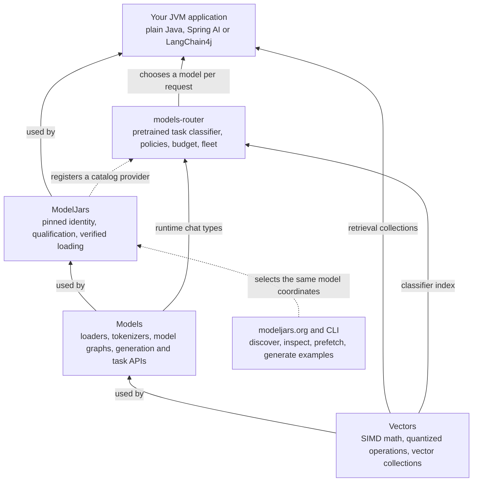
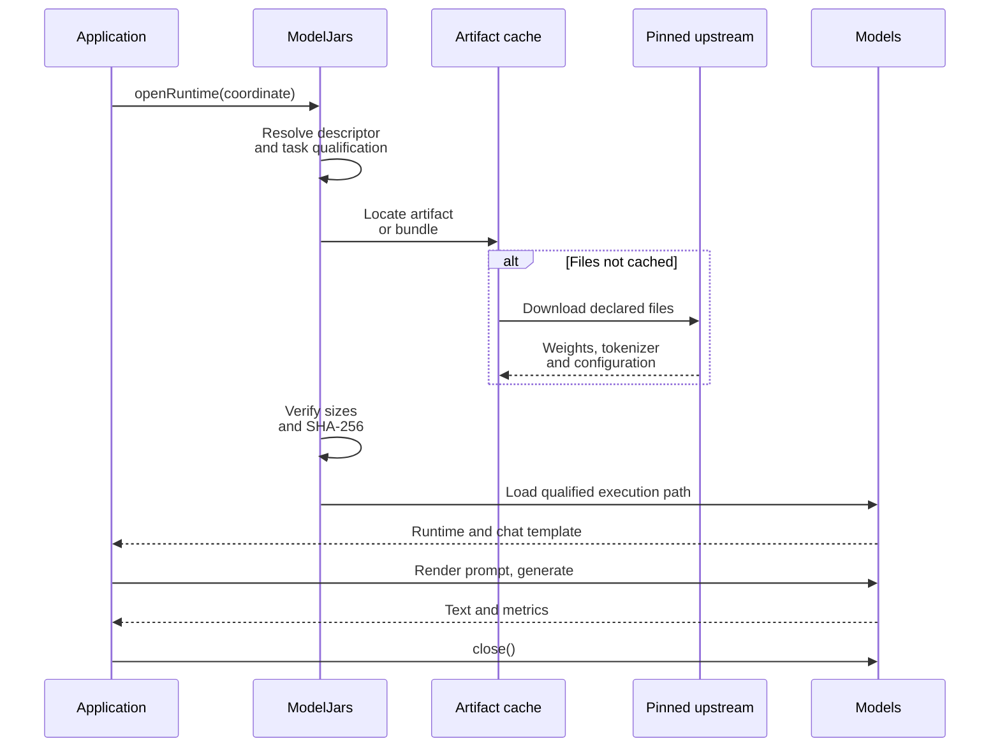
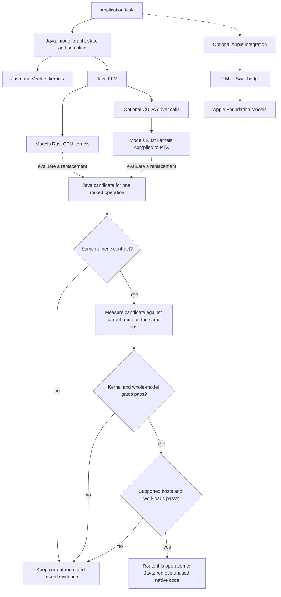
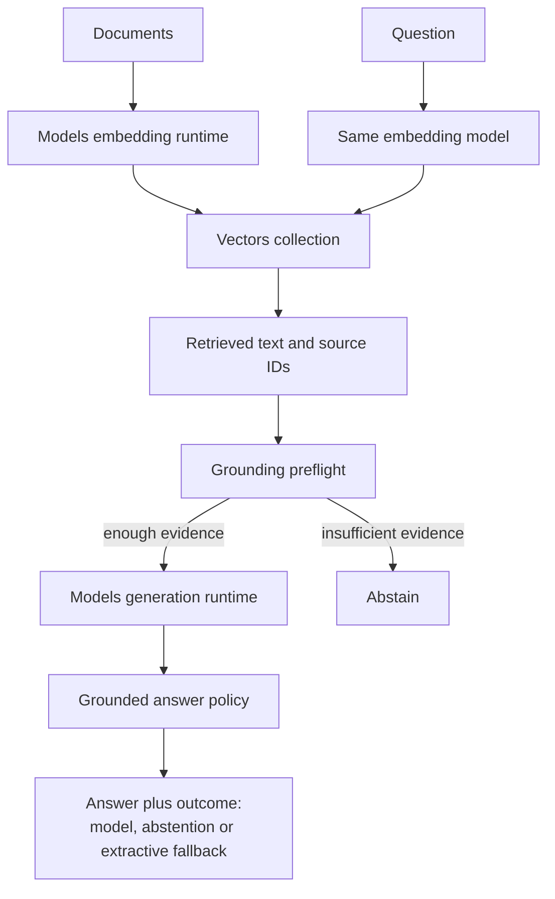

# A hundred models, one dependency, and a router that keeps most of them local

ModelJars publishes language models as Maven artifacts: you add a coordinate, and the weights arrive
through the same resolver that brings you Jackson. Models is the runtime that executes them on the
JVM. `models-router` decides, per request, which of them should answer.

This article takes one support conversation, runs it twice — once the obvious way, once routed —
and compares what each costs. Every number was printed by a script in [`code/`](code/) on the
machine named in [the run record](evidence/fleet-routing/RESULTS.md). Two figures are declared
rather than measured and are labelled where they appear: the providers' prices, and the
four-characters-per-token estimate the script uses to charge its budget.

## The conversation

One support session, ten prompts, in the order they arrive. It is a retrieval-augmented
conversation: some of the questions have to be answered out of the company's own notes rather than
out of a model's memory. Those notes are three sentences, embedded into a Vectors collection at
startup:

```
Refunds are issued to the original payment method within five business days.
A duplicate charge is reversed automatically once billing reconciliation runs nightly.
Account closures require written confirmation from the account holder.
```

The ten prompts are not ten of the same thing. They fall into six kinds, and the difference
between them is the whole point of what follows.

**Heartbeats** — `ping`, `still there?`, `ok`. A browser tab checking the session is alive. The
only correct answer is a few tokens saying so. There are three of them, and in a real deployment
there would be thousands.

**A conversation** — `I was charged twice for my September order.`, then `tell me more`. Two turns
that share a transcript; the second is meaningless without the first. Customer text, so it should
not leave the building.

**A closed decision** — `I was charged twice for my September subscription and no refund arrived.`
The question asked of it is not "write me a reply" but "is this about billing, which queue, how
urgent", each with a fixed set of answers. What is wanted is a label and a confidence, not prose.

**Two grounded questions** — `When is a refund issued, and to which payment method?` and
`What happens to a duplicate charge?` Both are answerable from the three notes above and from
nothing else. The model's job is to retrieve and quote, not to recall.

**One synthesis prompt** — a policy conflict: refunds promise five business days to the original
payment method, duplicate charges reverse automatically on the nightly reconciliation, and a
customer who is both refunded and reconciled falls between them. Work out where they disagree and
draft the paragraph that resolves it. This one genuinely needs a frontier model.

**One long-context summary** — a five-sentence appendix to be condensed into two for a handbook.
Long input, short output, no reasoning.

Six kinds of work with wildly different requirements: one needs eight tokens, one needs a calibrated
label rather than prose, two need a document store, one needs real reasoning. And seven of the ten
are things you would rather not send to a third party at all — the heartbeats because there is no
reason to, the rest because they carry a customer's words.

## Without a router

The obvious implementation is one client, one model, one loop. Send every prompt to the best model
you have and let it sort them out. Strip the token and millisecond bookkeeping — this file is also
the measurement harness — and what is left is `callOpenAi(PREMIUM, ...)` once per prompt:

<!-- snippet:fleet#baseline -->
```java
System.out.printf("%n%-46s %8s %11s %8s%n", "PROMPT", "IN", "COMPLETION", "MS");
for (var prompt : prompts()) {
  lastRemoteUsage = null;
  long began = System.nanoTime();
  var answer = callOpenAi(PREMIUM, PREMIUM_CAP, prompt.text());
  long millis = (System.nanoTime() - began) / 1_000_000;
  accounted += millis;
  if (lastRemoteUsage == null) {
    System.out.printf("%-46s   no usage reported: %s%n", abbreviate(prompt.text(), 44), answer);
    continue;
  }
  input += lastRemoteUsage.inputTokens();
  output += lastRemoteUsage.outputTokens();
  System.out.printf(
      "%-46s %8d %11d %8d%n",
      abbreviate(prompt.text(), 44),
      lastRemoteUsage.inputTokens(),
      lastRemoteUsage.outputTokens(),
      millis);
}
```
<!-- end:snippet:fleet#baseline -->

That is the whole program, and it is not a stupid choice. A frontier model will answer all ten
correctly, including the heartbeats, and there is nothing to operate: no weights, no cache, no
startup. It is what most of these applications actually look like.

## What that costs

Three columns, and it is worth being precise about them because the router's table later uses a
different ruler. **IN** and **COMPLETION** are the provider's own numbers, lifted from the `usage`
object on its response — `prompt_tokens` and `completion_tokens` for OpenAI, `input_tokens` and
`output_tokens` for Anthropic, normalised into one `RoutingUsage` by whichever client made the call.
They are what you are billed for: input is everything the model was given, completion is everything
it generated. **MS** is wall-clock latency for the call, measured around it.

```
PROMPT                                               IN  COMPLETION       MS
ping                                                  7          10     2639
still there?                                          9          22     1360
ok                                                    7          23     1129
I was charged twice for my September order.          15         411     6294
tell me more                                          9         134     1883
I was charged twice for my September subscr…         19         513     4688
When is a refund issued, and to which payme…         18         289     3437
What happens to a duplicate charge?                  13         356     3908
Our refund policy promises five business da…         61         406     5135
Summarise this appendix for the support han…         89          81     1497

== every prompt through gpt-5.1 ==
provider-reported: 247 input + 2245 completion tokens
at the declared $1.25/M in, $10.00/M out: $0.022759
conversation wall clock: 31983 ms, of which 31970 ms (100.0%) was model calls
No local weights are loaded, so there is no startup cost to amortise.
Floor, not a ceiling: the grounded prompts are sent without their retrieved notes, which a
real all-remote implementation would have to include in the input.
```

Every prompt answered correctly, in 32 seconds, for **$0.022759**.

Now look at where it went. The three heartbeats — prompts whose only correct answer is "still
here" — took 2,639 ms, 1,360 ms and 1,129 ms, because a round trip to a frontier model costs a
second whatever you ask it. The closed decision came back as 513 tokens of prose when what was
wanted was three labels. And **1,758 of the 2,245 completion tokens, 77.8% of the bill, were spent
on the eight prompts that never needed a frontier model at all.**

Nothing here is a defect. The model did exactly what it was asked. The waste is in the asking.

## Adding a router

Nothing above is wrong, exactly. It is just paying frontier prices for work that is not frontier
work, and sending customer text to a third party to do it.

`models-router` replaces the single client with a fleet and a set of rules. Three pieces: what each
kind of traffic requires, what each model is, and the fleet that binds candidates to something
callable. None of it inspects prompt text.

### Saying what each kind of traffic requires

The six requirement objects are the whole routing policy. The classifier does read the prompt — it
embeds it to name a task type — but nothing branches on what it says: no `if` over prompt text, no
keyword matching, no per-model special case. The task type feeds the quality term in scoring;
eligibility is settled by these objects alone.

<!-- snippet:fleet#requirements -->
```java
var liveness =
    RoutingRequirements.builder()
        .requireCapability("liveness")
        .dataBoundary(RoutingDataBoundary.LOCAL_ONLY)
        .build();
var chatHere =
    RoutingRequirements.builder()
        .requireCapability("chat")
        .dataBoundary(RoutingDataBoundary.LOCAL_ONLY)
        .build();
var grounded =
    RoutingRequirements.builder()
        .requireCapability("grounding")
        .dataBoundary(RoutingDataBoundary.LOCAL_ONLY)
        .build();
var decision = RoutingRequirements.builder().requireCapability("decision").build();
var synthesis = RoutingRequirements.builder().requireCapability("reasoning").build();
// No local model claims long-context, so this must go remote. Which remote is then a policy
// question among three providers rather than a vendor choice written into the code.
var longContext = RoutingRequirements.builder().requireCapability("long-context").build();
```
<!-- end:snippet:fleet#requirements -->

A liveness check wants `liveness` and must stay local. A conversation wants `chat` and must stay
local. A ticket wants `decision`. A grounded question wants `grounding` and must stay local. Only
synthesis and long-context work may leave the machine, and even then the policy picks which provider.

### Describing the local models

A candidate is a description, not a wrapper: what the model claims to do, how fast it is, how large
a prompt it takes, how good it is at each task. Most of that you do not write. ModelJars registers a
catalog provider that `CatalogDiscovery` finds through `ServiceLoader`, so every model whose marker
jar is on the classpath arrives already carrying its id, whether it is local, the context window
read from its artifact — qwen3-0.6b's GGUF says 40,960 tokens, SmolLM2's says 8,192 — and
throughput, measured on this host if it has been benchmarked and logged as a conservative estimate
if not.

<!-- snippet:fleet#locals -->
```java
// Identity, locality, the context window read from the artifact and this host's throughput all
// come from the catalog, so none of them is written here.
var catalog = new LinkedHashMap<String, ModelCandidate>();
for (var found : CatalogDiscovery.discover()) {
  catalog.put(found.id(), found);
}

// Only what a catalog cannot know: `liveness` and `grounding` are names this application
// invented, and the quality weights are its judgement. `toBuilder` keeps the rest.
//
// Tags are a second filter, separate from capabilities and active only when non-empty: a model
// tagged `chat` is refused outright for a prompt classified `summarization`. The catalog tags
// these `chat` to describe the weights; this fleet selects on capability and quality, so the
// tags are cleared.
var tiny =
    discovered(catalog, TINY_ID)
        .tags(Set.of())
        .addCapabilities("liveness")
        .quality(Map.of("chat", 0.45))
        .build();
var small =
    discovered(catalog, SMALL_ID)
        .tags(Set.of())
        .addCapabilities("summarization")
        .quality(Map.of("chat", 0.60, "summarization", 0.62))
        .build();
var grounder =
    discovered(catalog, GROUNDER_ID)
        .tags(Set.of())
        .addCapabilities("grounding")
        .quality(Map.of("chat", 0.66, "grounding", 0.70))
        .build();
// Harriet is the exception. The catalog reports the composite's base weights as a chat model,
// true of the weights and wrong about this arm: three typed questions, three forward passes, no
// generated prose. So `capabilities` replaces rather than adds -- a decision arm claiming `chat`
// would be eligible for a customer's real question -- and tokens-per-second is overridden
// because it does not describe this cost. The window carries through.
var decisions =
    discovered(catalog, HARRIET_ID)
        .tags(Set.of())
        .capabilities(Set.of("decision"))
        .tokensPerSecond(1)
        .quality(Map.of("decision", 0.90))
        .build();
```
<!-- end:snippet:fleet#locals -->

What you write is what a catalog cannot know. `liveness` and `grounding` are not properties of the
weights; they are names this application invented for jobs it has. Per-task quality is a judgement
about a fleet, not a measurement of a file. `toBuilder()` and `addCapabilities(...)`, both new in
Models 0.4.1, add those to a discovered candidate without restating the dozen components discovery
already got right. (`discovered(catalog, id)` is a small helper that looks an id up and fails
naming what *was* found, since an absent entry means a missing marker jar.)

The capability sets are the load-bearing part. Only SmolLM2 claims `liveness`, only the Llama arm
claims `grounding`, only Harriet claims `decision`. That is an operator's declaration about what
each model is allowed to serve, and the router treats it as a hard filter before any score is
compared — which keeps a liveness check off a 4B decision model without an `if` statement anywhere.

Clearing the tags is the line worth pausing on, because tags and capabilities are different axes and
only one is obvious. A capability is a hard requirement a request asks for. A **non-empty** tag set
is a *second* hard filter, on the classifier's task type: a model tagged `chat` is refused for a
prompt classified `summarization`, however good it is at summarising, while an empty tag set
disables that filter entirely. The catalog tags these models `chat` to describe the weights; this
fleet routes on capability and quality, so the tags are cleared on purpose. Leave them and
`tell me more` — the one prompt in the run above that clears the 0.60 similarity floor — matches
nothing local.

Harriet is the exception. The catalog reports the composite's base weights as an ordinary chat model
with a 262,144-token window: true of the weights, wrong about the arm, which answers three typed
questions in three forward passes and generates no prose. So its capabilities *replace* rather than
add — a decision arm claiming `chat` would be eligible for a customer's real question — and its
throughput is overridden, because tokens per second does not describe what three forward passes
cost. The context window, which really is a fact of the weights, carries through.

### Binding each candidate to something callable

`ModelFleet<T>` is generic over the client type, and this is where that earns its keep. Each
provider's closure is where its SDK would live; `models-router` never learns any of their names.

<!-- snippet:fleet#wiring -->
```java
return ModelFleet.<Responder>builder()
    .classifier(classifier)
    // BALANCED weights quality 0.40 and latency 0.15, and picks qwen3-0.6b for a customer's
    // question. LOCAL_FIRST picks it too: every local arm scores identical locality, so a 0.35
    // thumb there separates nothing between them, and the LOCAL_ONLY boundary already keeps
    // these requests on this machine. FASTEST is the policy that changes the answer -- it
    // hands ordinary chat to the 360M model on latency alone, which is the wrong trade here.
    .policy(RoutingPolicy.BALANCED)
    .model(tiny, prompt -> acknowledge(TINY, prompt))
    .model(small, prompt -> chat(SMALL, prompt, 80))
    .model(grounder, prompt -> ground(retrieval, prompt))
    .model(decisions, fleet::decide)
    // One fleet, three remote clients. Each closure is where a provider's SDK would live, so
    // models-router never learns any of their names.
    .model(premium, prompt -> callOpenAi(PREMIUM, PREMIUM_CAP, prompt))
    .model(economy, prompt -> callOpenAi(ECONOMY, ECONOMY_CAP, prompt))
    .model(haiku, prompt -> callAnthropic(HAIKU, HAIKU_CAP, prompt))
    .build();
```
<!-- end:snippet:fleet#wiring -->

Two of those closures call OpenAI with different models and ceilings. The third calls Anthropic,
which needs a different endpoint, a different auth header and a different response shape — and the
fleet does not know or care.

## What the router does

Same ten prompts, same order. **CLASSIFIED** is what the local classifier made of the prompt and how
close the match was; **SELECTED** is the model the router chose. **TOK** is deliberately not the
same measurement as `IN` above: it is the *local* qwen3-0.6b tokenizer's count of the prompt text,
the only ruler that can measure a prompt that never leaves the machine. It reads lower than a
provider's figure for the same words — `ping` is 1 token here and 7 at OpenAI — because the provider
tokenizes differently and also counts the chat envelope it wraps the message in. The two are kept
apart everywhere below: shares are quoted on the local ruler, bills on the provider's.

```
WARMING                            LOAD MS
smollm2_360m_instruct_q8_0            2249
qwen3_0_6b_q4_0                       2043
bartowski_llama_3_2_1b_instruct…      3221
unsloth_qwen3_5_4b_gguf_q4_k_m       20196
total                                27709

PROMPT                           CLASSIFIED           SELECTED                          TOK      MS
ping                             ~chat 0.48           smollm2_360m_instruct_q8_0          1     170
    still here
still there?                     ~summarization 0.50  smollm2_360m_instruct_q8_0          3     172
    still here
ok                               ~reasoning 0.57      smollm2_360m_instruct_q8_0          1     160
    still here
I was charged twice for my Se…   ~tool-use 0.46       qwen3_0_6b_q4_0                     9    4057
    We'll check the details of your order to confirm if there was any issue with the payment. Let me know how we can assist you.
tell me more                     summarization        qwen3_0_6b_q4_0                     3    2307
    Of course, let me know how we can assist you with the next steps.
I was charged twice for my Se…   ~tool-use 0.49       unsloth_qwen3_5_4b_gguf_q4_k_m     13   12620
    billing=true(p=0.91,c=0.58) queue=billing(p=0.99,c=0.95) urgency=this week(p=0.38,c=0.01)
When is a refund issued, and …   ~tool-use 0.51       bartowski_llama_3_2_1b_instruct…   12    2039
    A refund is issued to the original payment method within five business days.
What happens to a duplicate c…   ~code 0.45           bartowski_llama_3_2_1b_instruct…    7    1798
    A duplicate charge is reversed automatically once billing reconciliation runs nightly.
Our refund policy promises fi…   ~tool-use 0.52       gpt-5.1                            55    6873
    There are two processes that can affect the same charge: 1. **Refund path** - Trigger: A support rep or system issues a refund. - P…
Summarise this appendix for t…   ~summarization 0.54  claude-haiku-5-5                   84    1312
    Refunds go back to the original payment method within five business days, and account closures require written confirmation from th…
```

Six kinds of traffic, six different destinations, no `if` statement over prompt text:

**Heartbeats** (`ping`, `still there?`, `ok`) require a `liveness` capability that only the 360M
SmolLM2 declares. They are answered statelessly under an eight-token ceiling — the table shows them
spending one to three — and never enter the conversation transcript, because a liveness check is not
a conversation turn.

**The conversation** (`I was charged twice…`, then `tell me more`) requires `chat` with a
`LOCAL_ONLY` boundary, and carries a session id. The first turn picks qwen3-0.6b on quality; the
follow-up stays there because of the switch margin. `tell me more` only means anything because the
transcript is real, which is why the arm appends both sides of each turn.

**The closed decisions** go to Harriet, which answers three typed questions in three forward
passes: a boolean, a choice over three queues, and an ordered severity. Nothing is generated, so
there is no JSON to repair. Each outcome carries a written rule, and that matters: Harriet's own
javadoc records accuracy **0.8917 with a rubric against 0.7500 without**, measured 2026-09-24 over
120 JevBench items on the same model and kernel. Note that the model is confident about what the
ticket is (`p=0.99`) and openly unconfident about its urgency (`c=0.01`) — a calibrated model
declining to commit is the feature, not a defect.

**The grounded questions** require a `grounding` capability that only the Llama-3.2-1B arm declares,
and that arm does retrieval before generation. Both answers come back as one sentence drawn from
the notes.

**The synthesis prompt** requires `reasoning`, which only `gpt-5.1` declares among the three
remotes, so it is the one request that can only go there. **The appendix summary** requires
`long-context`, which no local model claims and all three remotes do, so the policy picks among
providers — and it picked Anthropic's Haiku, the cheapest and fastest of them. Both calls really
happened: those answers are the providers', and the tokens they report are what the ledger bills.

The `CLASSIFIED` column repays a second look. Only `tell me more` clears the classifier's 0.60
similarity floor, as `summarization`. The rest print their nearest task with a tilde and the
similarity that fell short — `ping` is ~chat at 0.48, `ok` is ~reasoning at 0.57, "What happens to a
duplicate charge?" is ~code at 0.45. That is `PretrainedTaskClassifier.match`, new in Models 0.3.60.
Before it, every one of those rows was a bare dash, and a prompt unlike every exemplar looked
identical to one that nearly matched. The numbers say what is really going on: an index built from
1,929 work-shaped prompts has nothing much to say about conversational filler, and it reports that
honestly instead of guessing a task and silently applying the wrong quality column.

### The bill

`IN` and `COMPLETION` are the providers' own numbers again, so this table is directly comparable
with the no-router one; `COST` is `ModelCandidate.costOf` applied to the candidate that actually
ran, at that candidate's declared prices.

```
== ledger ==
10 prompts, 2 escalated to a remote provider, 8 answered on local weights
local ruler (qwen3-0.6b tokenizer): 139 of 188 input tokens were routed off this machine (73.9%)
provider ruler (gpt-5.1 reported): 204 input + 668 completion tokens billed
  the same prompt measured 139 tokens locally, so the two rulers differ by 65
completions generated on local weights: 123 tokens
REMOTE PROVIDER            IN   COMPLETION         COST
gpt-5.1                    61          563    $0.005706
claude-haiku-5-5          143          105    $0.000067
total                     204          668    $0.005773
had every prompt gone to gpt-5.1: $0.000235 of input alone, plus $0.001230 for the completions this machine produced for nothing
router-accounted spend: $0.005773 of the $0.05 shared budget
```

Eight of ten requests never left the machine. Of the two that did, the policy conflict went to
gpt-5.1 and the appendix summary went to Haiku, and the per-provider table is where having more than
one remote stops being a design note and starts being money: **563 completion tokens on gpt-5.1 cost
$0.005706, while 105 on Haiku cost $0.000067.** Per completion token that is $10.00 against $0.50 per
million — a factor of twenty for work that did not need the expensive one. The ledger prices each
line with `ModelCandidate.costOf` on the candidate that actually ran, which is the only way this
stays right once a fleet holds several providers, and the router's own accounted spend matches the
total exactly.

Against the no-router run:

| | input | completion | cost |
| --- | --- | --- | --- |
| Every prompt through gpt-5.1 | 247 | 2,245 | **$0.022759** |
| Routed across seven models | 204 | 668 | **$0.005773** |

**74.6% less, a factor of 3.94.** Not because the prompts got shorter — input barely moved, 247
tokens to 204 — but because 1,577 completion tokens were never bought. The saving is in not paying a
frontier model to generate output that did not need generating.

### The time

One row per model: how many calls it took, the total and mean wall-clock time for them, and `SHARE`,
that model's slice of the whole conversation's wall clock.

```
== timing, warm ==
MODEL                            CALLS  TOTAL MS   MEAN MS     SHARE
smollm2_360m_instruct_q8_0           3       502       167      1.4%
qwen3_0_6b_q4_0                      2      6364      3182     17.5%
unsloth_qwen3_5_4b_gguf_q4_k_m       1     12620     12620     34.6%
bartowski_llama_3_2_1b_instruct…     2      3837      1918     10.5%
gpt-5.1                              1      6873      6873     18.9%
claude-haiku-5-5                     1      1312      1312      3.6%
conversation wall clock: 36452 ms, of which 31508 ms (86.4%) was model calls
one-off load of the four local models: 27709 ms, paid once at startup, not per request
```

**Routing did not make this conversation faster.** 36,452 ms against the no-router run's 31,983 ms
— 14% slower — and that is before the 27,709 ms of one-off model loading, which a long-lived server
amortises to nothing and a short script does not.

Per prompt, though, the picture is not uniform:

| prompt | no router | routed | |
| --- | --- | --- | --- |
| `ping` | 2,639 ms | **170 ms** | 15× faster |
| `still there?` | 1,360 ms | **172 ms** | 8× faster |
| `ok` | 1,129 ms | **160 ms** | 7× faster |
| "When is a refund issued…" | 3,437 ms | **2,039 ms** | faster |
| "What happens to a duplicate charge?" | 3,908 ms | **1,798 ms** | 2× faster |
| the closed decision | **4,688 ms** | 12,620 ms | 2.7× *slower* |
| the synthesis prompt | 5,135 ms | 6,873 ms | same model, run variance |

A heartbeat answered locally in 170 ms beats a network round trip every time; nothing a frontier
model does can be fast when the speed of light is in the way. The decision arm is the opposite
trade: Harriet is a 4B model doing three forward passes on a laptop CPU, and it loses to a hosted
frontier model by a factor of nearly three. You buy a calibrated label and local custody of the
customer's text, and you pay eight seconds for them.

So the honest summary is that routing bought **a 3.94× cost reduction and a 14% wall-clock
regression** on this conversation — and that the regression is concentrated in one arm whose job is
not speed. Turn the volume up to thousands of heartbeats, where the 15× applies and the decision arm
does not, and the arithmetic moves the other way.

Those shapes hold across runs on an unloaded machine. The absolute numbers do not survive a busy
one: at load average 39, qwen3-0.6b reports **25,163 ms** for the call it answers in 4,057 ms above.
The tell is the last line of the table. A healthy run spends 86% of its wall clock inside model
calls; the contended one spent 50.3%, which means the process was starved rather than slow. Measure
on a quiet machine, and check that share before believing a timing — a starved run still prints a
complete and plausible table.

The 28 seconds of loading above the table is paid once. Four models stay resident, which is what a
server does, and a resident fleet needs one explicit decision: each native runtime otherwise sizes
its worker pool for every logical CPU, so four pools on twelve cores oversubscribe badly. The same
prompt qwen3-0.6b answers in 1,169 ms alone took 23,946 ms beside the others until the script gave
each runtime three threads.

### Where these numbers come from

Token counts are each provider's own report or the qwen3-0.6b tokenizer's, kept apart because they
disagree — the escalated prompts measured 139 tokens locally and 204 at the providers. Shares are
quoted on the local ruler, where every prompt is measured identically, and bills on the provider's,
where they are charged.

Prices are the script's declared inputs, matching published rates from third-party trackers in
autumn 2026: $1.25/$10.00 per million for gpt-5.1, $0.40/$1.60 for gpt-4.1-mini, $0.10/$0.50 for
Haiku 5.5. Set them to your own contracts. Haiku also charges a higher rate above a 100k-token
prompt, which the script declares as `.pricingTier(100_001, 0.50, 2.50)` — new in Models 0.4.0.
Nothing here comes close to that threshold, so every figure above is the base rate; it is declared
because `RoutingBudget` charges whatever `costOf` reports, and a budget told a flat price would
overshoot by five times on a long request.

Scoring, though, still uses list price. Cost is normalised across the eligible candidates into a
0–1 term, so a rate that moved with prompt size would shift a candidate against all the others at
its own threshold and make its rank non-monotonic in request size. Accounting is where the tier has
to be exact. That split is not universal: reading the other routers on this machine rather than
their documentation, weave-os applies its tier when scoring as well as billing — it can, because it
scores on an absolute dollar estimate — while vLLM's semantic router and RouteLLM carry no tier
concept at all, and LiteLLM carries one but is a gateway, so the question does not arise.

Where prices come from divides the same field three ways. LiteLLM fetches a community-maintained
price map over HTTP at startup, validates it, and falls back to a packaged copy. weave-os keeps its
catalog in source. TensorZero and the selection routers take operator-declared values. Models is in
the last group deliberately — a startup fetch trades a network dependency and a third-party trust
boundary for freshness, which is a deployment's call, not a library's — and the cost of that is
real: a declared price goes stale silently. Citations are in
[the run record](evidence/fleet-routing/RESULTS.md).

Two caveats on the comparison itself. The no-router figure is a floor, because its grounded prompts
were sent without the retrieved notes a real implementation would have to include in the input. And
the headline percentage moves: gpt-5.1 bills its reasoning as completion tokens and does not spend
the same amount twice, so four pairs on these same prompts at these same prices came out at 74.3%,
69.4%, 78.7% and the 74.6% above. Read it as roughly **70–80%, a factor of three to five** on this
workload.

## Inside the router

`com.integrallis:models-router` ships a pretrained task classifier **inside the jar**: an index of
1,929 exemplar prompts across ten task types — chat, code, creative, extraction, math, reasoning,
sql, summarization, tool-use and translation — embedded at 768 dimensions with
`google_embeddinggemma_300m_gguf_q8_0` and stored SQ4-quantized. Both sides are embedded under the
prefix `task: classification | query: `, and the index records that prefix so callers do not have
to know the convention.

The consequence is that classification is one local forward pass on a model already in your cache.
No prompt text leaves the machine in order to decide where the prompt should go. That is the part
most routing layers get backwards.

Around the classifier sits the rest of the machinery, each piece of which earned its place in the
run above:

- **Capabilities are a hard filter.** A model is eligible only if it declares every capability the
  request requires. This is an operator's declaration, not a measurement.
- **Tags are a second, separate filter** on the classifier's task type, and only when non-empty: a
  candidate tagged `chat` is refused for a prompt classified `summarization`, while a candidate with
  no tags is never filtered on task type at all.
- **Policies** are weight vectors over cost, quality, latency, availability and locality.
  `BALANCED` weights quality 0.40 and latency 0.15; `LOCAL_FIRST` weights locality 0.35;
  `CHEAPEST`, `FASTEST`, `BEST_QUALITY` and `PRIVACY_STRICT` sit where their names suggest.
- **A data boundary** (`LOCAL_ONLY` or `REMOTE_ALLOWED`) is enforced per request.
- **A shared budget** charges each attempt from the candidate's declared prices against actual
  usage. When the budget denies an attempt, the router falls through to the next candidate — so an
  exhausted budget pushes work local rather than failing the request.
- **Sessions make routing sticky.** A request carrying a session id gives the incumbent model a
  `switch-margin` so a conversation does not hop between models on a near-tie.

A fleet binds candidates to whatever your application can call. `ModelFleet<T>` is generic over the
client type on purpose, and that is what makes **several remote providers ordinary rather than
special**. A provider is not a mode the router has to support; it is a candidate with its own
prices, its own context window, its own output ceiling, and a closure that knows how to call it.
One fleet can hold an in-process Models runtime, two different vendors' hosted APIs and a private
gateway, and `models-router` never learns any of their names or links any of their SDKs.

The fleet holds three remote providers alongside the four local models: `gpt-5.1` for work
that needs reasoning, `gpt-4.1-mini` as a cheaper stablemate, and Anthropic's `claude-haiku-5-5`
through an entirely separate endpoint, credential and response shape. Only the premium one declares
`reasoning`; all three declare `long-context`. So when a request needs a long document summarised,
which provider serves it is a policy question among three, not a vendor decision written into the
code — and each client normalises its own provider's usage into one `RoutingUsage`, which is the
only thing the ledger needs.

### Declaring the remote providers

Three of them, at two vendors. They differ in price by two orders of magnitude on output.

<!-- snippet:fleet#providers -->
```java
var premium =
    ModelCandidate.builder(PREMIUM)
        .local(false)
        .capabilities(Set.of("chat", "reasoning", "summarization", "long-context"))
        .costPerMillionTokens(PREMIUM_IN, PREMIUM_OUT)
        // New in Models 0.3.60. A reasoning model bills its reasoning as completion, so it
        // cannot share an output ceiling with a model that answers a liveness check in eight
        // tokens. The execution-wide bound stays small for the local arms.
        .maxOutputTokens(PREMIUM_CAP)
        .contextWindow(400000)
        .timeToFirstTokenMillis(850)
        .tokensPerSecond(90)
        .quality(Map.of("chat", 0.95, "reasoning", 0.96, "summarization", 0.94))
        .build();
var economy =
    ModelCandidate.builder(ECONOMY)
        .local(false)
        .capabilities(Set.of("chat", "summarization", "long-context"))
        .costPerMillionTokens(ECONOMY_IN, ECONOMY_OUT)
        .maxOutputTokens(ECONOMY_CAP)
        .contextWindow(1000000)
        .timeToFirstTokenMillis(400)
        .tokensPerSecond(140)
        .quality(Map.of("chat", 0.82, "summarization", 0.86))
        .build();
var haiku =
    ModelCandidate.builder(HAIKU)
        .local(false)
        .capabilities(Set.of("chat", "summarization", "long-context"))
        .costPerMillionTokens(HAIKU_IN, HAIKU_OUT)
        // New in Models 0.4.0. The provider's step is "over 100k", and the threshold is
        // inclusive, so it is declared one token above. Crossing it reprices the whole
        // request, output included.
        .pricingTier(100_001, HAIKU_HIGH_IN, HAIKU_HIGH_OUT)
        .maxOutputTokens(HAIKU_CAP)
        .contextWindow(200000)
        .timeToFirstTokenMillis(300)
        .tokensPerSecond(120)
        .quality(Map.of("chat", 0.80, "summarization", 0.83))
        .build();
```
<!-- end:snippet:fleet#providers -->

Only the premium model claims `reasoning`. All three claim `long-context`, so a request to
summarise a document is settled among providers on policy rather than by a vendor name written into
the code. The `maxOutputTokens` on the premium candidate matters more than it looks: a reasoning
model bills its reasoning as completion tokens, so it cannot share an output ceiling with a model
that answers a liveness check in eight tokens.

### Where a second vendor costs more than a config line

This is the part that only shows up when you actually call two providers:

<!-- snippet:fleet#anthropic -->
```java
static String callAnthropic(String model, int cap, String prompt) throws Exception {
  var key = System.getenv("ANTHROPIC_API_KEY");
  if (key == null || key.isBlank()) {
    return "[routed to " + model + "; not executed because ANTHROPIC_API_KEY is unset]";
  }
  var mapper = new ObjectMapper();
  var message = mapper.createObjectNode().put("role", "user").put("content", prompt);
  var body =
      mapper
          .createObjectNode()
          .put("model", model)
          .put("max_tokens", cap)
          .set("messages", mapper.createArrayNode().add(message));
  var request =
      HttpRequest.newBuilder(URI.create("https://api.anthropic.com/v1/messages"))
          .header("x-api-key", key)
          .header("anthropic-version", "2023-06-01")
          .header("Content-Type", "application/json")
          .timeout(Duration.ofMinutes(2))
          .POST(HttpRequest.BodyPublishers.ofString(body.toString()))
          .build();
  var response = HttpClient.newHttpClient().send(request, HttpResponse.BodyHandlers.ofString());
  JsonNode parsed = mapper.readTree(response.body());
  if (response.statusCode() != 200) {
    return "[%s returned HTTP %d: %s]"
        .formatted(
            model,
            response.statusCode(),
            parsed.path("error").path("message").asText(response.body()));
  }
  // Anthropic reports input_tokens and output_tokens where OpenAI reports prompt_ and
  // completion_. Each client normalises its own provider into one RoutingUsage.
  var usage = parsed.path("usage");
  if (usage.hasNonNull("input_tokens")) {
    lastRemoteUsage =
        new RoutingUsage(
            usage.path("input_tokens").asLong(), usage.path("output_tokens").asLong());
  }
  // Haiku 5.5 returns a thinking block first and the answer after it, so the text block has to
  // be found rather than assumed at index zero. Reading content[0] yields an empty answer that
  // then enters the ledger as a short one.
  for (JsonNode block : parsed.path("content")) {
    if ("text".equals(block.path("type").asText())) {
      return block.path("text").asText("");
    }
  }
  return "[%s returned no text block]".formatted(model);
}
```
<!-- end:snippet:fleet#anthropic -->

Anthropic reports `input_tokens` and `output_tokens` where OpenAI reports `prompt_tokens` and
`completion_tokens`, and it returns `content` as an array whose first block is `thinking` with the
answer in a later `text` block. Reading `content[0].text` yields an empty string, which then enters
the ledger as a short answer rather than as an error — it did exactly that on the first run. Each
client normalises its own provider into one `RoutingUsage`, and that is the only shape the ledger
needs to know.

### Counting what it cost, per provider

<!-- snippet:fleet#ledger -->
```java
if (!remoteSpend.isEmpty()) {
  System.out.printf("%-20s %8s %12s %12s%n", "REMOTE PROVIDER", "IN", "COMPLETION", "COST");
  var total = BigDecimal.ZERO;
  for (var entry : remoteSpend.entrySet()) {
    long[] t = remoteTokensBy.get(entry.getKey());
    total = total.add(entry.getValue());
    System.out.printf(
        "%-20s %8d %12d %12s%n",
        entry.getKey(),
        t[0],
        t[1],
        "$" + entry.getValue().setScale(6, RoundingMode.HALF_UP).toPlainString());
  }
  System.out.printf(
      "%-20s %8d %12d %12s%n",
      "total",
      remoteTokens,
      remoteCompletionTokens,
      "$" + total.setScale(6, RoundingMode.HALF_UP).toPlainString());
}
```
<!-- end:snippet:fleet#ledger -->

`costOf` belongs to the candidate that actually ran. With one remote provider that is a detail; with
three at different prices it is the difference between a ledger and a guess.

## Five things only a real run would tell you

**A decision without a rubric is a coin flip.** Harriet's yes-or-no call accepts a written rule for
each outcome, and without them the question "is this ticket about billing?" came back
`false p=0.503 confidence=0.00` on evidence any human reads at a glance. With the rules attached it
returns `true p=0.920 confidence=0.60`. Harriet's javadoc puts a number on that gap — accuracy
0.8917 with a rubric against 0.7500 without, over 120 JevBench items — and this is what it looks
like from the outside.

**A heartbeat should not get a vote on the conversation.** Sessions make the router sticky on
purpose: an incumbent model gets a `switch-margin` so a conversation does not hop mid-flight. Give
every prompt the same session id and the first heartbeat anchors the whole exchange to the 360M
model, which then handles a real customer complaint badly. Liveness checks carry no session, and
`scoreBreakdown()` is what shows you why — `switch-margin=0.05`, sitting in the numbers.

**A reasoning model does not fit a chat model's output bound.** A 512-token completion ceiling is
generous for a chat reply and far too small for a model that bills its reasoning as completion, so
the first keyed run stopped on `RoutingBudgetExceededException`. The router's own part was exact: it
refused the attempt, recorded the real cost, and named the limit it crossed. What it could not do
was hold two models to two different ceilings, because the bound belonged to the execution rather
than the candidate — and worse, a bound checked after the call discarded the completion the call had
already been billed for. Models 0.3.60 fixes both: a candidate declares its own `maxOutputTokens`,
and an overrun carries `billedResult()`, `billedUsage()` and `billedCost()` so the spend buys
something. The script declares 2,048 on the remote candidate and leaves the fleet-wide bound small
for the local arms.

**An empty set and an unset one are not the same thing.** The router's task filter reads
`taskType != null && !candidate.tags().isEmpty() && !candidate.tags().contains(taskType)`. An empty
tag set opts a candidate out of task filtering altogether; a populated one turns it into a hard
constraint. Discovery populates tags from the catalog, so a fleet that routes on capabilities has to
clear them — otherwise `tell me more`, the only prompt here that clears the similarity floor, finds
no model tagged `summarization` and the conversation dies. Nothing in a passing run tells you which
of the two states you are in, which is the argument for setting the field rather than leaving it.

**A resident fleet has to be told how to share a machine.** Four models held open, each sizing a
worker pool for all twelve cores, made qwen3-0.6b twenty times slower than it is alone. Three
threads each fixed it. This is the cost of keeping models warm, and it is worth paying — but only
once you have said how.

The run record carries all five with their numbers and the runs that produced them.

## What the catalog holds today

<!-- diagram:stack -->


<sub>[Mermaid source](diagrams/stack.mmd) · [SVG](diagrams/stack.svg) · the block below is the same diagram</sub>


<!-- end:diagram:stack -->


As of the fall of 2026 the published catalog has **103 entries** drawn from **67 upstream
repositories**, totalling 167.2 GB across the 101 that declare a size. The smallest is 13.7 MB and
the largest 16.8 GB; the median entry is 0.91 GB, which is the real centre of gravity — most of this
catalog runs on a laptop. Every figure in this section is derived by
[`tools/catalog_stats.py`](tools/catalog_stats.py) from
[the published catalog](evidence/modeljars-catalog.json), the exact body served by
`modeljars.org/catalog.json`.

Entries are not all the same kind of thing:

| Dimension | Breakdown |
| --- | --- |
| Format | 97 GGUF, 3 safetensors, 2 composite, 1 CACT |
| Capability | 67 chat and text-generation, 31 text-embedding and semantic-search, 9 code-completion, 7 reasoning, 3 tool-calling, 2 each reranking, text-to-speech and math |
| Architecture | 21 distinct families: qwen2 (21), llama (20), bert (16), qwen3 (8), qwen35 (7), nomic-bert (6), gemma3 and lfm2 (4 each), gemma4 (3), granite and soprano (2 each) |
| Quantization | 14 schemes, led by Q4_K_M (49), Q8_0 (13), Q4_0 (7) and F16 (6) |
| Domain | general (54), retrieval (34), embeddings (31), coding (10), reasoning (7), then legal, healthcare, finance, speech and mathematics in twos and threes |
| License | 77 Apache-2.0, 6 Gemma, 5 MIT, 5 Llama-3.2, 4 LFM-1.0, and 6 single-model terms including one non-commercial |

Qualification is tracked per entry and per task, not as a single badge: 65 entries carry RAG
qualifications, 31 carry embedding qualifications, 29 have a performance profile measured on
specific hardware, 3 carry tool qualifications and 2 carry speech. 

### The models people actually pull

Popularity is not something the catalog invents; it comes from upstream. These are the catalog's
busiest upstream repositories by HuggingFace 30-day downloads, read from the HuggingFace API on
2026-10-16 and committed as [a snapshot](evidence/huggingface-downloads.json), because a
download count is a moving number and quoting one without saying when it was read is quoting
nothing. Across the 65 repositories that report counts, the total is 17,441,805 downloads in thirty
days.

| Upstream repository | 30-day downloads | Catalog entry |
| --- | --- | --- |
| Qwen/Qwen2.5-0.5B-Instruct | 5,973,624 | `qwen_qwen2_5_0_5b_instruct_bf16` |
| deepreinforce-ai/Ornith-1.0-9B-GGUF | 2,324,254 | `deepreinforce_ai_ornith_1_0_9b_gguf_q4_k_m` |
| unsloth/gemma-4-12b-it-GGUF | 1,615,593 | `unsloth_gemma_4_12b_it_gguf_q4_k_m` |
| unsloth/Qwen3.5-4B-GGUF | 1,228,761 | `unsloth_qwen3_5_4b_gguf_q4_k_m` |
| mixedbread-ai/mxbai-rerank-xsmall-v1 | 681,103 | `mixedbread_ai_mxbai_rerank_xsmall_v1_f16` |
| Qwen/Qwen3-8B-GGUF | 581,959 | `qwen3_8b_q4_k_m` |
| bartowski/Meta-Llama-3.1-8B-Instruct-GGUF | 499,927 | `llama_3_1_8b_instruct_q4_k_m` |

Two of the 67 report no count, and neither is a HuggingFace repository: the first-party
compositions `org.modeljars.composite:harriet` and `org.modeljars.composite:granite-answerability`
carry `modeljars://` source ids, exist only here, and so have no upstream history to count. They are
the catalog's own contributions rather than republished weights.

Just outside that table, ninth by downloads, sits `ggml-org/embeddinggemma-300M-GGUF` at 373,740
pulls. It is a 334 MB embedding model, and it is also the model the router's task classifier runs
on — which is where this turns from a catalog into a system. The
router's position in that system is the part worth looking at: it takes its classifier index from
Vectors and its chat types from Models, it does not depend on ModelJars at all, and ModelJars
reaches it the other way round, by registering a catalog provider that the router finds through
`ServiceLoader`.

## How a model gets from a coordinate to a forward pass

Two diagrams for the parts underneath. Opening a model is resolution, verification and mapping:

<!-- diagram:loading -->


<sub>[Mermaid source](diagrams/loading.mmd) · [SVG](diagrams/loading.svg) · the block below is the same diagram</sub>


<!-- end:diagram:loading -->

And the boundary between Java and the native kernels, which is where the arithmetic that matters
actually runs:

<!-- diagram:native-boundary -->


<sub>[Mermaid source](diagrams/native-boundary.mmd) · [SVG](diagrams/native-boundary.svg) · the block below is the same diagram</sub>


<!-- end:diagram:native-boundary -->

Retrieval, which the grounded arm above performs before it generates, is the third:

<!-- diagram:rag -->


<sub>[Mermaid source](diagrams/rag.mmd) · [SVG](diagrams/rag.svg) · the block below is the same diagram</sub>


<!-- end:diagram:rag -->

## The rest of the walkthrough

Every script below runs on ModelJars 0.1.60, Models 0.4.1 and Vectors 0.1.30, all released and
verified on Maven Central — the local copies were deleted first so resolution had to come from
Central. All fourteen completed on 2026-10-16; outcomes are in
[the run record](evidence/fleet-routing/RESULTS.md).

| Script | What it shows |
| --- | --- |
| [`chat.java`](code/chat.java) | A GGUF chat model end to end, with load, prefill and decode timings |
| [`safetensors.java`](code/safetensors.java) | The same API over a BF16 safetensors bundle |
| [`embed.java`](code/embed.java) | A 1,024-dimensional embedding |
| [`gemma.java`](code/gemma.java) | EmbeddingGemma under the publisher's own prefix recipe |
| [`rerank.java`](code/rerank.java) | Cross-encoder reranking, correct ordering by score |
| [`rag.java`](code/rag.java) | Retrieval with a grounding policy that can abstain |
| [`tools.java`](code/tools.java) | A model proposing tool calls that the JVM executes |
| [`composite.java`](code/composite.java) | A composition sharing a physical KV prefix, 182 tokens |
| [`decisions.java`](code/decisions.java) | Typed, calibrated decisions with no generation |
| [`speech.java`](code/speech.java) | Text to a 32 kHz wav, RTF 1.378 on this run |
| [`spring.java`](code/spring.java) | The same model behind a Spring AI `ChatModel` |
| [`route.java`](code/route.java) | Discovery from the classpath, selection only, no weights needed |
| [`bonsai.java`](code/bonsai.java) | A verified 5.95 GB PTQ1_0 artifact |
| [`fleet.java`](code/fleet.java) | The routing fleet and ledger from the top of this article |

Run them with Java 25 and JBang from [`code/`](code/README.md). Discovery is driven by the
classpath: a marker jar carries its model's descriptor, so `CatalogDiscovery` reports the model and
its context window without the weights being present — measured here by hiding both the cached GGUF
and the local registry, which changed nothing. Weights are fetched when a runtime is opened, not
when a model is discovered, which is why `route.java` can select between models it has never run.

## What this adds up to

A catalog is only interesting if you can choose from it, and choosing by hand does not scale past
about three models. The router turns 103 entries into a fleet you can state the rules for: what each
model is allowed to serve, which traffic may leave the machine, what you are willing to spend, and
how much better an alternative must be before a conversation switches models mid-flight. Then it
tells you which rule fired, in numbers, for every request.

Most of the traffic in the run above never needed a frontier model. Eight of ten requests never
left the machine, two did, and exactly one of those needed a reasoning model — which it got. That is
the whole argument.
