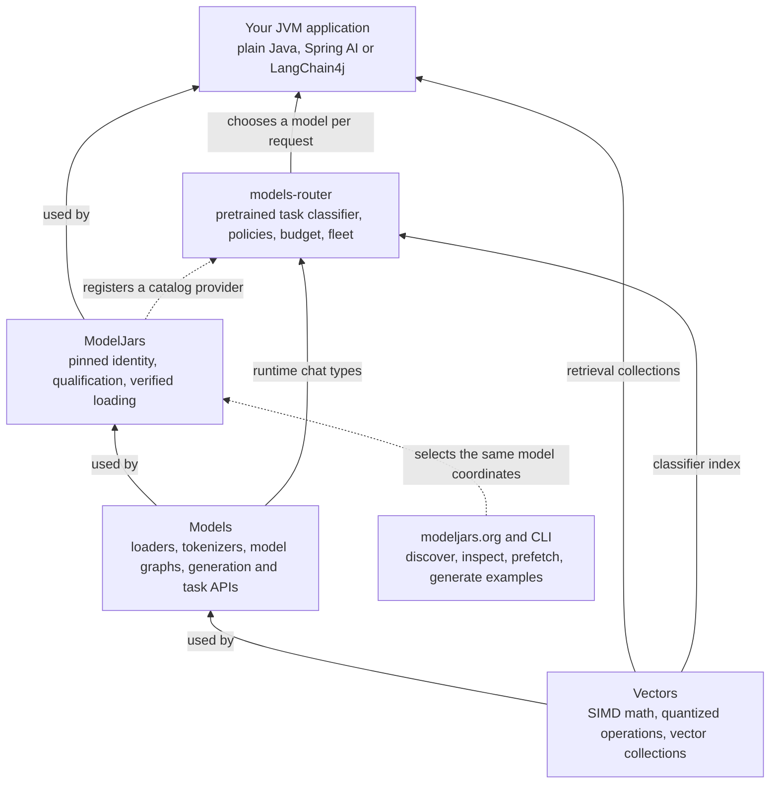
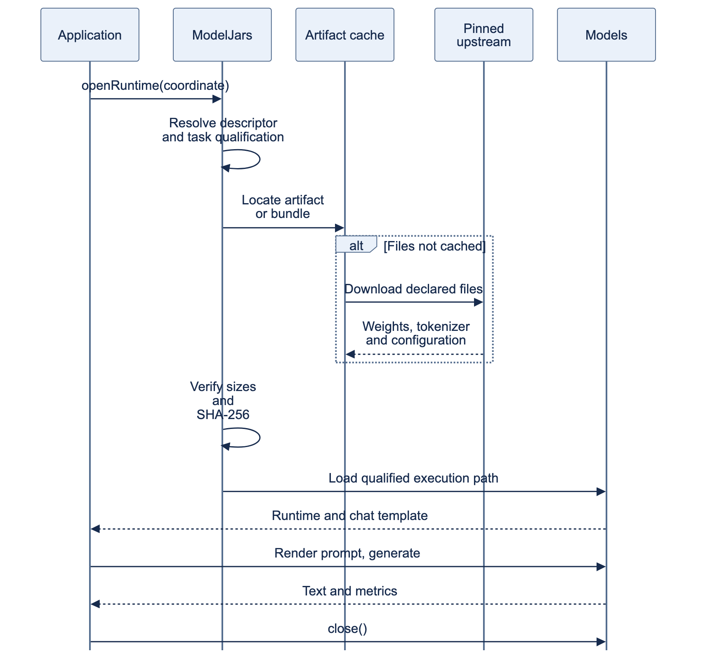
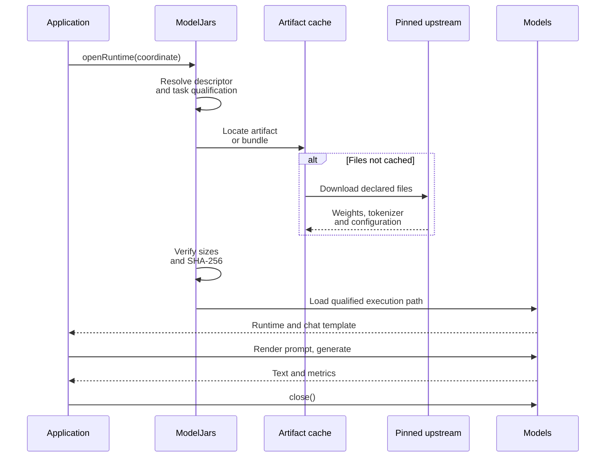
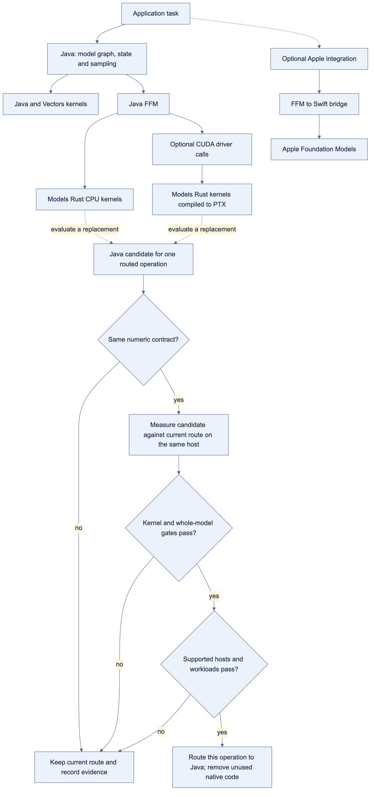
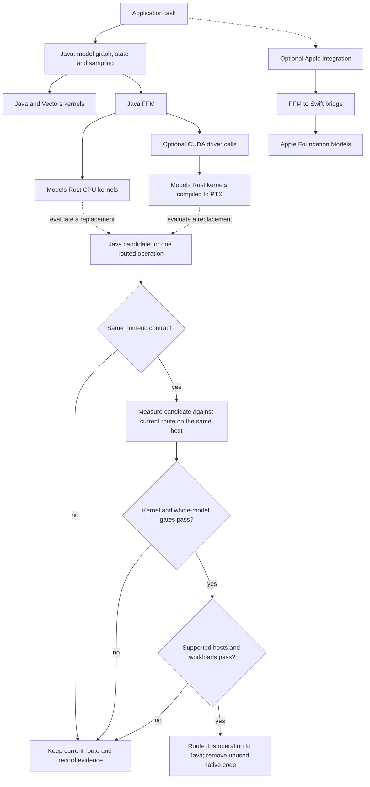
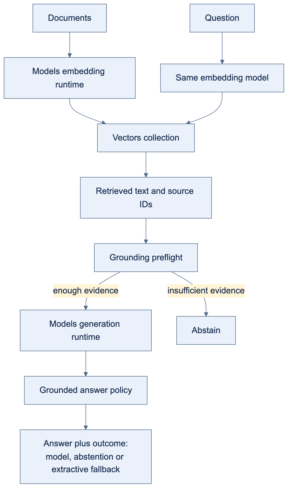
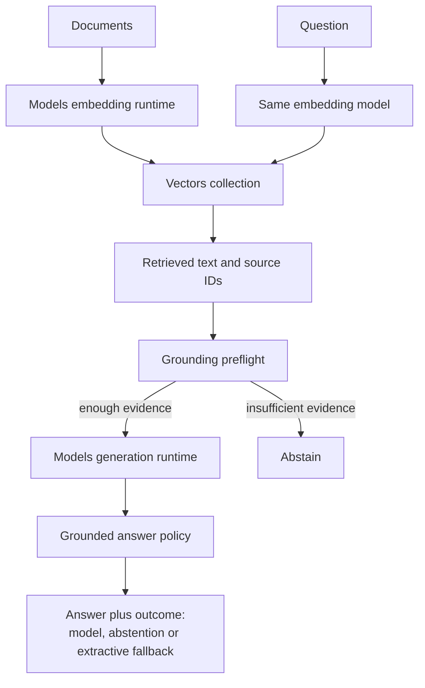

# A hundred models, one dependency, and a router that keeps most of them local

ModelJars publishes language models as Maven artifacts: you add a coordinate, and the weights arrive
through the same resolver that brings you Jackson. Models is the runtime that executes them on the
JVM. `models-router` decides, per request, which of them should answer.

This article takes one support conversation, runs it twice — once the obvious way, once routed —
and compares what each costs. Then it does the harder half: it scores whether the local models can
actually do the work the fleet hands them, on public datasets, against the frontier model the
routed arm is trying to avoid. That second measurement rejected every one of this fleet's four
quality claims — one arm now escalates what it is unsure about, one was replaced by a model eight
times its size, one claim was narrowed to what the evidence covers and one was deleted outright —
which is why the fleet in the code below is not the fleet this article started with.

Every number was printed by a script in [`code/`](code/) on the machine named in
[the run record](evidence/fleet-routing/RESULTS.md), or scored by one of the experiments in
[`experiments/`](experiments/) from raw rows committed beside it — four of the five have results
the article quotes, and the fifth is a frozen protocol with a baseline and no finding yet. Two
figures are declared rather than measured and are labelled where they appear: the providers' prices,
and the four-characters-per-token estimate the script uses to charge its budget.

## The conversation

One support session, ten prompts, in the order they arrive. It is a retrieval-augmented
conversation: some of the questions have to be answered out of the company's own notes rather than
out of a model's memory. Those notes are three sentences, embedded into a Vectors collection at
startup:

```
Refunds are issued to the original payment method within five business days.
A duplicate charge is reversed automatically once billing reconciliation runs nightly.
Account closures require written confirmation from the account holder.
```

The ten prompts are not ten of the same thing. They fall into six kinds, and the difference
between them is the whole point of what follows.

**Heartbeats** — `ping`, `still there?`, `ok`. A browser tab checking the session is alive. The
only correct answer is a few tokens saying so. There are three of them, and in a real deployment
there would be thousands.

**A conversation** — `I was charged twice for my September order.`, then `tell me more`. Two turns
that share a transcript; the second is meaningless without the first. Customer text, so it should
not leave the building.

**A closed decision** — `I was charged twice for my September subscription and no refund arrived.`
The question asked of it is not "write me a reply" but "is this about billing, which queue, how
urgent", each with a fixed set of answers. What is wanted is a label and a confidence, not prose.

**Two grounded questions** — `When is a refund issued, and to which payment method?` and
`What happens to a duplicate charge?` Both are answerable from the three notes above and from
nothing else. The model's job is to retrieve and quote, not to recall.

**One synthesis prompt** — a policy conflict: refunds promise five business days to the original
payment method, duplicate charges reverse automatically on the nightly reconciliation, and a
customer who is both refunded and reconciled falls between them. Work out where they disagree and
draft the paragraph that resolves it. This one genuinely needs a frontier model.

**One long-document summary** — a billing appendix of 2,500 consolidated clauses, **245,741
tokens** by the local tokenizer, to be condensed into two sentences for a handbook. Long input,
short output, no reasoning. The size is the point: it is larger than any local model in this fleet
can hold, and larger than one of the three remote providers can hold either.

Six kinds of work with wildly different requirements: one needs eight tokens, one needs a calibrated
label rather than prose, two need a document store, one needs real reasoning. And seven of the ten
are things you would rather not send to a third party at all — the heartbeats because there is no
reason to, the rest because they carry a customer's words.

## Without a router

The obvious implementation is one client, one model, one loop. Send every prompt to the best model
you have and let it sort them out. Strip the token and millisecond bookkeeping — this file is also
the measurement harness — and what is left is `callOpenAi(PREMIUM, ...)` once per prompt:

<!-- snippet:fleet#baseline -->
```java
System.out.printf("%n%-46s %8s %8s %8s%n", "PROMPT", "IN", "OUT", "MS");
for (var prompt : prompts()) {
  lastRemoteUsage = null;
  long began = System.nanoTime();
  var grounded = resolve(retrieval, prompt);
  if (grounded == null) {
    // The same refusal, in the arm that has no router. Sending the question anyway would make
    // this arm look better by answering something the other arm declined to answer, which is
    // not a difference between the arms but a difference in what they were asked.
    System.out.printf("%-46s %8s %8s %8s%n", abbreviate(prompt.text(), 44), "-", "-", "-");
    continue;
  }
  var answer = callOpenAi(PREMIUM, PREMIUM_CAP, grounded);
  long millis = (System.nanoTime() - began) / 1_000_000;
  accounted += millis;
  if (lastRemoteUsage == null) {
    System.out.printf("%-46s   no usage reported: %s%n", abbreviate(prompt.text(), 44), answer);
    continue;
  }
  input += lastRemoteUsage.inputTokens();
  output += lastRemoteUsage.outputTokens();
  System.out.printf(
      "%-46s %8d %8d %8d%n",
      abbreviate(prompt.text(), 44),
      lastRemoteUsage.inputTokens(),
      lastRemoteUsage.outputTokens(),
      millis);
}
```
<!-- end:snippet:fleet#baseline -->

That is the whole program, and it is not a stupid choice. A frontier model will answer all ten
correctly, including the heartbeats, and there is nothing to operate: no weights, no cache, no
startup. It is what most of these applications actually look like.

## What that costs

`IN` and `OUT` are the provider's own token counts, straight off the `usage` object on its
response. `MS` is latency.

```
PROMPT                                               IN      OUT       MS
ping                                                  7       10     1712
still there?                                          9       26     1095
ok                                                    7       19     1001
I was charged twice for my September order.          15      562     8633
tell me more                                          9       95     2068
I was charged twice for my September subscr…         19      700     8545
When is a refund issued, and to which payme…        162       28     1839
What happens to a duplicate charge?                 157       27     1352
Our refund policy promises five business da…         61      459     7848
Summarise this appendix for the support han…     236534       89    16063

== every prompt through gpt-5.1 ==
provider-reported: 236980 input + 2015 completion tokens
at the declared $1.25/M in, $10.00/M out: $0.316375
conversation wall clock: 50171 ms, of which 50156 ms (100.0%) was model calls
No local weights are loaded, so there is no startup cost to amortise.
Retrieval ran for the grounded prompts here exactly as it does in the routed arm, so both
arms sent byte-identical text and the comparison is like for like.
```

<!-- figures:baseline -->
Every prompt answered, in 50 seconds, for **$0.316375**.

Two things in that table do the damage. The appendix is **236,534 input tokens**, and at the declared rate that one prompt is **$0.295668** — 93% of the bill, paid to a frontier model to compress a document into two sentences. And the 3 heartbeats, whose only correct answer is "still here", took 1,001 ms, 1,095 ms, 1,712 ms, because a network round trip costs most of a second whatever you ask for.
<!-- end:figures:baseline -->

Nothing here is a defect. The model did exactly what it was asked, and did it well. The waste is in
the asking: one request needed a 236k-token window, and the claim this article has to earn is that
the others did not need a frontier model at all. Earning it takes more than a cost table — it takes
scoring the local answers against this same model on public data, which is what the accuracy
section does. It replaced one of the arms below outright, put a confidence gate on another, and
removed a third from the fleet, all before this article was finished.

## Adding a router

Nothing above is wrong, exactly. It is just paying frontier prices for work that is not frontier
work, and sending customer text to a third party to do it.

`models-router` replaces the single client with a fleet and a set of rules. Three pieces: what each
kind of traffic requires, what each model is, and the fleet that binds candidates to something
callable. None of it inspects prompt text.

### Saying what each kind of traffic requires

The six requirement objects are the whole routing policy. The classifier does read the prompt — it
embeds it to name a task type — but nothing branches on what it says: no `if` over prompt text, no
keyword matching, no per-model special case. The task type feeds the quality term in scoring;
eligibility is settled by these objects alone.

<!-- snippet:fleet#requirements -->
```java
var liveness =
    RoutingRequirements.builder()
        .requireCapability("liveness")
        .dataBoundary(RoutingDataBoundary.LOCAL_ONLY)
        .build();
var chatHere =
    RoutingRequirements.builder()
        .requireCapability("chat")
        .dataBoundary(RoutingDataBoundary.LOCAL_ONLY)
        .build();
var grounded =
    RoutingRequirements.builder()
        .requireCapability("grounding-single-passage")
        .dataBoundary(RoutingDataBoundary.LOCAL_ONLY)
        .build();
var decision = RoutingRequirements.builder().requireCapability("decision").build();
var synthesis = RoutingRequirements.builder().requireCapability("reasoning").build();
// Nothing here says "go remote". The appendix is larger than any local arm's context window,
// so ModelRouter.eligible rules them out on `contextWindow < estimatedTokens` and only the
// three remotes are left. Which of them serves it is a policy question, not a vendor decision
// written into the code.
var longDocument = RoutingRequirements.builder().requireCapability("summarization").build();
```
<!-- end:snippet:fleet#requirements -->

A liveness check wants `liveness` and must stay local. A conversation wants `chat` and must stay
local. A ticket wants `decision`. A grounded question wants `grounding-single-passage` and must stay
local -- the narrow name is itself a measured result, and the accuracy section below is where it got
narrowed. Only the synthesis prompt and the long document may leave the machine, and even then the
policy picks which provider.

### Describing the local models

A candidate is a description, not a wrapper: what the model claims to do, how fast it is, how large
a prompt it takes, how good it is at each task. Most of that you do not write. ModelJars registers a
catalog provider that `CatalogDiscovery` finds through `ServiceLoader`, so every model whose marker
model already on disk arrives carrying its id, whether it is local, the context window read from
its artifact — qwen3-0.6b's GGUF says 40,960 tokens, SmolLM2's says 8,192 — and
throughput, measured on this host if it has been benchmarked and logged as a conservative estimate
if not.

<!-- snippet:fleet#locals -->
```java
// Identity, locality, the context window read from the artifact and this host's throughput all
// come from the catalog, so none of them is written here.
var catalog = new LinkedHashMap<String, ModelCandidate>();
for (var found : CatalogDiscovery.discover()) {
  catalog.put(found.id(), found);
}

// Only what a catalog cannot know: `liveness` and `grounding-single-passage` are names this
// application invented, because they describe how this application intends to use a model
// rather than a property of the weights. `toBuilder` keeps everything the catalog measured.
//
// No quality numbers are declared here, and that is the point. This fleet used to carry four
// of them -- chat 0.45, chat 0.60, grounding 0.70, decision 0.90 -- typed in by hand because
// the router scored an unmeasured candidate zero and an honest fleet therefore never routed
// locally. MEASURED 2026-10-20 against gpt-5.1 on four public datasets, those numbers were
// optimistic by 16 to 35 points, and the 0.70 contradicted this catalog's own evidence for the
// artifact it described: that entry is GUARDED_RAG with a model-only correctness of 0.111, and
// this fleet was generating unguarded.
//
// Models 0.5.x made declaring nothing the honest option: an unmeasured task scores a neutral
// prior rather than a zero, so absence no longer loses by default, and `withMinimumQuality`
// refuses an unmeasured candidate outright instead of pretending it scored zero. 0.5.0 put
// that prior under a second breakdown key and 0.5.2 removed it again, so `scoreBreakdown()`
// has the keys it had in 0.4.3 and the distinction between "nobody measured this" and
// "measured zero" lives in `ModelCandidate.measuredQualityFor`, which is typed. What the
// catalog measures, the router gets. What nobody measured, nobody claims.
//
// Tags are a second filter, separate from capabilities and active only when non-empty: a model
// tagged `chat` is refused outright for a prompt classified `summarization`. The catalog tags
// these `chat` to describe the weights; this fleet selects on capability and quality, so the
// tags are cleared.
// `capabilities`, not `addCapabilities`: replace what the catalog describes rather than add to
// it. The catalog calls these weights a chat model, which is true of the weights and wrong
// about this arm's job. Adding `liveness` to `chat` leaves a 360M model eligible for a
// customer's billing complaint, and with the invented quality numbers deleted nothing else
// separated it from the 0.6B arm: both scored the neutral prior, the tie fell to latency, and
// the smallest model won. It answered "I was charged twice for my September order." with
// "still here".
//
// That was always the declaration this fleet meant to make -- the prose beside the decision
// arm has said so since it was written -- and an invented 0.45 was quietly covering for it.
// A capability is an application saying what a model is allowed to serve. A quality score is a
// claim that it serves it well. Only the first belongs in this file.
var tiny =
    discovered(catalog, TINY_ID)
        .tags(Set.of())
        .capabilities(Set.of("liveness"))
        .build();
// The 0.6B arm is gone from the fleet and still loaded, and both halves of that are
// deliberate.
//
// Gone, because it was measured. MEASURED 2026-10-20 on CoQA and QuAC, 100 items each
// (experiments/local-only-chat): it scores 14.7 and 27.1 token F1 where the 8B arm scores 82.2
// and 48.1 and gpt-5.1 scores 83.9 and 49.0 -- and it gets there by answering "I don't know"
// to **62 and 72 of its 100 items**. An arm that declines two thirds of what it is asked is
// not a cheap chat arm, it is an outage with a low latency, and the limp replies in this
// article's own run record were it standing one notch away from refusing. `summarization` went
// the same way earlier for a different reason: the router never once acted on it, because the
// only summarization prompt here is larger than every local context window.
//
// Still loaded, because its tokenizer is the ruler every token count in this article is
// measured with -- the "local ruler" column and the share of input routed off the machine.
// Swapping rulers would renumber figures that have nothing to do with which arm answers. It
// declares no capability, so `ModelRouter.eligible` can never select it, and it appears below
// only in the warm-up and in LOCAL_IDS, which count what is loaded rather than what can serve.
// `grounding-single-passage`, not `grounding`, and the narrower name is the result of a
// measurement rather than a way around one.
//
// MEASURED 2026-10-20 at n=100 per dataset (experiments/grounding-arm-selection): on SQuAD v2
// -- one short passage, half the questions unanswerable -- this arm scores 79.0 exact match
// against gpt-5.1's 70.0. On HotpotQA -- ten paragraphs, two hops, nothing unanswerable -- it
// scores 31.0 against 60.0, and 6.0 points *behind* the 1B arm it replaced, because it
// declines 33 of 100 questions that do have answers. No local arm in this catalog is within 23
// points of the frontier model on that dataset, and the two datasets disagree about which
// local arm is better, so `grounding` as a whole is a claim nothing here can carry. That null
// is published rather than worked around.
//
// What this fleet actually asks for is the narrower thing: `buildRetrieval` indexes three
// one-sentence notes and `resolve` retrieves the top two, so a grounded prompt here is one
// short passage and never a multi-hop join over ten. The declaration says that, the gate maps
// the narrow name to the dataset that measures it and still holds the broad name to both, and a
// deployment whose retrieval returns ten paragraphs must not reuse this declaration.
// One arm, two capabilities, both measured against gpt-5.1 on public data and neither of them
// the broad claim the name might suggest. `chat` here is conversational question answering --
// CoQA and QuAC, where this arm is 1.6 and 0.9 points off gpt-5.1, inside the two points this
// project requires -- and not tone, instruction following or multi-turn task completion, which
// nothing here measures. `grounding-single-passage` is the narrow name the grounding evidence
// supports; see the comment on GROUNDER above for why the broad one was dropped.
var grounder =
    discovered(catalog, GROUNDER_ID)
        .tags(Set.of())
        .capabilities(Set.of("grounding-single-passage", "chat"))
        .build();
// Harriet is the exception. The catalog reports the composite's base weights as a chat model,
// true of the weights and wrong about this arm: three typed questions, three forward passes, no
// generated prose. So `capabilities` replaces rather than adds -- a decision arm claiming `chat`
// would be eligible for a customer's real question -- and tokens-per-second is overridden
// because it does not describe this cost. The window carries through.
var decisions =
    discovered(catalog, HARRIET_ID)
        .tags(Set.of())
        .capabilities(Set.of("decision"))
        .tokensPerSecond(1)
        .build();
```
<!-- end:snippet:fleet#locals -->

What you write is what a catalog cannot know. `liveness` and `grounding-single-passage` are not
properties of the weights; they are names this application invented for jobs it has. Per-task
quality is a judgement about a fleet, not a measurement of a file. `toBuilder()` and
`addCapabilities(...)`, both new in Models 0.4.1, add those to a discovered candidate without
restating the dozen components discovery already got right. (`discovered(catalog, id)` is a small
helper that looks an id up and fails naming what *was* found, since an absent entry means a missing
marker jar.)

The capability sets are the load-bearing part. Only SmolLM2 claims `liveness`, only Harriet claims
`decision`, and only the Llama arm claims `grounding-single-passage` and `chat`. That is an
operator's declaration about what each model is allowed to serve, and the router treats it as a hard
filter before any score is compared — which keeps a liveness check off a 4B decision model without
an `if` statement anywhere.

Clearing the tags is the line worth pausing on, because tags and capabilities are different axes and
only one is obvious. A capability is a hard requirement a request asks for. A **non-empty** tag set
is a *second* hard filter, on the classifier's task type: a model tagged `chat` is refused for a
prompt classified `summarization`, however good it is at summarising, while an empty tag set
disables that filter entirely. The catalog tags these models `chat` to describe the weights; this
fleet routes on capability and quality, so the tags are cleared on purpose. Leave them and
`tell me more` — the one prompt in the run above that clears the 0.60 similarity floor — matches
nothing local.

Harriet is the exception. The catalog reports the composite's base weights as an ordinary chat model
with a 262,144-token window: true of the weights, wrong about the arm, which answers three typed
questions in three forward passes and generates no prose. So its capabilities *replace* rather than
add — a decision arm claiming `chat` would be eligible for a customer's real question — and its
throughput is overridden, because tokens per second does not describe what three forward passes
cost. The context window, which really is a fact of the weights, carries through.

### Binding each candidate to something callable

`ModelFleet<T>` is generic over the client type, and this is where that earns its keep. Each
provider's closure is where its SDK would live; `models-router` never learns any of their names.

<!-- snippet:fleet#wiring -->
```java
return ModelFleet.<Responder>builder()
    .classifier(classifier)
    // The policy no longer decides who answers a customer's question, and that is a result
    // rather than a simplification. `chat` is declared by one arm because it is the only one
    // measured able to serve it: the 0.6B that used to hold the declaration answered "I don't
    // know" to 62 of 100 CoQA items. BALANCED, LOCAL_FIRST and BEST_QUALITY therefore all pick
    // the same arm here. FASTEST would still change the answer -- it would hand a billing
    // complaint to the 360M liveness arm on latency alone -- which is why `liveness` is a
    // capability of its own rather than a faster flavour of `chat`.
    .policy(policy)
    .model(tiny, prompt -> acknowledge(TINY, prompt))
    .model(grounder, fleet::ground)
    .model(decisions, fleet::decide)
    // One fleet, three remote clients. Each closure is where a provider's SDK would live, so
    // models-router never learns any of their names.
    .model(premium, prompt -> callOpenAi(PREMIUM, PREMIUM_CAP, prompt))
    .model(economy, prompt -> callOpenAi(ECONOMY, ECONOMY_CAP, prompt))
    .model(haiku, prompt -> callAnthropic(HAIKU, HAIKU_CAP, prompt))
    .build();
```
<!-- end:snippet:fleet#wiring -->

Two of those closures call OpenAI with different models and ceilings. The third calls Anthropic,
which needs a different endpoint, a different auth header and a different response shape — and the
fleet does not know or care.

## What the router does

Same ten prompts, same order. `CLASSIFIED` is the local classifier's nearest task and its
similarity, `SELECTED` the model chosen. `LOCAL IN` is the qwen3-0.6b tokenizer's count — the only
ruler available for a prompt that never leaves the machine, and a lower one: `ping` is 1 token
locally and 7 at OpenAI, which tokenizes differently and also bills the chat envelope.

```
WARMING                            LOAD MS
smollm2_360m_instruct_q8_0            2252
qwen3_0_6b_q4_0                       3765
llama_3_1_8b_instruct_q4_k_m         19131
unsloth_qwen3_5_4b_gguf_q4_k_m       19651
total                                44799

PROMPT                           CLASSIFIED           SELECTED                          LOCAL IN      MS
ping                             ~chat 0.48           smollm2_360m_instruct_q8_0               1     196
    still here
still there?                     ~summarization 0.50  smollm2_360m_instruct_q8_0               3     190
    still here
ok                               ~reasoning 0.57      smollm2_360m_instruct_q8_0               1     170
    still here
I was charged twice for my Se…   ~tool-use 0.46       llama_3_1_8b_instruct_q4_k_m             9   34771
    That can be frustrating and confusing. I'd be happy to help you try to resolve the issue. Can you please provide more details about…
tell me more                     summarization        llama_3_1_8b_instruct_q4_k_m             3   13778
    I didn't tell you anything yet. This conversation just started. What would you like to talk about? I can share some interesting fac…
I was charged twice for my Se…   ~tool-use 0.49       unsloth_qwen3_5_4b_gguf_q4_k_m          13   15635
    billing=true(escalated, local was true c=0.58) queue=billing(p=0.99,c=0.95) urgency=today(escalated, local was this week c=0.01)
When is a refund issued, and …   ~summarization 0.48  llama_3_1_8b_instruct_q4_k_m           153   27570
    Refunds are issued to the original payment method within five business days. [note-0] [note-1]
    grounding policy: MODEL_ANSWER
What happens to a duplicate c…   ~summarization 0.50  llama_3_1_8b_instruct_q4_k_m           148   13637
    A duplicate charge is reversed automatically once billing reconciliation runs nightly. [note-1] [note-0]
    grounding policy: MODEL_ANSWER
Our refund policy promises fi…   ~tool-use 0.52       gpt-5.1                                 55    5338
    Here’s where the conflict happens and a paragraph you can drop into your terms. **Where they conflict** - Path A (Refund policy): Y…
Summarise this appendix for t…   summarization        gpt-4.1-mini                        245741    6071
    Refunds are issued to the original payment method within five business days unless the charge has already been reconciled during th…
```

Six kinds of traffic, six different destinations, no `if` statement over prompt text:

**Heartbeats** (`ping`, `still there?`, `ok`) require a `liveness` capability that only the 360M
SmolLM2 declares. They are answered statelessly under an eight-token ceiling — the table shows them
spending one to three — and never enter the conversation transcript, because a liveness check is not
a conversation turn.

**The conversation** (`I was charged twice…`, then `tell me more`) requires `chat` with a
`LOCAL_ONLY` boundary, and carries a session id. Both turns go to the Llama-3.1-8B arm, which is the
only arm that declares `chat` — the 0.6B that used to hold that declaration lost it to a
measurement, and the accuracy section below is where that happened. The session's switch margin
keeps the follow-up on the incumbent, and `tell me more` only means anything because the transcript
is real, which is why the arm appends both sides of each turn.

**The closed decisions** go to Harriet, which answers three typed questions in three forward
passes: a boolean, a choice over three queues, and an ordered severity. Nothing is generated
locally, so there is no JSON to repair. Each outcome carries a written rule, and that matters:
Harriet's own javadoc records accuracy **0.8917 with a rubric against 0.7500 without**, measured
2026-09-24 over 120 JevBench items on the same model and kernel.

The confidences are the reason that row reads the way it does. Harriet is sure what the ticket is
about (`queue=billing` at `p=0.99`, `c=0.95`) and openly unsure how urgent it is (`c=0.01`) — a
model declining to commit is the feature, not a defect, and it is what makes the next step possible.
The fleet ships a confidence gate on by default, so the two answers below 0.6 were re-asked of
`gpt-5.1` and the one above it was not: the row prints `escalated, local was …` for each one that
left, next to what the local arm had said. That default is why this prompt is one of the three that
sent text off the machine, and the escalation measurement that justifies it is in the accuracy
section below — along with what a fourth experiment found when it audited that confidence instead
of trusting it.

**The grounded questions** require a `grounding-single-passage` capability that only the
Llama-3.1-8B arm declares, and that arm does retrieval before generation. The name is narrow because
the measurement was: the broad `grounding` claim is one no arm in this catalog could carry, which is
the subject of the accuracy section below. Both answers come back as one sentence drawn from the
notes, and that arm used to be a 1B model for the same reason the name changed.

**The synthesis prompt** requires `reasoning`, which only `gpt-5.1` declares among the three
remotes, so it is the one request that can only go there. **The appendix summary** asks for nothing
special at all — plain `summarization`, which no local arm declares and all three remotes do. It
would leave the machine on its size alone in any case: at 245,741 tokens it does not fit any local
context window, so `ModelRouter.eligible` would rule every local arm out on
`contextWindow < estimatedTokens` even if one of them claimed the capability. One of them used to,
and the section on accuracy below is why it no longer does: a declaration the router could never
act on is a claim with nothing behind it. Which remote it picked is the whole of the bill below. Both
escalations really happened: those answers are the providers', and the tokens they report are what
the ledger bills.

The `CLASSIFIED` column repays a second look. Only `tell me more` clears the classifier's 0.60
similarity floor, as `summarization`. The rest print their nearest task with a tilde and the
similarity that fell short — `ping` is ~chat at 0.48, `ok` is ~reasoning at 0.57, "What happens to a
duplicate charge?" is ~code at 0.45. That is `PretrainedTaskClassifier.match`, new in Models 0.3.60.
Before it, every one of those rows was a bare dash, and a prompt unlike every exemplar looked
identical to one that nearly matched. The numbers say what is really going on: an index built from
1,929 work-shaped prompts has nothing much to say about conversational filler, and it reports that
honestly instead of guessing a task and silently applying the wrong quality column.

### The bill

`COST` is `ModelCandidate.costOf` on the candidate that actually ran, at that candidate's prices.

```
== ledger ==
10 prompts, 2 routed to a remote provider, 8 answered on local weights
7 of 10 prompts sent no text off this machine; 3 did, 1 of them while a local arm answered
the decision arm escalated 2 of its questions below confidence 0.6, and those calls are in the ledger below
local ruler (qwen3-0.6b tokenizer): 245809 of 246127 input tokens were routed off this machine (99.9%)
provider ruler (gpt-5.1 reported): 236694 input + 598 completion tokens billed
  the same prompt measured 245809 tokens locally, so the two rulers differ by -9115
completions generated on local weights: 236 tokens
REMOTE PROVIDER            IN      OUT         COST
gpt-5.1                   159      521    $0.005409
gpt-4.1-mini           236535       77    $0.094737
total                  236694      598    $0.100146
had every prompt gone to gpt-5.1: $0.307659 of input alone, plus $0.002360 for the completions this machine produced for nothing
router-accounted spend: $0.099823 of the $0.50 shared budget
```

<!-- figures:cost -->
7 of the 10 prompts sent no text off this machine. The 2 the router sent to a provider did not go to the same one: *Our refund policy promises five business da…* to gpt-5.1, *Summarise this appendix for the support han…* to gpt-4.1-mini — and that second choice is most of the story. A further prompt left while a local arm answered: the decision arm escalated 2 of its questions below confidence 0.6.

| | input tokens | completion tokens | cost |
| --- | --- | --- | --- |
| Every prompt through gpt-5.1 | 236,980 | 2,015 | **$0.316375** |
| Routed across the fleet | 236,694 | 598 | **$0.100146** |

**68.3% less, a factor of 3.16.** Note where it does *not* come from. The 8 prompts answered locally would have cost $0.015151 on gpt-5.1 — **4.8%** of the bill. Keeping them local is almost free either way.

The saving is one decision: the same 236,535-token document cost **$0.094737** at gpt-4.1-mini's declared rate instead of **$0.296439** at gpt-5.1's. Both providers can hold it; one costs 3.1 times less to read it.
<!-- end:figures:cost -->

That is what having more than one remote buys, and it only works if the ledger prices each line
with `ModelCandidate.costOf` on the candidate that actually ran — which is why the router's
accounted spend matches the total exactly.

On this workload the small prompts are a rounding error and the big one is the bill. On a workload
of ten thousand heartbeats it would be the other way around. The router does not need to know which
you have.

### The time

`SHARE` is each model's slice of the conversation's wall clock.

```
== timing, warm ==
MODEL                            CALLS  TOTAL MS   MEAN MS     SHARE
smollm2_360m_instruct_q8_0           3       556       185      0.4%
llama_3_1_8b_instruct_q4_k_m         4     89756     22439     71.8%
unsloth_qwen3_5_4b_gguf_q4_k_m       1     15635     15635     12.5%
gpt-5.1                              1      5338      5338      4.3%
gpt-4.1-mini                         1      6071      6071      4.9%
conversation wall clock: 125040 ms, of which 117356 ms (93.9%) was model calls
one-off load of the 4 local models: 44799 ms, paid once at startup, not per request
```

Per prompt, with each arm's own wall clock:

<!-- figures:per-prompt -->
| prompt | no router | routed | | destination |
| --- | --- | --- | --- | --- |
| ping | 1,712 ms | **196 ms** | 8.7× faster | local |
| still there? | 1,095 ms | **190 ms** | 5.8× faster | local |
| ok | 1,001 ms | **170 ms** | 5.9× faster | local |
| I was charged twice for my September order. | **8,633 ms** | 34,771 ms | 4.0× *slower* | local |
| tell me more | **2,068 ms** | 13,778 ms | 6.7× *slower* | local |
| I was charged twice for my September subscr… | **8,545 ms** | 15,635 ms | 1.8× *slower* | local |
| When is a refund issued, and to which payme… | **1,839 ms** | 27,570 ms | 15.0× *slower* | local |
| What happens to a duplicate charge? | **1,352 ms** | 13,637 ms | 10.1× *slower* | local |
| Our refund policy promises five business da… | 7,848 ms | **5,338 ms** | 1.5× faster | gpt-5.1 |
| Summarise this appendix for the support han… | 16,063 ms | **6,071 ms** | 2.6× faster | gpt-4.1-mini |

One row holds across all 3 archived pairs: a heartbeat is answered locally **5.5× to 10.4× faster** than a network round trip can answer it at all. Nothing a hosted model does is quick when the speed of light is in the way, and in a real deployment this row is most of the traffic.

The rest of the table is one afternoon: **2 of the 10 prompts** changed which arm was faster between pairs, so the per-prompt ordering is not a property of the fleet either. What is stable is where each prompt went and what it cost, which is what the policy actually decides.
<!-- end:figures:per-prompt -->

Where a prompt went was the policy's decision, and the two prompts the router sent off-machine were
sent for price, not for speed: the appendix to gpt-4.1-mini because it reads a long document for a
third of gpt-5.1's rate, and the synthesis prompt to gpt-5.1 because it is the only remote that
declares `reasoning`. The closed decision went the other way, to a 4B model on this laptop's CPU,
because the text is a customer's — and then that arm's own confidence gate sent the two questions it
was unsure about to gpt-5.1 anyway, which is a second decision, taken inside the arm rather than by
the router, and the one place in this fleet where local-first and accuracy actually conflict. Change
the weights and you change the first decision — `FASTEST` would have kept the appendix on gpt-5.1
and the decision off Harriet, at roughly three times the price. The router does not decide which you
want. It makes the trade explicit, prices both sides, and lets the policy pick.

#### The ratio between the arms is mostly a statement about the provider

Run the same pair again and the headline ratio moves, on code that has not changed:

<!-- figures:variance -->
| run (UTC) | routed | no router | latency ratio | cost factor |
| --- | --- | --- | --- | --- |
| `20261021T053512Z` | 134,244 ms | 43,861 ms | 3.06× | 3.13× cheaper |
| `20261021T053908Z` | 137,880 ms | 26,918 ms | 5.12× | 3.12× cheaper |
| `20261021T054341Z` | 125,040 ms | 50,171 ms | 2.49× | 3.16× cheaper |

Across **3 measured pairs** — same code, same prompts, same machine, all archived under [`evidence/fleet-routing/runs/`](evidence/fleet-routing/runs) — the latency ratio moved from **2.49× to 5.12×** (median 3.06×) while the cost factor moved from **3.12× to 3.16×**. One of those is a property of the fleet; the other is a property of the provider's queue on the day. Which is which:

- the no-router arm's wall clock ranged over **1.86×** (26,918 ms to 50,171 ms)
- the routed arm's remote portion ranged over **1.96×** (19,093 ms to 37,493 ms)
- the routed arm's local portion ranged over **1.06×** (100,387 ms to 105,947 ms)
- the appendix prompt alone, byte for byte identical every run, came back in 4,040 ms at best and 17,640 ms at worst — **4.37×** on one call to one provider
<!-- end:figures:variance -->

The local arm is the stable one. Four models on this laptop's CPU answer in nearly the same time
every run, because nothing is competing for them and no queue stands in front of them. The hosted
calls are the opposite, and the last bullet is worth isolating: that is one prompt, one provider,
identical input. Sent repeatedly on purpose by
[`appendix-providers`](evidence/fleet-routing/appendix-providers.log):

<!-- figures:provider-latency -->
| provider | n | fastest | median | slowest | spread | cost of the same input |
| --- | --- | --- | --- | --- | --- | --- |
| gpt-5.1 | 5 | 2,224 ms | 2,705 ms | 3,436 ms | **1.5×** | $0.296568 to $0.296678 |
| gpt-4.1-mini | 5 | 1,869 ms | 1,920 ms | 2,644 ms | **1.4×** | $0.094737 to $0.094740 |

The same prompt, the same declared model, 5 calls each: latency spread **1.4× to 1.5×**, while the bill moved in the sixth decimal place — the few completion tokens the model chose to emit. A hosted model's price is something you can quote. Its latency is something you can only sample, and this article says how many times it was sampled wherever it quotes one.
<!-- end:figures:provider-latency -->

The no-router arm is made entirely of calls like that.

So the honest claim is not "routing is faster" and not "routing is slower" — on this mix it has
landed on both sides of parity across runs. It is that routing moves most of the conversation onto
hardware whose latency you can measure once and then rely on, and prices the part that stays
remote. The cost factor above is the number that holds still; the latency ratio is the number that
depends on somebody else's afternoon. Quote a single pair of wall clocks for an API arm and you are
quoting that afternoon.

None of these numbers survive a busy machine, which is why each pair is gated before it is kept:
at load average 39, qwen3-0.6b reported **25,163 ms** for a call it answers in about 3,000 ms quiet.
The share of wall clock spent inside model calls is a weaker tell than it looks — a contended run
once reported 96.1% while every per-call figure was inflated eight-fold, because contention slows
the calls themselves rather than descheduling the process between them. So acceptance is decided
after the run, on a known model's mean against its quiet baseline, and a pair that drifts is thrown
away. Each kept pair carries its load readings beside it in
[`runs/`](evidence/fleet-routing/runs).

The model loading reported above the table is paid once. Four models then stay resident, which is
what a server does, and each native runtime sizes its worker pool for every logical CPU unless told
otherwise — four pools on twelve cores. Measured on this host by
[`oversubscription.java`](code/oversubscription.java), that costs less than it sounds: the same
prompt takes **3,152 ms** with qwen3-0.6b alone and **3,749 ms** with three other runtimes resident,
a factor of 1.2. Capping each runtime at three threads did not improve it — 3,584 ms and 3,827 ms,
and slower on its own. The script still sets the cap; that measurement does not justify it, and the
figure is published as it came out.

What changed since is that one of the four resident models is now an 8B, which makes the cap matter
in a way it did not when the largest was a 4B composite: three threads is a third of this host and
the 8B's two grounded answers are the longest local calls in the run. Whether lifting the cap helps
is a question for the load-gated harness that keeps these pairs, not for an ad-hoc run on a laptop
that is also compiling — three unguarded runs of the same configuration came out at 81, 97 and 111
seconds of wall clock here, which is exactly the spread the gate exists to reject. It is written
down as an open question rather than answered with the worse instrument.

### Where these numbers come from

<!-- figures:rulers -->
Token counts are each provider's own report or the qwen3-0.6b tokenizer's, kept apart because they disagree about the same bytes. On the local ruler **245,809 of 246,127** input tokens left this machine (99.9%); the providers billed **236,694** for exactly that text, a gap of **9,115 tokens** (3.7%). The direction is the safe one: the local ruler counts more than the providers bill, so a budget planned on it overestimates rather than under. Shares are quoted on the local ruler, where every prompt is measured identically, and bills on the provider's, where they are charged.
<!-- end:figures:rulers -->

Prices are the script's declared inputs, matching published rates from third-party trackers in
autumn 2026: $1.25/$10.00 per million for gpt-5.1, $0.40/$1.60 for gpt-4.1-mini, $0.10/$0.50 for
Haiku 5.5. Set them to your own contracts. Haiku also charges a higher rate above a 100k-token
prompt, which the script declares as `.pricingTier(100_001, 0.50, 2.50)` — new in Models 0.4.0.
Nothing here comes close to that threshold, so every figure above is the base rate; it is declared
because `RoutingBudget` charges whatever `costOf` reports, and a budget told a flat price would
overshoot by five times on a long request.

Scoring, though, still uses list price. Cost is normalised across the eligible candidates into a
0–1 term, so a rate that moved with prompt size would shift a candidate against all the others at
its own threshold and make its rank non-monotonic in request size. Accounting is where the tier has
to be exact. That split is not universal: reading the other routers on this machine rather than
their documentation, weave-os applies its tier when scoring as well as billing — it can, because it
scores on an absolute dollar estimate — while vLLM's semantic router and RouteLLM carry no tier
concept at all, and LiteLLM carries one but is a gateway, so the question does not arise.

Where prices come from divides the same field three ways. LiteLLM fetches a community-maintained
price map over HTTP at startup, validates it, and falls back to a packaged copy. weave-os keeps its
catalog in source. TensorZero and the selection routers take operator-declared values. Models is in
the last group deliberately — a startup fetch trades a network dependency and a third-party trust
boundary for freshness, which is a deployment's call, not a library's — and the cost of that is
real: a declared price goes stale silently. Citations are in
[the run record](evidence/fleet-routing/RESULTS.md).

<!-- figures:saving-spread -->
One thing about the comparison itself. The headline percentage moves between runs, because gpt-5.1 bills its reasoning as completion tokens and does not spend the same amount twice. Across the three archived pairs on this pin it came out at **67.9% to 68.3%** — a factor of **3.12× to 3.16×**. Read it as roughly **68%, a factor of three**, and expect it to move with how much reasoning the provider decides to bill.
<!-- end:figures:saving-spread -->

Both arms send byte-identical text, retrieval included, so the input side is a like-for-like
measurement rather than an estimate.

## Inside the router

`com.integrallis:models-router` ships a pretrained task classifier **inside the jar**: an index of
1,929 exemplar prompts across ten task types — chat, code, creative, extraction, math, reasoning,
sql, summarization, tool-use and translation — embedded at 768 dimensions with
`google_embeddinggemma_300m_gguf_q8_0` and stored SQ4-quantized. Both sides are embedded under the
prefix `task: classification | query: `, and the index records that prefix so callers do not have
to know the convention.

The consequence is that classification is one local forward pass on a model already in your cache.
No prompt text leaves the machine in order to decide where the prompt should go. That is the part
most routing layers get backwards.

Around the classifier sits the rest of the machinery, each piece of which earned its place in the
run above:

- **Capabilities are a hard filter.** A model is eligible only if it declares every capability the
  request requires. This is an operator's declaration, not a measurement — the router has no way to
  know whether the model can do what you said it can, and this fleet declared four things it could
  not. What closed that is a build gate over the declarations, not a library feature; it is the
  second half of the accuracy section.
- **Tags are a second, separate filter** on the classifier's task type, and only when non-empty: a
  candidate tagged `chat` is refused for a prompt classified `summarization`, while a candidate with
  no tags is never filtered on task type at all.
- **Policies** are weight vectors over cost, quality, latency, availability and locality.
  `BALANCED` weights quality 0.40 and latency 0.15; `LOCAL_FIRST` weights locality 0.35;
  `CHEAPEST`, `FASTEST`, `BEST_QUALITY` and `PRIVACY_STRICT` sit where their names suggest.
- **A data boundary** (`LOCAL_ONLY` or `REMOTE_ALLOWED`) is enforced per request.
- **A shared budget** charges each attempt from the candidate's declared prices against actual
  usage. When the budget denies an attempt, the router falls through to the next candidate — so an
  exhausted budget pushes work local rather than failing the request.
- **Sessions make routing sticky.** A request carrying a session id gives the incumbent model a
  `switch-margin` so a conversation does not hop between models on a near-tie.

A fleet binds candidates to whatever your application can call. `ModelFleet<T>` is generic over the
client type on purpose, and that is what makes **several remote providers ordinary rather than
special**. A provider is not a mode the router has to support; it is a candidate with its own
prices, its own context window, its own output ceiling, and a closure that knows how to call it.
One fleet can hold an in-process Models runtime, two different vendors' hosted APIs and a private
gateway, and `models-router` never learns any of their names or links any of their SDKs.

<!-- figures:remotes -->
The fleet holds three remote providers alongside its local arms, at two vendors, through two endpoints, two credentials and two response shapes. Only `gpt-5.1` declares `reasoning`, which is why the synthesis prompt has exactly one place it can go. The rest of the line-up is settled by the windows they declare — 272,000 for `gpt-5.1`, 1,000,000 for `gpt-4.1-mini`, 200,000 for `claude-haiku-5-5` — against a prompt of 245,741 tokens: two of them can take it, and `claude-haiku-5-5` cannot, at 200,000. Which of the two serves it is then a policy question rather than a vendor decision written into the code, and each client normalises its own provider's usage into one `RoutingUsage`, which is the only thing the ledger needs.
<!-- end:figures:remotes -->

### Declaring the remote providers

<!-- figures:price-spread -->
Three of them, at two vendors, declared at rates that span **12x on input** ($1.25 for `gpt-5.1` against $0.10 for `claude-haiku-5-5`) and **20x on output** ($10.00 against $0.50), per million tokens.
<!-- end:figures:price-spread -->

<!-- snippet:fleet#providers -->
```java
var premium =
    ModelCandidate.builder(PREMIUM)
        .local(false)
        .capabilities(Set.of("chat", "reasoning", "summarization"))
        .costPerMillionTokens(PREMIUM_IN, PREMIUM_OUT)
        // New in Models 0.3.60. A reasoning model bills its reasoning as completion, so it
        // cannot share an output ceiling with a model that answers a liveness check in eight
        // tokens. The execution-wide bound stays small for the local arms.
        .maxOutputTokens(PREMIUM_CAP)
        // New in Models 0.4.3, and the mirror of maxOutputTokens. The fleet-wide input bound
        // has to stay small, because the execution takes input + output as the context every
        // request must fit: raise it and a one-token liveness check demands a window no local
        // model has. So the ceiling belongs on the candidate that can honour it.
        // 272,000, not the 400,000 a tracker lists. The provider is the authority and it
        // says so in its own refusal: "Input tokens exceed the configured limit of 272000
        // tokens. Your messages resulted in 284034 tokens." A declared window that is too
        // generous does not fail at routing time; it fails at the provider, after the
        // request was built and sent.
        .maxInputTokens(272_000)
        .contextWindow(272000)
        // Measured from this machine by code/provider_speed.java, five streamed samples per
        // model, medians: evidence/fleet-routing/provider-speed.log. A candidate must declare
        // both figures and no provider publishes either, so the only alternatives were to
        // measure them or to guess -- and the guesses that stood here, 850 ms and 90 tok/s,
        // were wrong in both directions and had the decode ordering of the three remotes
        // backwards.
        //
        // No quality is declared. These are hosted models with no qualification in any catalog
        // on this machine, and the scores that stood here (chat 0.95, reasoning 0.96,
        // summarization 0.94) were this application's opinion of a vendor's marketing. What
        // was measured on 2026-10-20 covers grounded answering and closed decisions, not chat,
        // reasoning or summarization, so it does not transfer to these labels either.
        .timeToFirstTokenMillis(1049)
        .tokensPerSecond(136.9)
        .build();
var economy =
    ModelCandidate.builder(ECONOMY)
        .local(false)
        .capabilities(Set.of("chat", "summarization"))
        .costPerMillionTokens(ECONOMY_IN, ECONOMY_OUT)
        .maxOutputTokens(ECONOMY_CAP)
        .maxInputTokens(1_000_000)
        .contextWindow(1000000)
        .timeToFirstTokenMillis(886)
        .tokensPerSecond(104.4)
        .build();
var haiku =
    ModelCandidate.builder(HAIKU)
        .local(false)
        .capabilities(Set.of("chat", "summarization"))
        .costPerMillionTokens(HAIKU_IN, HAIKU_OUT)
        // New in Models 0.4.0. The provider's step is "over 100k", and the threshold is
        // inclusive, so it is declared one token above. Crossing it reprices the whole
        // request, output included.
        .pricingTier(100_001, HAIKU_HIGH_IN, HAIKU_HIGH_OUT)
        .maxOutputTokens(HAIKU_CAP)
        .maxInputTokens(200_000)
        .contextWindow(200000)
        .timeToFirstTokenMillis(780)
        .tokensPerSecond(230.2)
        .build();
```
<!-- end:snippet:fleet#providers -->

Only the premium model claims `reasoning`. None of them claims anything about document length,
because length is not a capability — it is a number, and the router already filters on it. What the
three declare instead are their real context windows, 200k to 1M, and their own
`maxInputTokens`/`maxOutputTokens` ceilings.

Both ceilings matter more than they look, for the same reason: one fleet-wide pair cannot describe a
mixed fleet. A reasoning model bills its reasoning as completion tokens, so it cannot share an
output ceiling with a model that answers a liveness check in eight tokens. And a provider that
accepts a 245,741-token prompt cannot share an input ceiling with an 8,192-token local model —
`maxInputTokens` is new in Models 0.4.3 for exactly that, and the section on what the run cost
explains what went wrong without it.

### Where a second vendor costs more than a config line

This is the part that only shows up when you declare a second vendor:

<!-- snippet:fleet#anthropic -->
```java
static String callAnthropic(String model, int cap, String prompt) throws Exception {
  var key = System.getenv("ANTHROPIC_API_KEY");
  if (key == null || key.isBlank()) {
    return "[routed to " + model + "; not executed because ANTHROPIC_API_KEY is unset]";
  }
  var mapper = new ObjectMapper();
  var message = mapper.createObjectNode().put("role", "user").put("content", prompt);
  var body =
      mapper
          .createObjectNode()
          .put("model", model)
          .put("max_tokens", cap)
          .set("messages", mapper.createArrayNode().add(message));
  var request =
      HttpRequest.newBuilder(URI.create("https://api.anthropic.com/v1/messages"))
          .header("x-api-key", key)
          .header("anthropic-version", "2023-06-01")
          .header("Content-Type", "application/json")
          .timeout(Duration.ofMinutes(2))
          .POST(HttpRequest.BodyPublishers.ofString(body.toString()))
          .build();
  var response = HttpClient.newHttpClient().send(request, HttpResponse.BodyHandlers.ofString());
  JsonNode parsed = mapper.readTree(response.body());
  if (response.statusCode() != 200) {
    return "[%s returned HTTP %d: %s]"
        .formatted(
            model,
            response.statusCode(),
            parsed.path("error").path("message").asText(response.body()));
  }
  // Anthropic reports input_tokens and output_tokens where OpenAI reports prompt_ and
  // completion_. Each client normalises its own provider into one RoutingUsage.
  var usage = parsed.path("usage");
  if (usage.hasNonNull("input_tokens")) {
    lastRemoteUsage =
        new RoutingUsage(
            usage.path("input_tokens").asLong(), usage.path("output_tokens").asLong());
  }
  // Haiku 5.5 returns a thinking block first and the answer after it, so the text block has to
  // be found rather than assumed at index zero. Reading content[0] yields an empty answer that
  // then enters the ledger as a short one.
  for (JsonNode block : parsed.path("content")) {
    if ("text".equals(block.path("type").asText())) {
      return block.path("text").asText("");
    }
  }
  return "[%s returned no text block]".formatted(model);
}
```
<!-- end:snippet:fleet#anthropic -->

That unset-key branch is not hypothetical here. In the three archived pairs this article quotes,
`ANTHROPIC_API_KEY` was absent — each pair's `.meta` records `provider keys present: openai` — so
Haiku was declared, carried its own prices and context window through eligibility, and was never
called. On this mix it could not have been, for two different reasons and neither of them the
missing key: the synthesis prompt requires `reasoning`, which Haiku does not declare, and the
appendix requires `summarization`, which it does — but at 245,741 tokens the appendix is outside its
200,000-token window. The decision arm's escalations are not routed at all; they go to the frontier
model the fleet names for them. A declared provider that no prompt in a given workload can reach is
still worth declaring, and is worth saying out loud rather than leaving a reader to assume three
vendors were exercised.

Anthropic reports `input_tokens` and `output_tokens` where OpenAI reports `prompt_tokens` and
`completion_tokens`, and it returns `content` as an array whose first block is `thinking` with the
answer in a later `text` block. Reading `content[0].text` yields an empty string, which then enters
the ledger as a short answer rather than as an error — it did exactly that on the first run. Each
client normalises its own provider into one `RoutingUsage`, and that is the only shape the ledger
needs to know.

### Counting what it cost, per provider

<!-- snippet:fleet#ledger -->
```java
if (!remoteSpend.isEmpty()) {
  System.out.printf("%-20s %8s %8s %12s%n", "REMOTE PROVIDER", "IN", "OUT", "COST");
  var total = BigDecimal.ZERO;
  for (var entry : remoteSpend.entrySet()) {
    long[] t = remoteTokensBy.get(entry.getKey());
    total = total.add(entry.getValue());
    System.out.printf(
        "%-20s %8d %8d %12s%n",
        entry.getKey(),
        t[0],
        t[1],
        "$" + entry.getValue().setScale(6, RoundingMode.HALF_UP).toPlainString());
  }
  System.out.printf(
      "%-20s %8d %8d %12s%n",
      "total",
      remoteTokens,
      remoteCompletionTokens,
      "$" + total.setScale(6, RoundingMode.HALF_UP).toPlainString());
}
```
<!-- end:snippet:fleet#ledger -->

`costOf` belongs to the candidate that actually ran. With one remote provider that is a detail; with
three at different prices it is the difference between a ledger and a guess.

## Six things only a real run would tell you

**A decision without a rubric is a coin flip, and the library now refuses to make one.** Harriet's
yes-or-no call takes a written rule for each outcome. An earlier version of
[`decisions.java`](code/decisions.java) left them out and the question "is this ticket about
billing?" came back `false` at zero confidence on evidence any human reads at a glance. This
article quoted that run's exact probability for a while, which it should not have: the run was
never kept, and its only trace was a sentence in another document saying what it had said. The
figure is gone from here for that reason. What replaced it is better, because it reproduces — run
today with `-Ddecisions.rubrics=false`, the current library does not produce a bad answer at all;
it declines to build the answer space:

```
the library refuses a rubric-less answer space:
java.lang.IllegalArgumentException: criterion for false must not be blank
```

With the rules attached, the same three questions on the same ticket come back
`true p=0.920 confidence=0.60`, `billing p=0.991 confidence=0.95` and
`today p=0.389 confidence=0.02`, reproduced on the current pins by the flag's other setting and
kept in [`evidence/decisions-rubrics/`](evidence/decisions-rubrics/). Harriet's javadoc puts a
number on what a rubric is worth: accuracy 0.8917 with one against 0.7500 without, over 120
JevBench items. That number is the library's, read rather than re-measured here, and labelled as
such.

**A heartbeat should not get a vote on the conversation.** Sessions make the router sticky on
purpose: an incumbent model gets a `switch-margin` so a conversation does not hop mid-flight. Give
every prompt the same session id and the first heartbeat anchors the whole exchange to the 360M
model, which then handles a real customer complaint badly. Liveness checks carry no session, and
`scoreBreakdown()` is what shows you why — `switch-margin=0.05`, sitting in the numbers.

**A reasoning model does not fit a chat model's output bound.** A 512-token completion ceiling is
generous for a chat reply and far too small for a model that bills its reasoning as completion, so
the first keyed run stopped on `RoutingBudgetExceededException`. The router's own part was exact: it
refused the attempt, recorded the real cost, and named the limit it crossed. What it could not do
was hold two models to two different ceilings, because the bound belonged to the execution rather
than the candidate — and worse, a bound checked after the call discarded the completion the call had
already been billed for. Models 0.3.60 fixes both: a candidate declares its own `maxOutputTokens`,
and an overrun carries `billedResult()`, `billedUsage()` and `billedCost()` so the spend buys
something. The script declares 2,048 on the remote candidate and leaves the fleet-wide bound small
for the local arms.

**An empty set and an unset one are not the same thing.** The router's task filter reads
`taskType != null && !candidate.tags().isEmpty() && !candidate.tags().contains(taskType)`. An empty
tag set opts a candidate out of task filtering altogether; a populated one turns it into a hard
constraint. Discovery populates tags from the catalog, so a fleet that routes on capabilities has to
clear them — otherwise `tell me more`, the only prompt here that clears the similarity floor, finds
no model tagged `summarization` and the conversation dies. Nothing in a passing run tells you which
of the two states you are in, which is the argument for setting the field rather than leaving it.

**A batch of decisions used to amortise only when the questions shared a rubric.** Harriet reads
the ticket once and then answers each question against that read — but until 0.1.62 the resumption
point was captured after the *shared prefix*, and the shared prefix is the evidence **and the
rubric** (`ModelJarDecisionRuntime.sharedPrefix` is
`criteria.isEmpty() ? state : state + "\n" + criteria`). Two questions reused that read only when
their rubrics were byte-identical. The three questions this demo asks are a boolean, a choice over
three queues and an ordered severity, each with its own written rules, so no two of them shared a
prefix and each one read the ticket again. Writing this article is what found it. Measured by [`grouping.java`](code/grouping.java) on one 250-token ticket, on both releases,
on a host provisioned for the measurement and doing nothing else — this laptop's own editor moves
a figure like this by more than the difference does:

<!-- figures:grouping -->
| questions about one ticket | one shared rubric, 0.1.61 | one shared rubric, 0.1.62 | three different rubrics, 0.1.61 | three different rubrics, 0.1.62 |
| --- | --- | --- | --- | --- |
| 1 | 8,019–8,275 ms | 8,231–8,432 ms | 7,972–8,232 ms | 8,244–8,438 ms |
| 2 | 8,622–8,934 ms | 8,919–9,096 ms | 16,132–16,603 ms | 10,294–10,540 ms |
| 3 | 9,348–9,657 ms | 9,617–9,819 ms | 24,418–25,206 ms | 12,612–12,945 ms |

Each build was run 2 times and the range is what moved; the first question costs what reading the ticket costs and no build changes it. What the next two cost is the finding. On 0.1.61 they cost **8,223–8,487 ms** each when the rubrics differ against **664–691 ms** when they are shared, because a question whose rubric differed read the whole ticket again.

0.1.62 moves the resumption point behind the rubric when the rubrics differ, so such a question reads only its own rules: **2,184–2,254 ms** each, **3.6× to 3.9× cheaper**, with every measured answer identical and the live heap unchanged. A batch that shares one rubric is untouched (693–694 ms per extra question) and is still the cheapest shape there is.
<!-- end:figures:grouping -->

Where the rubric sits in the *prompt* is a measured choice, not an accident: the library's own
record puts rubric-before-with-letters-after at Intelligence 88.9 over 120 JevBench items against
86.1 for both after the criterion and 79.6 for both before. What that choice never forced is where
the *resumption point* sits, and that is what 0.1.62 changes. `decideAll` sees every question
before it answers any of them, so it decides: one rubric across the batch keeps the point after the
whole prefix, and rubrics that differ put it after the ticket, so each question re-reads its own
rules rather than the ticket. The prompts are byte-identical, the answers are unchanged to six
places, and no extra state is held — a second resumption point would have cost 98.3 MiB on every
open runtime, measured, which is why there is still only one.

The operating rule the measurement leaves you with: a batch that shares one rubric is nearly free
after its first question, and a batch of unlike rubrics now costs its first question plus one rubric
read each, not one ticket read each. The walkthrough above is the second kind — a boolean, a choice
over three queues and an ordered severity — which is most of what the decision row in its timing
table costs.

**Keeping four models resident costs less than expected, and the obvious fix does not work.**
Holding three other runtimes open while qwen3-0.6b answers takes it from 3,152 ms to 3,749 ms, a
factor of 1.2 — not the collapse that four worker pools on twelve cores suggests. Capping each
runtime at three threads, which is what the script does, measured no better: 3,584 ms alone and
3,827 ms beside. Both numbers are in
[`oversubscription.log`](evidence/fleet-routing/oversubscription.log), and the cap stays in the
script only because the run above was measured with it.

The run record carries all six with their numbers and the runs that produced them.

## What the catalog holds today

<!-- diagram:stack -->


<sub>[Mermaid source](diagrams/stack.mmd) · [SVG](diagrams/stack.svg) · the block below is the same diagram</sub>


<!-- end:diagram:stack -->


As of the fall of 2026 the published catalog has **103 entries** drawn from **67 upstream
repositories**, totalling 167.2 GB across the 101 that declare a size. The smallest is 13.7 MB and
the largest 16.8 GB; the median entry is 0.91 GB, which is the real centre of gravity — most of this
catalog runs on a laptop. Every figure in this section is derived by
[`tools/catalog_stats.py`](tools/catalog_stats.py) from
[the published catalog](evidence/modeljars-catalog.json), the exact body served by
`modeljars.org/catalog.json`.

Entries are not all the same kind of thing:

| Dimension | Breakdown |
| --- | --- |
| Format | 97 GGUF, 3 safetensors, 2 composite, 1 CACT |
| Capability | 67 chat and text-generation, 31 text-embedding and semantic-search, 9 code-completion, 7 reasoning, 3 tool-calling, 2 each reranking, text-to-speech and math |
| Architecture | 21 distinct families: qwen2 (21), llama (20), bert (16), qwen3 (8), qwen35 (7), nomic-bert (6), gemma3 and lfm2 (4 each), gemma4 (3), granite and soprano (2 each) |
| Quantization | 14 schemes, led by Q4_K_M (49), Q8_0 (13), Q4_0 (7) and F16 (6) |
| Domain | general (54), retrieval (34), embeddings (31), coding (10), reasoning (7), then legal, healthcare, finance, speech and mathematics in twos and threes |
| License | 77 Apache-2.0, 6 Gemma, 5 MIT, 5 Llama-3.2, 4 LFM-1.0, and 6 single-model terms including one non-commercial |

Qualification is tracked per entry and per task, not as a single badge: 65 entries carry RAG
qualifications, 31 carry embedding qualifications, 29 have a performance profile measured on
specific hardware, 3 carry tool qualifications and 2 carry speech. 

### The models people actually pull

Popularity is not something the catalog invents; it comes from upstream. These are the catalog's
busiest upstream repositories by HuggingFace 30-day downloads, read from the HuggingFace API on
2026-10-16 and committed as [a snapshot](evidence/huggingface-downloads.json), because a
download count is a moving number and quoting one without saying when it was read is quoting
nothing. Across the 65 repositories that report counts, the total is 17,441,805 downloads in thirty
days.

| Upstream repository | 30-day downloads | Catalog entry |
| --- | --- | --- |
| Qwen/Qwen2.5-0.5B-Instruct | 5,973,624 | `qwen_qwen2_5_0_5b_instruct_bf16` |
| deepreinforce-ai/Ornith-1.0-9B-GGUF | 2,324,254 | `deepreinforce_ai_ornith_1_0_9b_gguf_q4_k_m` |
| unsloth/gemma-4-12b-it-GGUF | 1,615,593 | `unsloth_gemma_4_12b_it_gguf_q4_k_m` |
| unsloth/Qwen3.5-4B-GGUF | 1,228,761 | `unsloth_qwen3_5_4b_gguf_q4_k_m` |
| mixedbread-ai/mxbai-rerank-xsmall-v1 | 681,103 | `mixedbread_ai_mxbai_rerank_xsmall_v1_f16` |
| Qwen/Qwen3-8B-GGUF | 581,959 | `qwen3_8b_q4_k_m` |
| bartowski/Meta-Llama-3.1-8B-Instruct-GGUF | 499,927 | `llama_3_1_8b_instruct_q4_k_m` |

Two of the 67 report no count, and neither is a HuggingFace repository: the first-party
compositions `org.modeljars.composite:harriet` and `org.modeljars.composite:granite-answerability`
carry `modeljars://` source ids, exist only here, and so have no upstream history to count. They are
the catalog's own contributions rather than republished weights.

Just outside that table, ninth by downloads, sits `ggml-org/embeddinggemma-300M-GGUF` at 373,740
pulls. It is a 334 MB embedding model, and it is also the model the router's task classifier runs
on — which is where this turns from a catalog into a system. The
router's position in that system is the part worth looking at: it takes its classifier index from
Vectors and its chat types from Models, it does not depend on ModelJars at all, and ModelJars
reaches it the other way round, by registering a catalog provider that the router finds through
`ServiceLoader`.

## How a model gets from a coordinate to a forward pass

Two diagrams for the parts underneath. Opening a model is resolution, verification and mapping:

<!-- diagram:loading -->


<sub>[Mermaid source](diagrams/loading.mmd) · [SVG](diagrams/loading.svg) · the block below is the same diagram</sub>


<!-- end:diagram:loading -->

And the boundary between Java and the native kernels, which is where the arithmetic that matters
actually runs:

<!-- diagram:native-boundary -->


<sub>[Mermaid source](diagrams/native-boundary.mmd) · [SVG](diagrams/native-boundary.svg) · the block below is the same diagram</sub>


<!-- end:diagram:native-boundary -->

Retrieval, which the grounded arm above performs before it generates, is the third:

<!-- diagram:rag -->


<sub>[Mermaid source](diagrams/rag.mmd) · [SVG](diagrams/rag.svg) · the block below is the same diagram</sub>


<!-- end:diagram:rag -->

## The rest of the walkthrough

Every script below runs on ModelJars 0.1.64, Models 0.5.2 and Vectors 0.1.30, all released and
verified on Maven Central. The thirteen non-keyed scripts were re-run on the 0.1.64 pins and every
one exited 0; `fleet.java` is the fourteenth and is measured separately, because it is the one that
spends money. Per-script logs, source hashes and exact dependency lists are in
[the walkthrough record](evidence/walkthrough-0.1.64.md), which is generated from those receipts
rather than written beside them, and the findings behind the release are in
[the run record](evidence/fleet-routing/RESULTS.md).

| Script | What it shows |
| --- | --- |
| [`chat.java`](code/chat.java) | A GGUF chat model end to end, with load, prefill and decode timings |
| [`safetensors.java`](code/safetensors.java) | The same API over a BF16 safetensors bundle |
| [`embed.java`](code/embed.java) | A 1,024-dimensional embedding |
| [`gemma.java`](code/gemma.java) | EmbeddingGemma under the publisher's own prefix recipe |
| [`rerank.java`](code/rerank.java) | Cross-encoder reranking, correct ordering by score |
| [`rag.java`](code/rag.java) | Retrieval with a grounding policy that can abstain |
| [`tools.java`](code/tools.java) | A model proposing tool calls that the JVM executes |
| [`composite.java`](code/composite.java) | A composition sharing a physical KV prefix, 182 tokens |
| [`decisions.java`](code/decisions.java) | Typed, calibrated decisions with no generation |
| [`speech.java`](code/speech.java) | Text to a 32 kHz wav, RTF 1.800 on this run |
| [`spring.java`](code/spring.java) | The same model behind a Spring AI `ChatModel` |
| [`route.java`](code/route.java) | Discovery over what is already cached, selection only |
| [`bonsai.java`](code/bonsai.java) | A verified 5.95 GB PTQ1_0 artifact |
| [`fleet.java`](code/fleet.java) | The routing fleet and ledger from the top of this article |

Two more scripts in [`code/`](code/README.md) are measurement harnesses rather than examples, both
used earlier in this article: [`oversubscription.java`](code/oversubscription.java), which times one
model alone against the same model with three other runtimes resident, and
[`grouping.java`](code/grouping.java), which times a batch of typed decisions with and without a
shared rubric. Neither needs an API key.

Run them with Java 25 and JBang from [`code/`](code/README.md). Discovery reports only models whose
weights are already on disk — `ModelJarsCatalog` checks the descriptor's local path and then the
content-addressed cache, and skips what it cannot find — so run `chat.java` and `safetensors.java`
before `route.java`. Discovery never downloads anything; opening a runtime is what fetches, which is
why `fleet.java` warms every local arm before it builds its fleet.

## The two arms, side by side

Everything above, on one screen. Each row is a range over the three archived pairs rather than one
reading, because one of these rows is a property of the fleet and most of the rest are properties of
the afternoon, and a table of single numbers hides which is which.

<!-- figures:summary -->
| | Routed fleet — four local models and three providers | Every prompt to gpt-5.1 |
| --- | --- | --- |
| **Cost, all 10 prompts** | **$0.099726–$0.100146** | $0.311055–$0.316375 |
| Cost factor | **3.12× to 3.16× cheaper**, and steady: the prompts fix the token counts | — |
| **Wall clock, warm** | **125,040–137,880 ms** | 26,918–50,171 ms |
| Latency ratio | **2.49× to 5.12×** over 3 pairs | — |
| Latency you can rely on | local portion 100,387–105,947 ms, a **1.06× spread** | all of it is the other kind: the routed arm's own remote portion spans **1.96×**, and one byte-identical provider call spans **4.37×** |
| The 3 heartbeats | **156–196 ms** | 853–1,822 ms — 5.5× to 10.4× slower |
| Startup | **44,799–46,762 ms** to load four local models, paid once, excluded from every per-request figure above | none |
| Data boundary | **7 of 10 prompts sent no text off the machine**; by token count 99.9% still did, because the one appendix dwarfs the other nine prompts | every prompt and every token goes to gpt-5.1 |
| **Accuracy** | **-2.0 to +9.0 points** against gpt-5.1 on 5 public datasets across 3 declared capabilities, every declaration checked — see below | the reference: **49 to 96** depending on the task |
<!-- end:figures:summary -->

<!-- figures:tradeoff -->
Routing buys a bill **3.12× to 3.16× smaller** and a local latency you can predict -- the part of the wall clock spent on this machine varies by **1.06×** across three runs of identical code, where one byte-identical provider call varies by more than four. What it does to total latency is the other half of the trade, and on this fleet it costs it: **2.49× to 5.12×** the no-router arm's wall clock. That is the price of the arms the accuracy section chose. A grounding and chat arm that answers rather than declines is an 8B model, and an 8B model on six laptop cores is seconds per answer where a 0.6B was a second -- the same swap that moved the fleet from 16 to 35 points behind gpt-5.1 to within two points of it. A deployment that needs the old latency can have it back by declaring the smaller arm again, and the gate will then refuse the capability, which is the honest version of that choice.
<!-- end:figures:tradeoff -->

### The accuracy row, which used to say "not measured"

That row was empty for most of this article's life, and it was the row the whole argument rested
on: a 1B model quoting retrieved sentences and a 4B model choosing between labels are supposed to
be good enough that moving that traffic off a frontier model is free. The harness above never
tested it — it records what each arm charged and how long it took, not whether the answers were
right.

So it was tested, on four public datasets nobody here wrote, under a decision rule and a kill
criterion [frozen before the first call](experiments/routing-accuracy/README.md). Both arms got
byte-identical prompts, hashed per item. The local arms answered 100% of the items routing sent
them, so this measures the models and not the eligibility rules.

These are the arms the walkthrough had when the question was asked. Two of them are not the arms it
ships now, and the next section is why.

<!-- figures:accuracy -->
| public dataset | metric | the local arm this fleet had | every prompt to gpt-5.1 | difference |
| --- | --- | --- | --- | --- |
| SQuAD v2 dev, half of it unanswerable (n=100) | exact match | **35.0** | **70.0** | -35.0 [-47, -23] |
| HotpotQA distractor, ten paragraphs per question (n=100) | exact match | **37.0** | **60.0** | -23.0 [-35, -11] |
| SNIPS 2017, seven intents (n=100) | label accuracy | **80.0** | **96.0** | -16.0 [-24, -9] |
| TREC coarse, six classes (n=100) | label accuracy | **76.0** | **92.0** | -16.0 [-25, -8] |

Every dataset rejects it, by 16 to 35 points, under a threshold fixed before the run. The aggregate hides where the loss is, and the split is the finding: on SQuAD's answerable half the 1B model scores **70.0** against the frontier model's **70.0** — a tie on extracting an answer from one short passage. On the unanswerable half it scores **0.0** against **70.0**, because it declined **0 times out of 50** while gpt-5.1 declined 35. HotpotQA, which has no unanswerable questions, isolates the rest: ten paragraphs and two-hop answers cost 23 points with no abstention involved.
<!-- end:figures:accuracy -->

**That rejects the quality claim, and the article is not going to round it off.** Three separate
things are in those numbers, and only one of them matches what this walkthrough asks of its local
arms. Extracting an answer from a single short passage — which is what the demo's three one-line
notes are — is a tie. Reading ten passages and combining two of them is 23 points worse. Knowing
that the answer is not there at all is not something the local arm did even once, though the prompt
told it exactly what to reply.

The obvious objection was measured rather than argued. `GroundedAnswerPolicy`, the grounding policy
the library ships and [`rag.java`](code/rag.java) uses and this fleet does not, was applied to the
same collected answers: it made them **worse** — 35.0 to 27.0 on SQuAD, 37.0 to 10.0 on HotpotQA —
because its extractive fallback overwrites answers that were already right, and it never produces
an abstention on an unanswerable question. Its declining comes from a retrieval-score gate that a
topically relevant paragraph passes.

[The findings](experiments/routing-accuracy/FINDINGS.md) carry the rest, including what four
datasets of a hundred items each cannot settle: three of the six traffic kinds above are untouched,
and prompt engineering was not attempted for either arm.

### What a rejection is for

A measurement that rejects a claim is not the end of the argument, it is the start of the work: it
says which arm is wrong and, in the split, usually why. Four declarations were wrong in four
different ways. One was closed by changing how the fleet asks, one by changing which model answers,
one by narrowing the claim to what the evidence supports and publishing the gap, and one by
deleting a claim the router had never acted on. None of them was closed by changing a sentence. A
fifth subsection is here for a different reason: it audits the one number the fleet ships that no
measurement had ever been asked to defend.

#### The decision arm asks when it does not know

<!-- figures:escalation -->
| public dataset | the local arm alone | the local arm, escalating when unsure | every decision to gpt-5.1 | escalated | what the escalations cost |
| --- | --- | --- | --- | --- | --- |
| SNIPS 2017, seven intents (n=100) | 80.0 | **98.0** (+2.0 [+0.0, +5.0]) | 96.0 | 33% | $0.0114 against $0.0343 |
| TREC coarse, six classes (n=100) | 76.0 | **90.0** (-2.0 [-6.0, +2.0]) | 92.0 | 74% | $0.0231 against $0.0312 |

Harriet does not answer with a label, it answers with a distribution, and the confidence it reports separates its own hits from its misses — by a lot on one dataset and a little on the other. On SNIPS the median confidence is **0.790** where the arm was right and **0.372** where it was wrong; on TREC, **0.483** against **0.350**. That separation is what makes a gate possible at all: the arm can be asked to hand over the questions it is unsure about, and below a confidence of 0.6 it does. How much it has to hand over depends on how wide the separation is, which is why the two escalation rates below are so far apart. The threshold was chosen on SNIPS and scored on TREC, so the data that picked it is not the data that justifies it.

Escalating 33% of the SNIPS decisions takes the arm from 80.0 to **98.0**, against gpt-5.1's 96.0. On TREC it escalates 74% and lands at 90.0 against 92.0. Both are inside the two points this project requires of a declared capability, and the second is exactly at the edge of it: at n=100 the TREC interval still spans -6.0 to +2.0, which is a hundred items telling you it cannot resolve two points, and is reported here rather than rounded into the claim.

The cost column is the honest part of the mechanism. Parity on these datasets is bought with provider calls, and the fleet ships with the gate on by default because a declaration measured with it on is a claim about a fleet that runs with it on. A deployment that cannot pay for the escalations sets the threshold to zero and keeps a local-only decision arm that is 16 points behind. Those dollars come from the all-API arm's measured token counts for the same items: an escalation sends that arm's prompt byte for byte, and the gated rows were collected before the harness recorded an escalated call's own usage. `MEASUREMENTS.json` says so per arm, in a `source` field, rather than leaving a reader to assume.

The SNIPS margin is the one figure here not to lean on. Composing the same two arms' committed rows at the same threshold reproduces TREC exactly and gives **96.0** on SNIPS against the **98.0** measured — parity with gpt-5.1 rather than two points above it — because the local arm's confidence is not reproducible between runs: median drift **0.0104**, and **3** of the hundred items changed side of 0.6 between the two runs. The declaration survives either way, since this project's frontier basis asks for parity within two points and not for a win. What does not survive is the claim that the arm beats the frontier model on SNIPS, and the [threshold audit](experiments/decision-threshold/FINDINGS.md) is where that was found.
<!-- end:figures:escalation -->

#### The threshold nobody had measured

A threshold is a claim. This one — escalate below a confidence of 0.6 — was picked by looking at
SNIPS and then scored on TREC, which is how a number that was never compared with an alternative
ends up shipping as a default. A [fourth experiment](experiments/decision-threshold/README.md)
applies the procedure in Hamel Husain's *How To Use Decision Models For Evals* to it: set a
requirement first, tune the threshold by cross-validation rather than by eye, and check the
calibration of the score the threshold is read against. It runs entirely on rows already committed
— no model loaded, no provider called — by composing the local arm's answers with the frontier
model's for the same items, which is the gated arm's own definition.

<!-- figures:threshold-audit -->
| public dataset | the folds chose | held-out accuracy, tuned | at 0.6 | escalated share, tuned | at 0.6 |
| --- | --- | --- | --- | --- | --- |
| SNIPS | 0.47, 0.55, 0.47, 0.47, 0.47 | 93.0 | 96.0 | 24% | 36% |
| TREC | 0.55, 0.52, 0.55, 0.55, 0.33 | 89.0 | 90.0 | 59% | 74% |

Read as a binary decision — escalate, with the positive class *the local arm was wrong* — the gate at 0.6 has precision **0.500** and recall **0.900** on SNIPS, and **0.297** and **0.917** on TREC. It catches nearly every mistake and pays by escalating questions the arm had right. The requirement the post starts from — at least 0.80 of each — is **met by no threshold on either dataset, on any of the five training splits**, so by that criterion this decision model would be ruled out as a judge. It is still the right arm for this fleet, because the gate is not the product: the combined arm's accuracy is, and it is bought by over-escalating.

Cross-validation picked a lower threshold on every fold and it measured **worse**: fewer provider calls, less accuracy, on both datasets. Under the rule written before the analysis ran, that is a null and the shipped 0.6 stays — kept because a cheaper gate was measured and lost, which is a different thing from kept because nobody looked.

| public dataset | mean confidence | observed accuracy | ECE | Brier, as reported | Brier, Platt-scaled | 95% CI of the change |
| --- | --- | --- | --- | --- | --- | --- |
| SNIPS | 0.663 | 0.800 | 0.153 | 0.1198 | 0.1044 | [-0.0351, +0.0046] |
| TREC | 0.455 | 0.760 | 0.322 | 0.2695 | 0.1743 | [-0.1486, -0.0414] |

The confidence the gate reads is **not calibrated**, and it errs the useful way round: the arm is right 80% of the time on SNIPS while reporting 0.663, and 76% on TREC while reporting 0.455. Platt scaling fitted on the training folds improves the held-out Brier score on both by point estimate, conclusively on TREC and inconclusively on SNIPS, and it is adopted as a reporting change only: a monotone recalibration cannot move which questions this gate escalates, only the number printed beside an answer.

Which leaves the translation, and it is the part worth carrying away. Once the score is calibrated, the shipped threshold of 0.6 means *escalate unless this answer is about 82% likely to be right* on SNIPS and 84% on TREC — nearly the same requirement on both, even though one escalates a third of its questions and the other three quarters. The gate's meaning is stable across the two datasets; what differs is how hard the questions are. A threshold that reads as "escalate when less than 60% sure" is doing something considerably stricter than it sounds.
<!-- end:figures:threshold-audit -->

#### The grounding arm, where size bought one capability and refused another

The 1B arm's whole deficit on SQuAD v2 was abstention: a tie on the answerable half, zero out of
fifty on the unanswerable one. "Know when the answer is not in the notes" is not a prompt-
engineering problem at that size, so [a second experiment](experiments/grounding-arm-selection/README.md)
asked whether a larger local model has it — same questions, same prompts, same scorer, protocol and
decision rule frozen before the first call, with the 1B arm as a control.

The answer is the most useful kind: half yes, and the half that is no cost this fleet a claim. The
experiment rejected the hypothesis under its own frozen rule, and what came out of it is a narrower
declaration with a name that says so.

One consequence shows up in the run above before any dataset does. With the 1B arm, both grounded
prompts came back `EXTRACTIVE_FALLBACK` — `GroundedAnswerPolicy` rejecting the model's sentence and
substituting one lifted from the notes, which is the policy working and the model contributing
nothing. With the 8B arm both come back `MODEL_ANSWER`: the policy accepts what the model wrote.
The guard in `tools/check_grounding_guard.sh` asserts that, so a regression to always-fallback
fails the build rather than passing quietly.

<!-- figures:grounding-arm -->
| arm | public dataset | exact match | gpt-5.1 | difference | median per answer | peak heap |
| --- | --- | --- | --- | --- | --- | --- |
| Llama 3.2 1B | SQuAD v2 dev, half of it unanswerable (n=100) | **35.0** | 70.0 | -35.0 [-47.0, -23.0] | 1,904 ms | — |
| Llama 3.2 1B | HotpotQA distractor, ten paragraphs per question (n=100) | **37.0** | 60.0 | -23.0 [-35.0, -11.0] | 12,898 ms | — |
| Llama 3.1 8B | SQuAD v2 dev, half of it unanswerable (n=100) | **79.0** | 70.0 | +9.0 [+1.0, +17.0] | 13,478 ms | 552 MiB |
| Llama 3.1 8B | HotpotQA distractor, ten paragraphs per question (n=100) | **31.0** | 60.0 | -29.0 [-40.0, -18.0] | 73,180 ms | 1915 MiB |

Where the difference is matters more than its size. On SQuAD v2's answerable half the 8B arm scores 72.0 against the 1B arm's 70.0, a difference of +2.0 — and it gets there having declined 3 questions the passage does answer, against the 1B arm's 0. On the unanswerable half the 1B arm scores 0.0 after declining 0 times out of 50, and the 8B arm scores 86.0 after declining 43: a difference of +86.0, which is almost the whole gap. Knowing that the answer is not in the notes is the capability that arrives with size, and gpt-5.1 itself declined only 35 of 50 on the same items.

And then the second dataset says the capability does not generalise, which is the result this experiment was run to find. HotpotQA gives ten paragraphs and asks a two-hop question, and there the 8B arm scores 31.0 against the 1B arm's 37.0 and gpt-5.1's 60.0 — **behind the model it replaced** by 6.0 points, and far behind the frontier. Worse, and more interesting: HotpotQA has no unanswerable questions, and the 8B arm declined **33 of its 100 items anyway**, where the 1B arm declined 0. The behaviour that won SQuAD v2 — saying so when the passage does not answer the question — misfires when the passage set is ten paragraphs deep and the answer needs two of them joined: it refuses questions that do have answers.

So calibrated abstention is not a capability a model either has or lacks. It is a trade between two kinds of error, and which way it pays depends on the shape of what retrieval hands the model. On one short passage it is worth tens of points. On ten paragraphs it costs answerable items and buys nothing, because nothing in that dataset is unanswerable to begin with.

**So `grounding` is a claim no model in this catalog can carry, and the fleet stopped making it.** The two datasets disagree about which local arm is better -- the 8B by 44.0 points on one and the 1B by 6.0 on the other -- and neither is close to the frontier model on multi-hop, so the experiment's own decision rule moves no declaration. What the fleet declares now is `grounding-single-passage`, on the 8B arm, because that is the shape its retrieval produces: three one-sentence notes indexed, the top two retrieved, never a two-hop join over ten paragraphs. The gate maps the narrow name to SQuAD v2 and still holds the broad name to both datasets, so the narrowing is a smaller claim rather than a softer gate, and a deployment whose retrieval returns ten paragraphs cannot reuse the declaration.

What this is not: a claim that an 8B model is cleverer than gpt-5.1. The task is extraction scored by exact match on short spans, both arms get the identical prompt asking for the shortest exact phrase and naming the abstention string, and a verbose answer loses the item however correct it is. Nor is it a claim that a better prompt could not move the multi-hop number: prompt engineering was out of scope for both arms, and it is the obvious next experiment rather than a reason to discount this one.
<!-- end:figures:grounding-arm -->

#### The chat arm is measured against the alternative it actually has

The two chat prompts in this session carry `dataBoundary(LOCAL_ONLY)`: a customer's billing
complaint does not leave the machine. Under that boundary gpt-5.1 is not a candidate the router may
pick, so "is it as good as gpt-5.1" is worth knowing and is not the question the fleet gets to
answer — the alternative to this model is a different local model, or no service.
[The third experiment](experiments/local-only-chat/README.md) measures both numbers and publishes
both: the ordering among local arms, which decides the declaration, and the distance to the
frontier model, which is what the boundary costs.

<!-- figures:chat-arm -->
| arm | public dataset | token F1 | behind the best local arm | gpt-5.1 | the boundary's cost | declined | median per answer |
| --- | --- | --- | --- | --- | --- | --- | --- |
| Qwen3 0.6B | CoQA dev, free-form conversational QA (n=100) | **14.7** | 67.5 behind | 83.9 | -69.2 | 62 of 100 | 9,092 ms |
| Qwen3 0.6B | QuAC val, information-seeking dialogue (n=100) | **27.1** | 20.9 behind | 49.0 | -21.8 | 72 of 100 | 13,760 ms |
| Llama 3.2 1B | CoQA dev, free-form conversational QA (n=100) | **57.8** | 24.5 behind | 83.9 | -26.1 | 3 of 100 | 3,635 ms |
| Llama 3.2 1B | QuAC val, information-seeking dialogue (n=100) | **28.0** | 20.1 behind | 49.0 | -21.0 | 19 of 100 | 6,220 ms |
| Llama 3.1 8B | CoQA dev, free-form conversational QA (n=100) | **82.2** | first | 83.9 | -1.6 | 1 of 100 | 32,988 ms |
| Llama 3.1 8B | QuAC val, information-seeking dialogue (n=100) | **48.1** | first | 49.0 | -0.9 | 16 of 100 | 48,578 ms |

Two numbers, both published. The ordering among local arms is what the fleet gets to act on: `llama3.1-8b` carries the `chat` declaration on both datasets, and the measurement's verdict on the arm this walkthrough shipped is **move to llama3.1-8b**. The distance to gpt-5.1 is what the local-only boundary costs, and it is in the table rather than in a footnote: a reader deciding whether to keep that boundary is entitled to its price.

The two datasets agree on the ordering: `llama3.1-8b` is first on both. What neither dataset can settle is the rest of chat: tone, instruction following, refusal behaviour and multi-turn task completion are not conversational question answering, and the declaration this evidence supports is narrower than the word on the capability.
<!-- end:figures:chat-arm -->

#### The summarization declaration was deleted, not defended

`small` also declared `summarization`, and the router never once acted on it: the only
summarization prompt in this session is the appendix, which is larger than every local arm's
context window, so eligibility rules the arm out before the capability is consulted. There was no
measurement to make and nothing to defend. An application that claims what it never exercises
should delete the claim, which is what the diff did.

### The gate that keeps it honest

Four wrong declarations shipped in this walkthrough because nothing checked them. Prose cannot
check them: the sentences were written by whoever typed the numbers. So the check is a program.

[`PARITY-BASIS.json`](PARITY-BASIS.json) records, for every capability the fleet declares, the kind
of evidence it rests on, and [`tools/parity_gate.py`](tools/parity_gate.py) refuses anything it
cannot verify. It reads the declarations out of `fleet.java` rather than from a list someone
maintains beside it, matches each one to a measurement of *that model* — the catalog ids in the
result rows have to include the id the fleet declares — and fails the build with an exit code equal
to the number of unsupported claims. There are three kinds of basis and no fourth, and no way to
write "waived":

- **frontier**, for work the fleet may send to a provider: within two points of gpt-5.1 on every
  public dataset that speaks for the capability, or the declaration goes.
- **best-local**, only for a capability whose requirement really does set `LOCAL_ONLY` — the gate
  checks that in `fleet.java` and refuses the basis otherwise: first among the local arms measured,
  with the distance to gpt-5.1 printed next to it.
- **latency-only**, for work with no accuracy axis, which here is exactly one thing: a liveness
  check, whose only correct answer is a few tokens saying the session is alive. The gate refuses
  this basis for any capability a dataset in these experiments scores, and requires the latency
  evidence it names to exist.

It also refuses two subtler things, and the second is the one that would have caught the original
four outright. A declaration measured with the escalation gate on is a claim about a fleet that
*ships* with the gate on, so the gate compares the threshold in the measurement against the default
in `fleet.java` and fails when they diverge — the configuration that was measured and the
configuration that ships are the same configuration, or the build is red. And a *quality number*
declared on an arm has to equal the **worst** measurement behind it: not the mean, because a mean
lets a strong dataset hide a weak one, and the number a floor compares against is the one a
deployment has to be able to rely on. Type `0.90` where the measurements say `0.79` and the build
says so, with both numbers and the dataset that produced the lower one.

This is the gate's own output, printed by the gate:

<!-- figures:declarations -->
| arm | capability | public dataset | local | gpt-5.1 | difference | basis |
| --- | --- | --- | --- | --- | --- | --- |
| `decisions` | decision | decide/snips | **98.0** | 96.0 | +2.0 [+0.0, +5.0] | ok; escalates 33.0% below 0.6 |
| `decisions` | decision | decide/trec | **90.0** | 92.0 | -2.0 [-6.0, +2.0] | ok; escalates 74.0% below 0.6 |
| `grounder` | chat | chat/coqa | **82.2** | 83.9 | -1.6 [-8.2, +4.8] | ok |
| `grounder` | chat | chat/quac | **48.1** | 49.0 | -0.9 [-10.0, +8.5] | ok |
| `grounder` | grounding-single-passage | qa/squad2 | **79.0** | 70.0 | +9.0 [+1.0, +17.0] | ok: first among local arms, 9.0 ahead of gpt-5.1 |
| `tiny` | liveness | - | **-** | - | - | ok: latency in evidence/fleet-routing/runs |
<!-- end:figures:declarations -->

`make check` runs it, together with re-deriving every scored number in this repository from the raw
rows committed beside it and every figure in this article from the archived run logs. A number that
cannot be re-derived fails the build in the same way a wrong declaration does.

The gate has its own tests, which is not a formality. Twice in one afternoon a check here passed or
failed for the wrong reason: an earlier version of this gate sliced `fleet.java` to the wrong
`// endregion`, found no declarations at all, and printed a clean table while measuring nothing;
and the guard that asserts the demo's grounded prompts stay local was grepping for a model id, so
it failed the day the grounding arm changed on measured evidence. `tools/test_parity_gate.py`
builds twelve throwaway repositories — a declaration with no basis, one behind the margin, one
measured on a different model, one measured with an escalation gate the fleet does not ship, an
inflated quality number, a `best-local` basis claimed where the requirement is not local-only —
and asserts the exit code and the sentence the gate prints for each.

## What this adds up to

A catalog is only interesting if you can choose from it, and choosing by hand does not scale past
about three models. The router turns 103 entries into a fleet you can state the rules for: what each
model is allowed to serve, which traffic may leave the machine, what you are willing to spend, and
how much better an alternative must be before a conversation switches models mid-flight. Then it
tells you which rule fired, in numbers, for every request.

<!-- figures:conclusion -->
7 of 10 requests in the run above sent no text off this machine, the bill came to 3.12× to 3.16× less than sending all ten to a frontier model, and across three runs of identical code the local portion of the wall clock varied by 1.06× while the remote portion varied by 1.96×. Those were the numbers this article had from the start.

What it did not have was the right to the word *enough*. It does now: 6 declarations are checked -- 5 of them against a public dataset, the rest against the evidence their basis names -- and every one of them is backed by a measurement of the model the fleet actually ships.
<!-- end:figures:conclusion -->

The part worth keeping is not the fleet, it is the loop. Four of this walkthrough's declarations
were wrong, and no amount of reading the code would have said which: it took public datasets,
frozen decision rules and a scorer written before the answers were collected. What came back then
told us which arm to change — a larger grounding model, a confidence gate on the decisions, a
deleted claim, a chat arm measured against the alternative it actually has — and the same
measurement is now a gate that fails the build if any of those declarations drifts from its
evidence again.

That loop is the product, and the router is what makes it cheap: every one of those changes was a
line of configuration, not a rewrite, because the fleet's rules live in data and the router reports
which one fired. The honest form of the argument is not "most of this traffic never needed a
frontier model". It is that you can find out which traffic didn't, in numbers, on your own
hardware, and have a build that refuses to let you forget.
